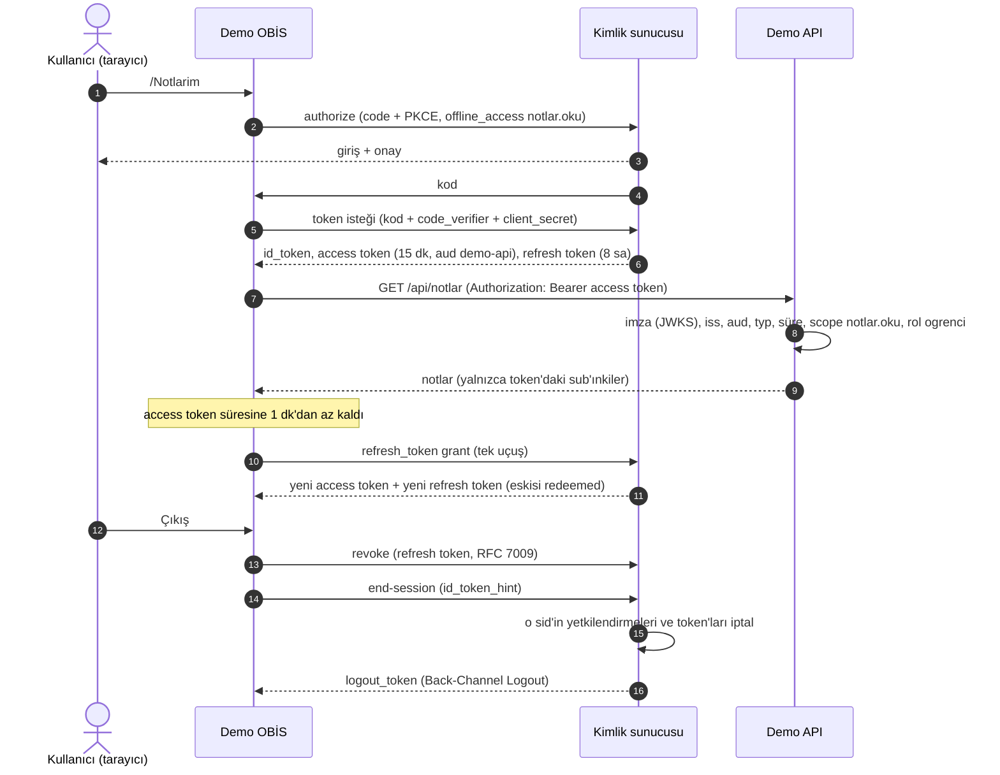
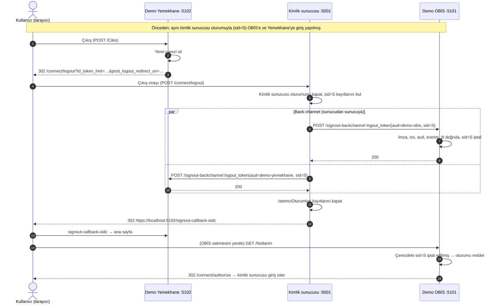

# Tek Şifre Giriş Sistemi (SelcukSSO)

Bitirme projesi: fakülte ve bölüm web uygulamaları için merkezi kimlik sunucusu.

> **Proje tanımı (bölümün verdiği):** "Fakülte ve bölüm genelinde kullanılan tüm web otomasyonları için merkezi
> bir kimlik doğrulama ve yetkilendirme altyapısı sunar. Kullanıcılar (öğrenci, akademisyen, idari personel) tek bir
> kullanıcı adı ve şifre ile güvenli bir şekilde tüm alt uygulamalara giriş yapabilir. Token tabanlı (JWT vb.) oturum
> yönetimini, şifre sıfırlama vb. özelliklere sahiptir."

Depoda şu an **kimlik sunucusu**, ona OpenID Connect ile bağlanan iki alt uygulama (**Demo OBİS**, **Demo Yemekhane**),
bu uygulamaların ortak istemci kütüphanesi ve access token'ı doğrulayan bir kaynak sunucusu (**Demo API**) var. **Tek giriş** (bir kez giriş, diğer uygulamalara şifresiz geçiş),
OIDC Back-Channel Logout ile **tek çıkış** (bir uygulamadan çıkınca hepsinden çıkış), e-postayla **şifre sıfırlama**,
**şifre değiştirme**, TOTP tabanlı **iki aşamalı doğrulama** (2FA), güvenlik olaylarının **denetim kaydı** ve
**uygulama bazlı erişim izni** ve **token yaşam döngüsü** (kısa ömürlü access token, kayan refresh token, iptal)
çalışıyor. Ayrıca yerelde çalışan **Tek Kapı** köprüsü (`araclar/tek-kapi`) public bir
OIDC istemcisi olarak bağlı ([Tek Kapı köprüsü](#tek-kapı-köprüsü)): SSO ile giriş, Back-Channel Logout ile tek çıkış.
Alınan önlemler [Güvenlik önlemleri](#güvenlik-önlemleri) bölümünde. Diğer özellikler
[yol haritasında](#yapılacaklar-yol-haritası).

## Mimari özet

```
                       ┌──────────────────────────────────────────┐
                       │ Selcuk.Identity  :5001                    │
                       │  Giriş · Onay · Çıkış · Uygulamalarım     │
                       │  ASP.NET Core Identity + OpenIddict (OIDC)│
                       │  EF Core ──► LocalDB (SelcukSSO)          │
                       └──────────────────────────────────────────┘
        authorize/token/userinfo ▲   │ logout_token      ▲   │ logout_token
        (code + PKCE S256)       │   ▼ (back-channel)    │   ▼ (back-channel)
            ┌────────────────────────────┐    ┌────────────────────────────┐
            │ Selcuk.Demo.Obis  :5101    │    │ Selcuk.Demo.Yemekhane :5102│
            │  Notlarım, Ders Yönetimi   │    │  Menü, Rezervasyonlarım,   │
            │                            │    │  Yemekhane Yönetimi        │
            └─────────────┬──────────────┘    └─────────────┬──────────────┘
                          └───────── Selcuk.Istemci.Ortak ──┘
                     AddSelcukSSO: Cookie + OIDC, güvenlik başlıkları,
                     /signout-backchannel alıcısı, token yenileme/iptal

     Selcuk.Demo.Obis ── Authorization: Bearer <access token> ──► Selcuk.Demo.Api :5201
                                                                   GET /api/notlar (JWKS ile doğrulama)
```

| Uç nokta | Adres | Açıklama |
|---|---|---|
| Discovery | `/.well-known/openid-configuration` | OIDC meta verisi (`backchannel_logout_supported: true`) |
| JWKS | `/.well-known/jwks` | İmza doğrulama anahtarları |
| Authorize | `/connect/authorize` | Giriş ve onay ekranı (Razor Page) |
| Token | `/connect/token` | `authorization_code` ve `refresh_token` grant'leri |
| Revocation | `/connect/revoke` | RFC 7009: gizli istemciler refresh token'ı iptal eder (çıkışta) |
| UserInfo | `/connect/userinfo` | Kapsama göre kullanıcı bilgisi |
| End-session | `/connect/logout` | Çıkış sayfası; Back-Channel Logout bildirimlerini gönderir, `post_logout_redirect_uri` ile istemciye döner |
| Uygulamalarım | `/` | Giriş yapmış kullanıcıya kayıtlı uygulamaların kartları; kart `initiate_login_uri?iss=…` adresine gider |
| Şifremi unuttum | `/Account/SifremiUnuttum` | Kullanıcı adı, öğrenci no veya e-postayla sıfırlama bağlantısı isteği |
| Şifre sıfırlama | `/Account/SifreSifirla?kullanici=…&kod=…` | E-postadaki bağlantı: yeni şifre + tekrar |
| Hesabım | `/Account/Hesabim` | Hesap bilgileri; **Şifre değiştir** (`/Account/SifreDegistir`) |
| Girişin ikinci adımı | `/Account/IkiAdim` | 2FA açık kullanıcıda şifreden sonra: TOTP kodu veya kurtarma kodu, "Bu cihazı hatırla" |
| İki aşamalı doğrulama | `/Account/IkiAdimDogrulama` | Hesabım → 2FA kurulumu (anahtar + QR), kurtarma kodlarını yenileme, kapatma |
| Ek doğrulama | `/Account/EkDogrulama` | 2FA isteyen bir uygulamaya şifreyle açılmış oturumdan gidilince ikinci adım (step-up) |
| Güvenlik geçmişi | `/Account/GuvenlikGecmisi` | Hesabım → kullanıcının kendi son 20 güvenlik olayı |

**Akışlar:** yalnızca Authorization Code + PKCE ve Refresh Token. PKCE sunucu genelinde zorunlu ve **yalnızca
`S256`** kabul edilir (`plain` kapalı). Implicit, hybrid, password ve client credentials akışları kapalı.

**Kapsamlar ve claim'ler:**

| Kapsam | Claim'ler |
|---|---|
| `openid` | `sub`; id_token'da ayrıca `sid` (kimlik sunucusu oturum kimliği) ve `amr` (`["pwd"]` veya `["pwd","mfa"]`) |
| `profile` | `name` (AdSoyad), `preferred_username` (öğrenci no / kullanıcı adı), `fakulte`, `bolum` |
| `email` | `email` (userinfo'da ayrıca `email_verified`) |
| `roles` | `role` (`ogrenci`, `akademisyen`, `personel`) |
| `offline_access` | Claim yok; refresh token verilir (yalnızca `demo-obis`, `demo-yemekhane`) |
| `notlar.oku` | Claim yok; access token'ın `aud`'u `demo-api` olur (Demo API kaynağı, yalnızca `demo-obis`) |

Claim'ler yalnızca kullanıcı ilgili kapsama onay verdiyse tokenlara yazılır. Profil ve e-posta bilgileri yalnızca
id_token'da ve userinfo'dadır; access token küçültülmüştür ([Token yaşam döngüsü](#token-yaşam-döngüsü)). Access
token'lar **imzalı ama şifresiz JWT** (`typ: at+jwt`, `DisableAccessTokenEncryption`), içerikleri tezde gösterilebilir.
Kaynak sunucusu kapsamı (`notlar.oku`) istenmişse `aud` = `demo-api`, istenmemişse `aud` yoktur; token'ın verildiği
istemci her durumda `client_id` claim'inde taşınır. Discovery'deki `claims_supported` listesi: `aud exp iat iss sub name email role fakulte bolum sid amr`.

**Kullanıcı modeli:** `ApplicationUser : IdentityUser` + `AdSoyad`, `Fakulte`, `Bolum`. Öğrencilerin `UserName`'i
öğrenci numarası, akademik/idari personelinki kurumsal kullanıcı adıdır.

**Kayıtlı istemciler** (Development'ta açılışta oluşturulur veya güncellenir; tanımlar
`src/Selcuk.Identity/Data/Istemciler.cs`):

| | `demo-obis` | `demo-yemekhane` |
|---|---|---|
| Görünen ad | Demo OBİS | Demo Yemekhane |
| Redirect URI | `https://localhost:5101/signin-oidc` | `https://localhost:5102/signin-oidc` |
| Post-logout redirect URI | `https://localhost:5101/signout-callback-oidc` | `https://localhost:5102/signout-callback-oidc` |
| `backchannel_logout_uri` | `https://localhost:5101/signout-backchannel` | `https://localhost:5102/signout-backchannel` |
| `client_uri` / `initiate_login_uri` | `https://localhost:5101/` / `…/Giris` | `https://localhost:5102/` / `…/Giris` |

Demo istemcilerin ortak kuralları: gizli (confidential) web istemcisi, `client_secret` user-secrets'ta; izinler authorization, token,
end-session ve revocation uç noktaları, `authorization_code` ve `refresh_token` grant'leri, `code`,
`openid profile email roles offline_access` (`demo-obis` ayrıca `notlar.oku`); PKCE zorunlu; onay türü
`explicit` (her uygulama için ilk girişte onay ekranı). Özel ayarlar (`backchannel_logout_uri`, `client_uri`,
`initiate_login_uri`, `aciklama`, ayrıca erişim izni için `izinliRoller` ve `izinliKullaniciAdlari`) OpenIddict istemci
kaydının `Properties` alanında saklanır. Demo istemcilerde izin listeleri boştur (herkes girebilir). Üçüncü kayıtlı
istemci **`tek-kapi`** (public, loopback adresli) [Tek Kapı köprüsü](#tek-kapı-köprüsü) bölümünde.

Tüm istemci adresleri https olmalıdır; tek istisna yerel (native) uygulamalar için `http://127.0.0.1` loopback
adresleridir (RFC 8252). Kural iki yerde uygulanır: kayıtta (`Istemciler.AdresleriDogrula`, açılışta) ve protokol
düzeyinde (authorize isteğindeki `redirect_uri` ile end-session isteğindeki `post_logout_redirect_uri` için OpenIddict
doğrulama işleyicisi; ihlalde istemciye yönlendirmeden 400 `invalid_request`). OpenIddict'in kendisi http adreslerini
sunucu adına bakmadan kabul ettiği için bu kural ayrıca eklendi.

## Roller ve test kullanıcıları

Roller tek bir katalogdadır: `src/Selcuk.Roller` (kimlik sunucusu, `Selcuk.Istemci.Ortak` ve `Selcuk.Arayuz`
kullanır). Her rolün kimliği (role claim'indeki değer), Türkçe adı, katmanı ve kısa açıklaması vardır; yeni rol
`Roller.Katalog`'a bir satır eklenerek tanımlanır. Katmanlar: **kullanıcı türü** (her kullanıcıda tam olarak bir tane:
`ogrenci`, `akademisyen`, `personel`), **idari görev** ve **komisyon/kurul üyeliği** (sıfır veya daha fazla). Bir
kullanıcının birden çok rolü olabilir. Tutarlılık kuralları `RolDogrulayici`'dadır (görev ve komisyon rolleri yalnızca
akademisyene veya yalnızca personele; öğrenciye hiçbiri; `bolum_baskani` ve `bolum_sekreteri` bölümü, `fakulte_sekreteri`
fakültesi dolu kullanıcıya). Kimlik sunucusu açılışta katalogdaki bütün rolleri oluşturur. Roller şimdilik yalnızca
başlangıç verisiyle atanır (yönetim paneli yok). Tam katalog, kurallar ve 11 bölüm otomasyonu için plan matrisi:
[docs/roller.md](docs/roller.md).

**Token'larda:** kullanıcının bütün rolleri `roles` kapsamıyla hem id_token'a hem access token'a `role` claim'i olarak
yazılır: tek rolde metin (`"ogrenci"`), birden çok rolde JSON dizisi (`["akademisyen","bolum_baskani"]`).
`Selcuk.Istemci.Ortak` iki biçimi de ayrı `role` claim'lerine çevirir; `User.IsInRole` her rol için çalışır. Kapsamlı
rollerin birimi için yeni claim yok: id_token'daki `bolum` ve `fakulte` kullanılır. Hesabım'da **Rollerin** bölümü ve
demo uygulamaların **Profilim** sayfası rolleri katmana göre gruplu, Türkçe adlarıyla ve kapsamlı rollerde birimiyle
gösterir ("Bölüm başkanı (Bilgisayar Mühendisliği)"); hesap menüsünde kullanıcı adının altında kullanıcı türü yazar.

**Test kullanıcıları** (yalnızca Development; ad soyadlar uydurma, e-postalar `<kullanıcı adı>@test.local`; hepsi
Teknoloji Fakültesi, `personel.test` ve `fakultesekreter.test` dışındakiler Bilgisayar Mühendisliği). Seed, rolleri
`RolDogrulayici`'dan geçirir; kurala uymayan bir tanım açılışı açık bir hatayla durdurur. Var olan kullanıcının şifresine
ve 2FA ayarlarına dokunulmaz, yalnızca eksik rolleri eklenir. Şifreler rastgele üretilip user-secrets'a yazılmıştır;
görmek için `dotnet user-secrets list --project src/Selcuk.Identity` çıktısındaki `TestKullanicilari:<Anahtar>:Sifre`
değerine bakın:

| Kullanıcı adı | Roller | Şifre anahtarı (`TestKullanicilari:…:Sifre`) |
|---|---|---|
| `203011001` | ogrenci | `Ogrenci` |
| `203011002` | ogrenci | `Ogrenci2` |
| `203011003` | ogrenci | `Ogrenci3` |
| `hoca.test` | akademisyen, danisman | `Akademisyen` |
| `personel.test` | personel | `Personel` |
| `baskan.test` | akademisyen, bolum_baskani, bolum_kurulu_uyesi | `BolumBaskani` |
| `sekreter.test` | personel, bolum_sekreteri | `BolumSekreteri` |
| `fakultesekreter.test` | personel, fakulte_sekreteri (bölüm boş) | `FakulteSekreteri` |
| `komisyon.test` | akademisyen, intibak_komisyonu, staj_komisyonu, mezuniyet_komisyonu, bolum_kurulu_uyesi | `Komisyon` |
| `mudek.test` | akademisyen, mudek_komisyonu, bolum_kurulu_uyesi | `Mudek` |
| `etik.test` | akademisyen, etik_kurul_uyesi | `Etik` |
| `koordinator.test` | akademisyen, cap_yandal_koordinatoru, danisman | `Koordinator` |
| `iskur.test` | personel, iskur_sorumlusu | `Iskur` |

Şifre anahtarı user-secrets'ta yoksa o kullanıcı oluşturulmaz (logda uyarı). Yeni bir makinede şifre üretmek için
(değer ekrana yazılmaz):

```powershell
$anahtarlar = 'Ogrenci','Ogrenci2','Ogrenci3','Akademisyen','Personel','BolumBaskani','BolumSekreteri',
    'FakulteSekreteri','Komisyon','Mudek','Etik','Koordinator','Iskur'
foreach ($a in $anahtarlar) {
    $b = New-Object byte[] 18; [Security.Cryptography.RandomNumberGenerator]::Create().GetBytes($b)
    $sifre = 'Aa1' + [Convert]::ToBase64String($b).Replace('+', 'x').Replace('/', 'y')
    dotnet user-secrets set "TestKullanicilari:${a}:Sifre" $sifre --project src/Selcuk.Identity | Out-Null
}
```

## Uygulama bazlı erişim izni

Her istemcinin kaydında iki isteğe bağlı liste vardır (OpenIddict `Properties`, JSON dizisi):

| Ayar | İçerik |
|---|---|
| `izinliRoller` | Rol adları (ör. `["akademisyen"]`) |
| `izinliKullaniciAdlari` | Kullanıcı adları / öğrenci numaraları (ör. `["203011001"]`) |

İkisi de boş veya yoksa herkes girebilir (önceki davranış; `demo-obis` ve `demo-yemekhane` böyle). Biri doluysa
kullanıcının rollerinden biri `izinliRoller`'de **veya** kullanıcı adı `izinliKullaniciAdlari`'nda olmalıdır
(büyük/küçük harf duyarsız). Hatalı biçimli (dizi olmayan) bir ayar istemciyi herkese açmaz, kimse uymaz sayılır.
Kural `Oidc/IstemciErisimi` sınıfındadır ve üç yerde uygulanır:

- **Authorize** (`/connect/authorize`, GET ve onay POST'u): izinsiz kullanıcı onay ekranı veya 2FA kurulumu görmeden
  istemcinin `redirect_uri`'sine OIDC standardındaki `error=access_denied` (ve `state`) ile döner; kod verilmez, onay
  kaydı oluşmaz.
- **Token** (`/connect/token`): yetkilendirme kodu ve refresh token için yeniden kontrol edilir. Kod alındıktan sonra
  izin kaldırıldıysa `invalid_grant` döner.
- **Uygulamalarım**: kullanıcının girmeye izni olmayan uygulamaların kartı gösterilmez.

İzinsiz her deneme denetim kaydına **"İstemciye erişim reddedildi"** (`IstemciErisimiReddedildi`) olarak, `client_id`
ve `uc=authorize` / `uc=token` ayrıntısıyla yazılır. İzinler şimdilik koddaki istemci tanımında ve (Tek Kapı için)
ayarlardadır; yönetim paneli yol haritasındadır.

### İstemci bazlı 2FA şartı (`mfaZorunlu`)

İstemci kaydındaki isteğe bağlı `mfaZorunlu` (bool) ayarı `true` ise o uygulamaya yalnızca **iki aşamalı doğrulanmış**
bir kimlik sunucusu oturumundan (id_token `amr` içinde `mfa`) kod ve token verilir. `tek-kapi` için `true`, demo
istemciler için `false`tur (davranışları değişmedi). Uygulamalarım'da böyle bir uygulamanın kartında **"2FA gerekli"**
etiketi görünür.

Authorize isteğinde oturumun `amr`'si `mfa` içermiyorsa (yalnızca şifreyle girildiyse veya "Bu cihazı hatırla" ile
ikinci adım atlandıysa; o oturum `["pwd"]` sayılır):

- **2FA'sı açık kullanıcı → ek doğrulama (step-up):** `/Account/EkDogrulama?returnUrl=<authorize isteği>`. Mevcut
  oturumda TOTP veya kurtarma kodu istenir ("Bu uygulama iki aşamalı doğrulama gerektiriyor"). Başarılıysa oturum aynı
  `sid`'le `["pwd","mfa"]` olarak yeniden imzalanır ve authorize akışı kaldığı yerden devam eder. Hatalı kodlar hatalı
  deneme sayacına eklenir (5'te kilit), kilitliyken kabul edilmez; TOTP tekrar oynatma koruması ve istek sınırı
  girişin ikinci adımıyla aynıdır. Kurtarma kodu kullanılırsa e-posta gider.
- **2FA'sı kapalı kullanıcı → kurulum:** `/Account/IkiAdimDogrulama?returnUrl=…`, "Bu uygulama iki aşamalı doğrulama
  gerektiriyor" mesajıyla. Kurulumda doğrulanan kod oturumu çok faktörlü yapar; kurtarma kodlarının altındaki
  "Kodları kaydettim, devam et" authorize isteğine döner.
- `prompt=none` ise istemciye `interaction_required` döner; onay formu doğrudan gönderilirse `access_denied`.

Token uç noktası da denetler: `mfaZorunlu` istemciye, `amr`'si `mfa` içermeyen bir yetkilendirmeden (ör. kod alındıktan
sonra istemci 2FA ister hâle geldiyse) token verilmez (`invalid_grant`). Denetim kaydı: yönlendirme ve retler
**"Uygulama iki aşamalı doğrulama istedi"** (`IstemciMfaGerekli`, `client_id`, `uc=authorize; yonlendirme=ek-dogrulama|kurulum`,
`uc=authorize; neden=onay-formu` veya `uc=token`), ek doğrulama sonucu `EkDogrulama` (başarılı/başarısız, `yontem=totp|kurtarma-kodu`).

## Tek Kapı köprüsü

**Tek Kapı**, kullanıcının **kendi bilgisayarında** çalışan ayrı bir Node.js uygulamasıdır (`araclar/tek-kapi`;
kendi README ve AGENTS.md dosyaları orada). Amaç,
henüz OIDC desteklemeyen gerçek üniversite sistemlerine (OBİS, UZEM, e-posta) bu bilgisayardan otomatik giriş yapan
yerel ve kişisel bir **geçiş dönemi aracı** (ESSO, enterprise single sign-on) sunmaktır. Kullanıcı Tek Kapı'ya Tek
Şifre Giriş Sistemi ile (OIDC) girer; üniversite sistemlerinin şifrelerini Tek Kapı kendi bilgisayarında, şifreli
olarak saklar ve kullanır.

- **Kimlik sunucusu üniversite şifrelerini hiçbir zaman görmez ve saklamaz.** Kimlik sunucusu Tek Kapı'ya yalnızca
  standart OIDC token'ları (id_token, access_token) verir. Gerçek sistemlere bağlantı ve şifre saklama tamamen Tek
  Kapı'nın, kullanıcının bilgisayarındadır. Kimlik sunucusu ve demo uygulamalar gerçek Selçuk sistemlerine
  bağlanmaz; tek istisna, kullanıcının kendi hesabıyla kendi bilgisayarında çalıştırdığı `araclar/tek-kapi`'dir.
  Hiçbir test gerçek Selçuk sistemlerine istek atmaz.
- **Kalıcı çözüm bu değildir.** Ekran/form doldurmaya dayanan ESSO kırılgandır ve şifrelerin bir yerde tutulmasını
  gerektirir. Gerçek sistemlerin kalıcı çözümü, Demo OBİS ve Demo Yemekhane gibi **OIDC ile doğrudan** kimlik
  sunucusuna bağlanmalarıdır ([Yeni bir uygulamayı sisteme bağlamak](#yeni-bir-uygulamayı-sisteme-bağlamak)).

**İstemci kaydı** (`Istemciler.TekKapi`, Development'ta açılışta oluşturulur veya güncellenir):

| | `tek-kapi` |
|---|---|
| Tür | **Public** (`client_secret` yok), uygulama türü native; PKCE (`S256`) zorunlu |
| Akış / yanıt türü | `authorization_code` / `code` |
| Kapsamlar | `openid profile roles` (e-posta yok) |
| Onay türü | `explicit` |
| Redirect URI | `http://127.0.0.1:4545/auth/callback` |
| Post-logout redirect URI | `http://127.0.0.1:4545/` |
| `backchannel_logout_uri` | `http://127.0.0.1:4545/auth/backchannel-logout` |
| `client_uri` / `initiate_login_uri` | `http://127.0.0.1:4545/` / `http://127.0.0.1:4545/auth/login` |
| Görünen ad | Tek Kapı — gerçek Selçuk sistemleri (yerel) |
| `izinliKullaniciAdlari` | `Istemciler:TekKapi:IzinliKullaniciAdlari` ayarından (`appsettings.Development.json`, varsayılan `["203011001"]`) |
| `mfaZorunlu` | `true`: yalnızca iki aşamalı doğrulanmış oturumdan kod/token (bkz. Uygulama bazlı erişim izni > İstemci bazlı 2FA şartı). Tek Kapı da callback'te `amr`'yi denetler (`SSO_MFA_ZORUNLU`, varsayılan açık) |

İzin listesi ayarda yoksa veya boşsa Tek Kapı **herkese açılmaz**; varsayılan `["203011001"]` kullanılır. Listeye
kullanıcı eklemek için `appsettings.Development.json`'daki diziyi değiştirip kimlik sunucusunu yeniden başlatın.

**Neden public ve neden http?** Tek Kapı kullanıcının bilgisayarında çalışan yerel (native) bir uygulamadır; içine
konan bir `client_secret` o bilgisayardaki herkes tarafından okunabilir, yani gizli tutulamaz (RFC 8252 bölüm 8.5).
Bu yüzden secret yerine PKCE kullanılır: kodu ele geçiren, `code_verifier`'ı bilmeden token alamaz. Yönlendirme
adresi `http://127.0.0.1` loopback'tir (RFC 8252 bölüm 7.3): istek bilgisayardan dışarı çıkmaz, TLS sertifikası
gerekmez; `localhost` adı yerine IP kullanılır (ad çözümlemesi değiştirilemesin, bölüm 8.3). OpenIddict http loopback
adreslerini **hiçbir güvenlik ayarı gevşetilmeden** kabul eder (adresler birebir karşılaştırılır).

**Back-Channel Logout:** çıkışta Tek Kapı'nın `http://127.0.0.1:4545/auth/backchannel-logout` adresine de imzalı
`logout_token` gider (gönderici https dışında yalnızca `http://127.0.0.1`'e gönderir). OIDC Back-Channel Logout 1.0
bölüm 2.2 bu adresin https kullanmasını önerir (SHOULD); http'yi açıkça yalnızca gizli istemciler için anar. Burada
istisna bilinçlidir: adres loopback olduğu için token makineden çıkmaz, `logout_token` bir erişim yetkisi taşımaz
(yalnızca oturumu kapattırır) ve alıcının imzayı, `aud`'u ve `jti`'yi doğrulaması gerekir. Tek Kapı çalışmıyorsa
gönderim hatası loglanır ve denetim kaydına "çıkış bildirimi ulaştırılamadı" yazılır; diğer istemcilere bildirim
gider, çıkış tamamlanır.

**Tek Kapı tarafı (SSO modu):** `SSO_ISSUER` tanımlıysa Tek Kapı portala erişimi iki katmanlı yapar: önce kimlik
sunucusunda SSO oturumu (openid-client; PKCE `S256`, state ve nonce sunucuda tek kullanımlık; id_token imzası, `iss`,
`aud`, `nonce`, `exp` doğrulanır; yalnızca izinli kullanıcılar), sonra kasa ana şifresi (kasa anahtarı kimlik
sunucusundan türetilmez). `logout_token` gelince (jose ile imza, `iss`, `aud`, `iat`, `typ`, `events`, `sid`/`sub`,
`nonce` yokluğu, `jti` tekrarı doğrulanır) kasa kilitlenir, yönetilen penceredeki gerçek site sekmeleri kapanır ve
çerezleri silinir. Node, kimlik sunucusunun .NET geliştirme sertifikasına `--use-system-ca` ile güvenir; TLS
doğrulaması kapatılmaz. Ayrıntılar: `araclar/tek-kapi/README.md` > SSO modu.

**Güvenlik notu:** Tek Kapı public istemcidir (RFC 8252): secret yok, PKCE zorunlu, adresler yalnızca 127.0.0.1.
Üniversite şifreleri yalnızca o bilgisayardaki şifreli kasada durur; kimlik sunucusu onları hiç görmez.

**Çalıştırma:** üç uygulama ve Tek Kapı (SSO modunda, ayrı pencerede) birlikte:

```powershell
powershell -ExecutionPolicy Bypass -File scripts\run-all.ps1 -TekKapi
```

Ardından https://localhost:5001 → **203011001** ile giriş → Uygulamalarım → **Tek Kapı** kartı → onay → kasa ana şifresi.
Kimlik sunucusundan veya Demo OBİS'ten çıkış yapınca Tek Kapı kilitlenir ve gerçek site sekmeleri kapanır. Taşıma
sonrası Tek Kapı kasası yeni konumda yeniden kurulur (`data/` taşınmadı).

**Güvenlik ayarları:** şifre politikası, kilitleme, istek sınırı, çerezler ve başlıklar
[Güvenlik önlemleri](#güvenlik-önlemleri) bölümünde.

## Token yaşam döngüsü

| Token | Ne işe yarar | Kime gider | Ömür | Biçim |
|---|---|---|---|---|
| **id_token** | Kullanıcının kim olduğunu ve nasıl doğrulandığını istemciye bildirir (giriş kanıtı); profil (`name`, `preferred_username`, `fakulte`, `bolum`, `email`), `sid`, `amr` | İstemci uygulama (OBİS, Yemekhane, Tek Kapı) | OpenIddict varsayılanı (20 dk); yalnızca girişte doğrulanır, oturum çerezi ayrıca tutulur | İmzalı JWT |
| **access token** | Bir API'yi (kaynak sunucusu) çağırma yetkisi. Veri minimizasyonu (KVKK): yalnızca `iss`, `sub`, `aud`, `exp`, `iat`, `jti`, `client_id`, `scope`, `role`, `sid` ve OpenIddict'in kişisel veri içermeyen iç tanımlayıcıları (`oi_prst`, `oi_au_id`, `oi_tkn_id`); ad, e-posta, fakülte, bölüm **yok** | Kaynak sunucusu (Demo API: `aud` = `demo-api`) ve userinfo | **15 dakika** (`Tokenlar:AccessTokenSuresi`) | İmzalı, şifresiz JWT (`typ: at+jwt`) |
| **refresh token** | Kullanıcı tekrar giriş yapmadan yeni access token almak | Yalnızca gizli istemci (sunucu tarafında, çerezde); `offline_access` kapsamıyla | **8 saat**, kayan (`Tokenlar:RefreshTokenSuresi`, kimlik sunucusu oturumuyla aynı); zincir ilk girişten itibaren en çok **12 saat** (`Tokenlar:MutlakOturumSuresi`) | Kimlik sunucusunca şifreli; istemci içeriğini okuyamaz |

`offline_access` yalnızca `demo-obis` ve `demo-yemekhane`'ye izinlidir (`refresh_token` grant izni); `tek-kapi`
isteyemez (OpenIddict isteği 400 ile reddeder), çünkü yalnızca id_token ile kendi oturumunu kurar. Onay ekranında
açıklaması: "Uygulama, oturumun açıkken erişimini sen tekrar giriş yapmadan yenileyebilir."

**Kayan (rolling) refresh token ve tekrar kullanım tespiti.** OpenIddict'te kayan refresh token varsayılan olarak
açıktır: her kullanımda yeni bir refresh token verilir, kullanılan "redeemed" işaretlenir. Kullanılmış bir refresh
token tekrar gelirse OpenIddict isteği `invalid_grant` ile reddeder ve **aynı yetkilendirmeye bağlı tüm token'ları
iptal eder** (yeni refresh token dahil). OpenIddict'in varsayılan **30 saniyelik tekrar kullanım payı**
(`RefreshTokenReuseLeeway`, eşzamanlı istekler için) kapatıldı (`SetRefreshTokenReuseLeeway(null)`): kullanılmış bir
refresh token hiçbir zaman kabul edilmez. Eşzamanlı istekler istemci tarafında tek uçuşla çözülür. Tekrar kullanım
denetim kaydına **"Refresh token tekrar kullanıldı"** (`RefreshTokenTekrarKullanildi`, kullanıcı ve `client_id` ile)
olarak yazılır (`Oidc/RefreshTokenTekrarDenetimi`, OpenIddict'in reddeden işleyicisinden hemen önce).

**Oturuma bağlı yetkilendirme.** Onay ekranının tekrar sorulmaması için kalıcı (permanent) yetkilendirme korunur;
ama authorize her kod verişinde o kimlik sunucusu oturumuna (`sid`) ait ayrı bir **ad-hoc yetkilendirme** açar
(`Oidc/TokenIptali`) ve kod ile ondan türeyen tüm token'lar ona bağlanır. Böylece iptal oturum bazında yapılabilir,
tekrar kullanılan bir refresh token da yalnızca o oturumun zincirini düşürür.

**Mutlak üst sınır** (`Oidc/YenilemeUstSiniri`). Kayan refresh token her kullanımda yeni 8 saat alır; böylece düzenli
yenilenen bir zincir sonsuza kadar yaşayabilirdi. Bir yetkilendirme zincirinin toplam ömrü, ilk girişten (authorize'ın
açtığı ad-hoc yetkilendirmenin oluşturulma zamanı) itibaren `Tokenlar:MutlakOturumSuresi`'ni (varsayılan **12 saat**)
aşamaz. OpenIddict'te kayan süreyle birlikte mutlak sınır veren bir ayar yok: `DisableSlidingRefreshTokenExpiration()`
kayan süreyi tamamen kapatıp refresh token'ı ilk token'ın bitişine sabitler. Bu yüzden token uç noktası
(`OidcUcNoktalari`) her kod ve refresh isteğinde kalan süreyi hesaplar: süre dolduysa `invalid_grant` ("Oturumun en
uzun süresi doldu") ve **"Uygulama oturumunun en uzun süresi doldu"** denetim kaydı (`MutlakOturumSuresiDoldu`);
dolmadıysa verilen refresh token'ın ve access token'ın ömrü kalan süreyle kısaltılır (OpenIddict'in principal'a özel
token ömrü: `SetRefreshTokenLifetime`, `SetAccessTokenLifetime`). Sınıra 5 dakika kalmış bir zincirin yeni refresh
token'ı 8 saat değil 5 dakika sonra biter; ardından kullanıcı yeniden giriş yapar (kimlik sunucusu oturumu açıksa
şifresiz).

**Budama** (`Oidc/TokenBudamaHizmeti`). OpenIddict token ve yetkilendirme tablolarını kendiliğinden temizlemez
(Quartz entegrasyonu eklenmedi). Arka plan hizmeti açılışta ve ardından `TokenBudama:Aralik` (varsayılan **1 gün**)
aralıkla OpenIddict'in kendi `PruneAsync` işlevini çağırır: süresi dolmuş, iptal edilmiş veya kullanılmış token'lar;
geçersiz yetkilendirmeler ve token'ı kalmamış ad-hoc (yetim) yetkilendirmeler silinir. Yalnızca
`TokenBudama:EnAzYas` (varsayılan **14 gün**) süresinden önce oluşturulmuş kayıtlar silinir; bu süre mutlak oturum
süresinden kısa verilirse mutlak süre kullanılır, çünkü yaşayan bir zincirin kullanılmış refresh token'ı silinirse
tekrar kullanım tespiti çalışmaz. Kalıcı onaylar silinmez. Hata loglanır, sonraki turda denenir.

**İstemci tarafında otomatik yenileme** (`Selcuk.Istemci.Ortak/TokenYenileyici`): çerezdeki access token'ın süresi
**1 dakikadan az** kaldıysa çerez doğrulaması sırasında refresh token ile sessizce yenilenir ve çerez güncellenir.
Aynı refresh token için eşzamanlı gelen istekler **tek bir** token isteği yapar (tek uçuş; sonuç 1 dakika boyunca, yeni
çerezi henüz almamış istekler için de paylaşılır). Yenileme `invalid_grant` ile reddedilirse (iptal edilmiş, süresi
dolmuş veya tekrar kullanılmış) yerel oturum kapanır ve korumalı sayfa kullanıcıyı yeniden kimlik doğrulamaya
gönderir. Ağ hatasında oturum korunur. Token değerleri loglanmaz. Tek uçuş kaydı uygulama örneğinin belleğindedir;
birden çok örnekte yapışkan oturum veya dağıtık kilit gerekir.

**İptal anları** (refresh token'lar dahil, oturuma bağlı yetkilendirme ve token'ları):

| Olay | Kapsam |
|---|---|
| İstemciden çıkış (RP-initiated logout) | İstemci önce refresh token'ını revocation uç noktasıyla iptal eder (RFC 7009), sonra end-session'a gider |
| Kimlik sunucusundan çıkış | O `sid`'e bağlı yetkilendirmeler (+ Back-Channel Logout) |
| Şifre değiştirme | Mevcut oturum hariç tüm oturumlar |
| Şifre sıfırlama | Tüm oturumlar |
| 2FA açma, kapatma, kurtarma kodu yenileme, kurulumu başlatma | Mevcut oturum hariç tüm oturumlar |
| Kullanılmış refresh token'ın tekrar gelmesi | O yetkilendirmenin (oturum + istemci) bütün token'ları (OpenIddict) |

Revocation uç noktası `/connect/revoke` (discovery'de `revocation_endpoint`); gizli istemciler `client_secret` ile
kullanır.



**Bilinçli sınırlama: JWT access token durumsuzdur.** Kaynak sunucusu (Demo API) access token'ı kendi başına, imza ve
süre üzerinden doğrular; kimlik sunucusuna sormaz. Bu yüzden iptal edilmiş bir oturumun access token'ı **süresi
dolana kadar (en çok 15 dakika)** API tarafından kabul edilebilir. Bu pencereyi daraltmak için access token ömrü kısa
seçildi; refresh token iptal edildiği için yeni access token alınamaz. Alternatif, **token introspection (RFC 7662)**:
API her istekte (veya kısa önbellekle) token'ı kimlik sunucusuna sorar. *Artısı:* iptal anında geçerli olur, token
opak (referans) olabilir ve içeriği istemcide görünmez. *Eksisi:* her API isteği kimlik sunucusuna bir ağ isteği
ekler (gecikme, yük), kimlik sunucusu erişilemezse API de çalışamaz ve API'nin kendi istemci kimlik bilgisi
gerekir. Bu projede introspection uygulanmadı; yalnızca belgelendi.

## Tek çıkış nasıl çalışıyor

1. Kullanıcı kimlik sunucusunda oturum açınca bu oturuma rastgele bir **oturum kimliği (`sid`)** verilir ve oturum
   çerezine yazılır.
2. Kullanıcı bir uygulamaya girdiğinde id_token'a aynı `sid` konur. Token uç noktası, o `sid` ile hangi istemciye
   token verildiğini `IstemciOturumlari` tablosuna kaydeder. Aynı oturumdan giriş yapılan her uygulama aynı `sid`'i
   alır.
3. Kullanıcı herhangi bir uygulamadan çıkınca uygulama yerel çerezini siler ve kullanıcıyı kimlik sunucusunun
   end-session uç noktasına gönderir (RP-initiated logout).
4. Kimlik sunucusu kendi oturumunu kapatır. Ardından o `sid`'e kayıtlı **her** istemcinin `backchannel_logout_uri`
   adresine tarayıcıyı kullanmadan, sunucudan sunucuya bir **logout_token** POST eder (OIDC Back-Channel Logout 1.0):
   - OpenIddict'in imzalama anahtarıyla imzalı JWT, `typ: logout+jwt`
   - Claim'ler: `iss`, `aud` (client_id), `iat`, `exp` (2 dk), `jti`, `sid`, `sub`,
     `events: {"http://schemas.openid.net/event/backchannel-logout": {}}`; `nonce` yok
   - Zaman aşımı 5 sn. Bildirimler paralel gider; bir istemci yanıt vermezse diğerleri yine bilgilendirilir.
     Hata loglanır, token içeriği loglanmaz.
   - Kayıtlar kapatılır (`KapanmaZamani`).
5. İstemcideki `/signout-backchannel` (Selcuk.Istemci.Ortak) token'ı doğrular ve `sid`'i dağıtık önbellekte
   (`IDistributedCache`) "iptal edildi" olarak işaretler. Doğrulanan kurallar: JWKS ile imza, iss, aud, exp/iat,
   typ, events, `nonce` yokluğu, `sid` veya `sub` varlığı, `jti`'nin daha önce kullanılmamış olması. Geçersiz token
   400, geçerli token 200 alır. İstemci kimlik sunucusunun discovery/JWKS adresine ulaşamazsa token doğrulanamaz;
   bu geçici durumda 503 döner.
6. O kullanıcının bu uygulamadaki çerezi bir sonraki istekte (`OnValidatePrincipal`) reddedilir. Kullanıcı
   çıkış yapmış sayılır; korumalı sayfaya gidince yeniden girişe yönlendirilir.



Aynı mekanizma şifre sıfırlamada (kullanıcının tüm oturumları), şifre değiştirmede ve 2FA'nın açılması, kapatılması
veya kurtarma kodlarının yenilenmesinde (işlemi yapan oturum dışındakiler) da kullanılır.

### İptal kayıtları ve dağıtık önbellek

İptal edilen `sid`/`sub` kayıtları ve kullanılmış `jti`'ler `IDistributedCache` üzerinde tutulur. Kayıtların ömrü
en az istemci çerezinin süresi (`Kimlik:OturumSuresi`, varsayılan 8 saat) kadardır; iptal edilen bir oturumun çerezi
bu süreden önce geçerliliğini yitirmez. `AddSelcukSSO` varsayılan olarak **bellek içi** önbelleği kaydeder
(`AddDistributedMemoryCache`): tek örnekli demo için yeterlidir, ama uygulama yeniden başlatılırsa kayıtlar silinir
ve aynı uygulamanın birden çok örneği kayıtları paylaşmaz.

Üretimde, aynı uygulamanın her örneğinin aynı kayıtları görmesi için dağıtık önbelleği `AddSelcukSSO`'dan **önce**
kaydedin (`AddSelcukSSO` önceden kaydedilmiş bir `IDistributedCache` varsa onu kullanır):

- **Redis:** `Microsoft.Extensions.Caching.StackExchangeRedis` paketi,
  ```csharp
  builder.Services.AddStackExchangeRedisCache(o =>
  {
      o.Configuration = builder.Configuration.GetConnectionString("Redis"); // ortam değişkeni / sır deposu
      o.InstanceName = "SelcukSSO:demo-obis:";
  });
  builder.Services.AddSelcukSSO(builder.Configuration);
  ```
- **SQL Server:** `Microsoft.Extensions.Caching.SqlServer` paketi; tablo bir kez
  `dotnet sql-cache create "<bağlantı>" dbo IstemciOnbellegi` ile oluşturulur,
  ```csharp
  builder.Services.AddDistributedSqlServerCache(o =>
  {
      o.ConnectionString = builder.Configuration.GetConnectionString("Onbellek");
      o.SchemaName = "dbo";
      o.TableName = "IstemciOnbellegi";
  });
  builder.Services.AddSelcukSSO(builder.Configuration);
  ```

Bu paketler depoya eklenmedi; bağlantı dizeleri koda değil ortam değişkenine veya sır deposuna yazılır.
`IDistributedCache`'te atomik "yoksa ekle" olmadığından birden çok örnekte aynı logout_token'ın iki kez kabul
edilmesi mümkündür; etkisi aynı oturumun ikinci kez iptal edilmesidir.

## Şifre sıfırlama ve şifre değiştirme

**Şifremi unuttum** (`/Account/SifremiUnuttum`): kullanıcı adı, öğrenci numarası veya e-posta girilir. Hesap var
olsun ya da olmasın aynı mesaj gösterilir: "Bilgiler bir hesapla eşleşiyorsa şifre sıfırlama bağlantısı e-posta
adresine gönderildi." Hesap varsa ve e-postası doğrulanmışsa bağlantı e-postayla gider.

- Token, Identity'nin yerleşik `DataProtectorTokenProvider`'ıdır; ayrı bir veri koruma amacıyla
  (`SifreSifirlama`) kaydedilir ve **30 dakika** geçerlidir. Token kullanıcının güvenlik damgasını içerir; şifre
  değişince (sıfırlamanın kendisi dahil) damga yenilenir, token **tek kullanımlıktır**.
- Bağlantı istekteki `Host` başlığından değil yapılandırılmış issuer adresinden (`OpenIddict:Issuer`) üretilir.
- Sıfırlama sayfası yeni şifre ve tekrarını ister, şifre politikasını gösterir. Başarıda: güvenlik damgası
  yenilenir, hesap kilidi ve hatalı deneme sayacı sıfırlanır, kullanıcının kimlik sunucusundaki **tüm oturumları**
  kapanır ve bu oturumlardan giriş yapılmış her istemciye Back-Channel Logout gider, "Şifreniz değiştirildi"
  bilgilendirme e-postası gönderilir.

**Şifre değiştirme** (Uygulamalarım → **Hesabım** → **Şifre değiştir**): mevcut şifre + yeni şifre + tekrar. Başarıda
güvenlik damgası yenilenir; bu oturum yeni damgayla yeniden imzalanır ve aynı `sid` ile açık kalır. Kullanıcının
**diğer** oturumları kapanır, onların istemcilerine Back-Channel Logout gider, bilgilendirme e-postası gönderilir.

Kimlik sunucusu oturum çerezindeki güvenlik damgası **her istekte** veritabanıyla karşılaştırılır (Identity'nin
varsayılanı 30 dakikada bir). Bu yüzden şifre değişince diğer tarayıcılardaki oturumlar bir sonraki istekte kapanır.
Çerez bu kontrolde yeniden yazılmaz, böylece `max_age` için kullanılan oturum başlangıç zamanı korunur.

### E-posta

| Ortam | Gönderici | Davranış |
|---|---|---|
| Development | `DosyaEpostaGonderici` | E-posta gönderilmez; `src/Selcuk.Identity/App_Data/eposta/` klasörüne `.eml` dosyası olarak yazılır (klasör `.gitignore`'da) |
| Diğer | `SmtpEpostaGonderici` | `Eposta:Smtp` ayarlarıyla (host, port, kullanıcı, SSL) SMTP; şifre `Eposta:Smtp:Sifre` (user-secrets / ortam değişkeni `Eposta__Smtp__Sifre`) |
| Testing | Sahte gönderici | Testler e-postaları bellekte yakalar |

E-postalar bir kuyruğa bırakılır ve arka planda gönderilir; sayfanın yanıt süresi e-posta gönderiminden etkilenmez.
Şablonlar Türkçedir; her e-posta düz metin ve aynı içeriğin HTML sürümüyle (multipart/alternative) gider. HTML sürümü
tasarım sisteminin renklerini kullanır, stilleri satır içidir, harici görsel veya kaynak yoktur. Başlık "Selçuk
Üniversitesi (Test) — Tek Şifre Giriş Sistemi"dir. Gönderen adresi
`Eposta:Gonderen` (varsayılan `tek-sifre@test.local`). Alıcı adresi ve e-posta gövdesi (sıfırlama bağlantısı)
loglanmaz.

## İki aşamalı doğrulama (2FA)

**2FA isteğe bağlıdır. Tek istisna, kaldırılması planlanan Tek Kapı istemcisidir** (`mfaZorunlu`, bkz. İstemci bazlı
2FA şartı). Hiçbir rol 2FA'ya zorlanmaz: `IkiAdimZorunluRoller` varsayılanı boş listedir ve bu bir testle sabittir
(`RolModeliTests`: katalogdaki her rol için 2FA'sı kapalı kullanıcı demo-obis'e kurulum sayfasına yönlendirilmeden
girer). 2FA'sı kapalı kullanıcı Hesabım'da nötr bir öneri bandı görür: "İki aşamalı doğrulama isteğe bağlıdır.
Açarsan hesabın şifren ele geçse bile korunur." ve **İki aşamalı doğrulamayı aç** düğmesi.

TOTP (RFC 6238, 6 hane, 30 saniye) tabanlıdır; Google Authenticator, Microsoft Authenticator gibi uygulamalarla
çalışır. Anahtar üretimi ve kod doğrulama Identity'nin yerleşik `AuthenticatorTokenProvider`'ı ve `UserManager`
API'siyle yapılır; kriptografi elle yazılmadı.

**Kurulum** (Uygulamalarım → Hesabım → **İki aşamalı doğrulama**):

1. **Kurulumu başlat**: Identity yeni bir paylaşılan anahtar üretir (`ResetAuthenticatorKeyAsync`). Bu, güvenlik
   damgasını da yeniler: bu oturum yeniden imzalanıp açık kalır, kullanıcının diğer oturumları kapanır ve onlardan
   giriş yapılmış istemcilere Back-Channel Logout gider (şifre değiştirmedeki rutin). Önceden diğer oturumlar damga
   yüzünden kapanıyor ama istemcilere bildirim gitmiyordu. Denetim kaydına "İki aşamalı doğrulama kurulumu başlatıldı
   (yeni anahtar)" yazılır ve kullanıcıya bilgilendirme e-postası gider (anahtar e-postada yoktur).
2. Anahtar hem metin olarak (4'lü gruplar) hem QR kod olarak gösterilir. QR kod **QRCoder** ile sunucu tarafında SVG
   olarak üretilir ve `` ile gösterilir: harici CDN veya JavaScript yok, CSP
   değişmedi (`img-src 'self' data:` zaten vardı). otpauth URI'si:
   `otpauth://totp/Selcuk%20SSO%20%28Test%29:<kullanıcı adı>?secret=<anahtar>&issuer=Selcuk%20SSO%20%28Test%29&digits=6`.
3. Uygulamadaki 6 haneli kod doğrulanmadan 2FA **açılmaz**. Bu kod kullanılmış sayılır: 3 dakika içinde girişte veya
   onaylarda tekrar kabul edilmez.
4. Açılınca 10 kurtarma kodu üretilir ve **yalnızca o yanıtta bir kez** gösterilir (TempData veya çerezle taşınmaz).
   Anahtar ve kod içeren yanıtlar `Cache-Control: no-store` ile döner.
5. **Kurtarma kodlarını yenile** ve **2FA'yı kapat**: ikisi de mevcut şifre + geçerli TOTP kodu ister. Biri yanlışsa
   hatalı deneme sayacı artar (5'te hesap kilitlenir). Kapatınca anahtar yenilenir, kalan kurtarma kodları silinir.
6. Açma, kapatma ve kurtarma kodu yenilemede güvenlik damgası yenilenir: bu oturum yeniden imzalanıp açık kalır,
   kullanıcının diğer oturumları kapanır ve onların istemcilerine Back-Channel Logout gider (şifre değiştirmedeki
   mekanizma), hatırlanan cihazlar geçersizleşir ve bilgilendirme e-postası gönderilir.

**Giriş:** şifre doğru ve 2FA açıksa kullanıcı `/Account/IkiAdim` sayfasına gider (Identity'nin 5 dakikalık
`TwoFactorUserId` çereziyle; kimlik sunucusu oturumu henüz açılmaz, authorize kod vermez). Tek alana TOTP kodu veya
kurtarma kodu yazılır (6 rakamsa TOTP, değilse kurtarma kodu; boşluk ve tire yok sayılır).

- Hatalı TOTP'yi Identity hatalı deneme sayacına ekler; hatalı kurtarma kodunu Identity saymadığı için sayfa ekler.
  5 denemede hesap 15 dakika kilitlenir. Identity kurtarma koduyla girişte kilidi kontrol etmediği için kilit iki yol
  için de sayfada kontrol edilir.
- POST istek sınırına tabidir (dakikada 10).
- **Tekrar oynatma koruması:** başarıyla kullanılan bir TOTP kodu aynı kullanıcı için **3 dakika** boyunca tekrar
  kabul edilmez (kurulumdaki doğrulama, girişin ikinci adımı, 2FA kapatma ve kurtarma kodu yenileme onayları). Tekrar kullanılan kod hatalı
  kod gibi hatalı deneme sayacına eklenir ve denetim kaydına "2FA kodu tekrar kullanıldı" olarak yazılır. Ayrıntı
  aşağıda.
- Kullanılan kurtarma kodu silinir (tek kullanımlık) ve kullanıcıya kalan kod sayısıyla bilgilendirme e-postası gider.
- **Bu cihazı 30 gün hatırla**: Identity'nin `TwoFactorRememberMe` çerezi; süresi `IkiAdimCihazHatirlamaGun`
  (varsayılan 30). Çerez güvenlik damgasını içerir; şifre veya 2FA ayarı değişince geçersiz olur.

**TOTP tekrar oynatma koruması** (`Hesap/TekKullanimlikTotpSaglayici`): Identity'nin `AuthenticatorTokenProvider`'ı
geçerlilik penceresi (±2 zaman adımı, yaklaşık ±1 dakika) içinde aynı kodu defalarca kabul eder; omuz üstünden
görülen veya kaydedilen bir kod bu sürede şifreyle birlikte yeniden kullanılabilir. Sağlayıcı Identity'ninkinden
türetildi ve `TokenOptions.DefaultAuthenticatorProvider` olarak kaydedildi: kod doğrulaması değişmeden Identity'de
kalır, geçerli kod ayrıca kullanıcının son 3 dakikada kabul edilmiş kodlarıyla karşılaştırılır.

- **Saklanan:** kullanıcı başına, son 3 dakikada kabul edilen her kod için `kabul zamanı (Unix saniye)|h1:<HMAC>`;
  HMAC, kullanıcı kimliği ve kodun anahtarlı özetidir (`AnahtarliOzet`, amaç etiketi `totp-tekrar`; denetim kaydındaki
  kullanıcı adı özetiyle aynı anahtar, farklı etiket). Kod düz metin saklanmaz; 6 haneli kodun yalnızca 10⁶ olası
  değeri olduğu için anahtarsız bir özet tümü denenerek geri çevrilebilirdi. Süresi geçen kayıtlar her yazımda atılır.
  Yalnızca "son kod" değil son 3 dakikanın tüm kodları tutulur; aksi hâlde araya başka bir kod girdiğinde ilk kod
  pencere içinde yeniden kullanılabilirdi.
- **Saklama yeri: `AspNetUserTokens`** (sağlayıcı `[SelcukSSO]`, ad `KullanilanTotpKodlari`; kurtarma kodu özetleriyle
  aynı yer), `IDistributedCache` değil. Gerekçe: (1) Yazım `UserManager.SetAuthenticationTokenAsync` üzerinden
  kullanıcı kaydının `ConcurrencyStamp` denetiminden geçer; aynı kodla eşzamanlı iki istekten yalnızca biri kabul
  edilir. `IDistributedCache`'te karşılaştır-ve-yaz işlemi yoktur, iki istek de "kullanılmamış" görüp kabul
  edilebilirdi. (2) Kayıt veritabanında olduğu için yeniden başlatmada kaybolmaz ve birden fazla sunucu örneği aynı
  kaydı görür; varsayılan bellek içi önbellekte ikisi de sağlanmazdı. (3) Yeni bir altyapı veya paket gerekmez.
  Bedeli, başarılı her TOTP doğrulamasında tek bir `UPDATE`'tir.
- **Kapsam:** kurulumdaki "Doğrula ve aç", girişin ikinci adımı (SignInManager → sağlayıcı) ile 2FA kapatma ve kurtarma
  kodu yenileme onayları. Onaylarda kod yalnızca şifre de doğruysa kullanılmış sayılır (şifresini yanlış yazan
  kullanıcı aynı kodla tekrar deneyebilir; `TuketmedenDogrulaAsync`).

**Kurtarma kodlarının saklanması:** Identity varsayılan olarak kurtarma kodlarını `AspNetUserTokens` tablosunda düz
metin (`;` ile birleşik) tutar. `Hesap/KurtarmaKoduOzetDeposu`, Identity'nin EF Core kullanıcı deposunu
(`UserStore`) genişletir ve yalnızca üç metodu değiştirir: `ReplaceCodesAsync` her kodu Identity'nin
`IPasswordHasher<ApplicationUser>`'ıyla (kullanıcı şifreleriyle aynı PBKDF2 biçimi ve ayarları, kod başına rastgele
tuz) özetler ve yalnızca özetleri saklar (`[SelcukSSO]` / `KurtarmaKoduOzetleri`); `RedeemCodeAsync` girilen kodu
özetlerle `VerifyHashedPassword` ile karşılaştırır ve eşleşen özeti siler; `CountCodesAsync` özetleri sayar.
`UserManager` ve `SignInManager`'ın kurtarma kodu API'si değişmeden bu depoyu kullanır. Kod büyük/küçük harf, boşluk ve
tireden bağımsız (normalize edilerek) özetlenir.

**`amr` claim'i (RFC 8176):** id_token'a yazılır ve her zaman JSON dizisidir: yalnızca şifreyle girişte `["pwd"]`,
şifre + TOTP veya kurtarma koduyla girişte `["pwd","mfa"]`. "Bu cihazı hatırla" ile ikinci adım atlandıysa `["pwd"]`
(Identity bu girişi şifre girişi sayar). 2FA kurulumunu bu oturumda tamamlayan kullanıcının oturumu da `mfa` sayılır
(şifre ve geçerli bir TOTP kodu doğrulandı). `otp` değeri eklenmedi: Identity oturum yenilemede yalnızca tek bir `amr`
değeri taşıyor, TOTP ile kurtarma kodunu ayırmak için ek durum gerekirdi. `claims_supported`'a `amr` eklendi. Demo
uygulamalar `amr`'yi göstermez ve zorunlu kılmaz (step-up yok).

**Rol bazlı zorunluluk (varsayılan kapalı):** `IkiAdimZorunluRoller` (varsayılan boş liste; hiçbir rol zorunlu değil) içindeki bir role sahip ve 2FA'sı kapalı
kullanıcı şifreyle girince kurulum sayfasına yönlendirilir. Kurulum bitmeden authorize kod vermez (kurulum sayfasına
dönüş adresiyle yönlendirir; `prompt=none`'da `interaction_required`), onay formu doğrudan gönderilse de
`access_denied` döner, token uç noktası da (kod veya refresh token zorunluluktan önce alınmış olsa bile)
`invalid_grant` döner. Zorunlu roldeki kullanıcı 2FA'yı kapatamaz.

| Ayar (`appsettings.json` kökü) | Varsayılan | Açıklama |
|---|---|---|
| `IkiAdimZorunluRoller` | `[]` | 2FA'nın zorunlu olduğu roller, ör. `["akademisyen", "personel"]` |
| `IkiAdimCihazHatirlamaGun` | `30` | "Bu cihazı hatırla" çerezinin süresi (gün) |

## Denetim kaydı

Güvenlik olayları `DenetimKayitlari` tablosuna yazılır (migration `DenetimKayitlari`): `Id`, `ZamanUtc`, `OlayTuru`,
`KullaniciId`, `IstemciId`, `IpAdresi`, `KisaUserAgent` (en fazla 200 karakter), `Sonuc` (`Basarili`/`Basarisiz`),
`Ayrinti` (kısa serbest metin, en fazla 500 karakter, ör. `neden=sifre-yanlis`).

**Kaydedilen olaylar:** giriş başarılı/başarısız, hesap kilitlendi, 2FA başarılı/başarısız, 2FA kodu tekrar
kullanıldı, kurtarma kodu kullanıldı, 2FA kurulumu başlatıldı,
2FA açıldı/kapatıldı (başarısız denemeler dahil), kurtarma kodları yenilendi, çıkış, şifre sıfırlama istendi, şifre
sıfırlandı (geçersiz bağlantı dahil), şifre değişti (yanlış mevcut şifre dahil), onay verildi/reddedildi, istemciye
token verildi (`client_id` ile), istemciye erişim reddedildi (`client_id` ile), uygulama iki aşamalı doğrulama
istedi (`client_id` ile), ek doğrulama (başarılı/başarısız), back-channel logout
gönderildi/başarısız, hız sınırı aşıldı.

**Asla kaydedilmeyenler:** şifre, TOTP veya kurtarma kodu, paylaşılan anahtar, sıfırlama token'ı, access/id/refresh
token, yetkilendirme kodu, çerez, logout_token. Var olmayan bir kullanıcı adıyla başarısız girişte (ve şifremi
unuttumda) yazılan metin saklanmaz, çünkü kullanıcılar bazen şifrelerini bu alana yazar. Bunun yerine normalize
edilmiş (Identity'nin `NormalizeName`'i, büyük harf) hâlinin anahtarlı özeti `Ayrinti`'ye
`kullanici_adi_ozeti=h1:<hex>` olarak yazılır; aynı hedefe yapılan denemeler böylece gruplanabilir.

**Anahtarlı özet (`Denetim/AnahtarliOzet`):** `h1:` + HMAC-SHA256(anahtar, amaç etiketi ‖ 0x00 ‖ değer)
(`System.Security.Cryptography.HMACSHA256`, elle yazılmadı). Anahtar `Denetim:KullaniciAdiOzetAnahtari` ayarından
gelir (base64, en az 32 bayt): Development'ta user-secrets'ta (bkz. [Sırlar](#sırlar-user-secrets)), diğer
ortamlarda ortam değişkeni (`Denetim__KullaniciAdiOzetAnahtari`) veya sır deposunda. Development dışında anahtar
yoksa veya geçersizse kimlik sunucusu **açılmaz** (açılışta açıklayıcı hata); Development'ta yoksa her açılışta
geçici bir anahtar üretilir ve uyarı loglanır. *Neden anahtarlı:* düz SHA-256 anahtarsızdır; kayıtları okuyan biri
olası kullanıcı adlarını (öğrenci numaraları kısa ve tahmin edilebilir) özetleyip karşılaştırarak yazılan adı geri
bulabilirdi. Anahtarı bilmeden bu yapılamaz. Aynı anahtar TOTP tekrar korumasında başka bir amaç etiketiyle kullanılır.

**Eski kayıtlar:** bu değişiklikten önce yazılmış kayıtlarda alan `kullanici_adi_sha256=<hex>` (anahtarsız SHA-256)
olarak **olduğu gibi kalır**; dönüştürülmez (asıl ad bilinmediği için dönüştürülemez de) ve yeni `h1:` özetleriyle
karşılaştırılamaz. Saklama süresi (180 gün) dolunca temizlik işiyle silinirler. `h1` öneki sürümdür: anahtar veya
yöntem değişirse yeni önek kullanılır, eski kayıtlar ayırt edilebilir kalır.

**Yazım:** sayfalar kaydı bellek içi bir kuyruğa bırakır (`Denetim/DenetimKaydedici`), arka plan hizmeti
(`DenetimYazmaHizmeti`) toplu olarak yazar. İstek yavaşlamaz; yazım hatası ana işlemi bozmaz, yalnızca loglanır.
Kapanışta kuyrukta kalanlar da yazılır.

**Saklama süresi (KVKK):** `DenetimKaydiSaklamaGun` (varsayılan **180**). `DenetimTemizlemeHizmeti` açılışta ve
ardından günde bir kez bu süreden eski kayıtları siler.

**Güvenlik geçmişi** (Hesabım → **Güvenlik geçmişi**): kullanıcı yalnızca kendi son 20 olayını görür (zaman TSİ,
Türkçe olay adı, uygulamanın görünen adı, IP). Yönetici ekranı yol haritasında (6. adım).

### Proxy arkasında çalışma (`GuvenilenProxyler`)

İstek sınırı ve denetim kaydı istemci IP'sini kullanır. `GuvenilenProxyler` (varsayılan boş liste) **boşsa**
`X-Forwarded-For` başlığı hiç işlenmez; ASP.NET Core'un loopback'ten gelen başlığa güvenen varsayılanı da kapatılır.
Böylece bir istemci başlığı kendisi yazarak istek sınırını atlatamaz veya kayıtlara sahte IP yazdıramaz. Uygulama bir
ters proxy (IIS ARR, nginx, YARP vb.) arkasındaysa proxy'nin adresi listeye yazılır; başlık **yalnızca** bu
adreslerden gelen isteklerde kabul edilir ve `RemoteIpAddress` gerçek istemci IP'si olur:

```json
"GuvenilenProxyler": [ "10.0.0.5", "10.1.0.0/24" ]
```

Tek adres veya CIDR ağı yazılabilir; geçersiz bir değerde uygulama açıklayıcı bir hatayla açılmaz.
Liste doluyken `X-Forwarded-For` ve `X-Forwarded-Proto` işlenir (`ForwardLimit` 1: en sağdaki, proxy'nin eklediği
değer); `X-Forwarded-Host` işlenmez. TLS'i proxy sonlandırıyor ve uygulamaya HTTP ile iletiyorsa proxy
`X-Forwarded-Proto: https` göndermelidir: istek HTTPS sayılır, OpenIddict'in HTTPS zorunluluğu karşılanır,
`UseHttpsRedirection` döngüye girmez ve yönlendirmeler (ör. girişe yönlendirme) `https://` ile üretilir. Issuer ve
sıfırlama bağlantıları zaten istekten değil `OpenIddict:Issuer` ayarından üretilir; çerezler `Secure` bayrağını her
durumda alır (`CookieSecurePolicy.Always`). Liste **boşken** `X-Forwarded-Proto` da yok sayılır: istemci kendi
yazdığı bir başlıkla HTTP isteğini HTTPS gibi gösteremez.

## Güvenlik önlemleri

Şu ana kadar sisteme eklenen önlemler ve her birinin kısa gerekçesi:

1. **Authorization Code + PKCE, yalnızca `S256`.** PKCE sunucu genelinde zorunlu, `plain` kapalı; implicit, hybrid,
   password (ROPC) ve client credentials akışları kapalı. *Gerekçe:* PKCE, ele geçirilen bir yetkilendirme kodunun
   başka biri tarafından token'a çevrilmesini önler (RFC 7636). Implicit akış token'ı URL'de taşır, ROPC kullanıcının
   şifresini istemci uygulamaya verir; ikisi de OAuth 2.0 güvenlik önerilerinde (RFC 9700) önerilmez.
2. **İmzalı JWT token'lar.** id_token ve access_token kimlik sunucusunun anahtarıyla imzalıdır; istemciler imzayı
   JWKS ile, ayrıca `iss`, `aud`, `exp` ve `nonce` değerlerini doğrular. Access token şifresizdir (içerik gizli değil,
   değiştirilemez). *Gerekçe:* token'ın kimin tarafından, kime verildiği ve değiştirilmediği doğrulanabilir; `nonce`
   tekrar oynatmayı önler.
3. **Şifre politikası ve özetleme.** En az 10 karakter, büyük harf, küçük harf ve rakam. Şifreler Identity'nin
   `PasswordHasher`'ıyla (PBKDF2) özetlenir, açık hâliyle saklanmaz. *Gerekçe:* tahmin edilebilir şifreleri azaltır;
   veritabanı sızsa bile şifreler doğrudan okunamaz. Kriptografi elle yazılmadı.
4. **Hesap kilitleme.** 5 hatalı denemede hesap 15 dakika kilitlenir. Yanlış şifre, yanlış TOTP veya kurtarma kodu,
   şifre değiştirmede yanlış mevcut şifre ve 2FA kapatma/kod yenilemede yanlış şifre veya kod aynı sayaca eklenir;
   kilitliyken şifre değiştirilemez. *Gerekçe:* tek bir hesaba karşı şifre ve kod denemesini yavaşlatır; ele
   geçirilmiş bir oturumdan mevcut şifre tahmin edilemez.

   **Kilit açık oturumları düşürmez (karar).** Hatalı denemelerden kaynaklanan bu geçici kilit **yeni girişleri**
   (şifre adımı, girişin ikinci adımı) engeller; kilitten önce açılmış kimlik sunucusu oturumunu ve o oturumdan token
   alınmasını engellemez. Authorize ve token uç noktaları bu kurala göre tutarlıdır: ikisi de kilidi kontrol etmez
   (önceden token uç noktası kontrol ediyor, authorize etmiyordu; oturumu açık kullanıcı kilit süresince authorize'dan
   kod alıp token alamıyordu). Şifre değiştirme, 2FA kapatma ve kurtarma kodu yenileme gibi yeniden kimlik doğrulama
   isteyen işlemler kilitliyken yine reddedilir. *Gerekçe:* kilidi herkes tetikleyebilir; yalnızca kullanıcı adını
   bilen biri 5 yanlış şifre deneyerek gerçek kullanıcının açık oturumlarını 15 dakika boyunca kullanılamaz hâle
   getirebilirdi (hizmet engelleme). Kilidin amacı tahmini yavaşlatmaktır; zaten doğrulanmış bir oturum tahminle
   ilgili değildir. Saldırgan oturumu ele geçirdiyse çözüm şifre sıfırlama/değiştirmedir (oturumları kapatır).
   Yöneticinin hesabı kapatması ayrı bir durumdur ve yol haritasında (6. adım) ele alınacaktır.
5. **İstek sınırı (rate limit).** Giriş, girişin ikinci adımı, 2FA kurulum/yönetim, şifremi unuttum, şifre sıfırlama ve
   şifre değiştirme formlarının POST'u IP başına dakikada 10 istekle sınırlıdır (`HizSiniri:DakikadaIstek`); aşılınca
   429, `Retry-After`, Türkçe hata sayfası ve denetim kaydı. IP, yalnızca `GuvenilenProxyler`'den gelen
   `X-Forwarded-For` ile değişir. *Gerekçe:* kilitleme tek hesabı korur; birçok hesaba yayılan denemeleri (password
   spraying), kullanıcı adı taramasını ve e-posta bombardımanını yavaşlatmak için IP başına sınır gerekir. Herkesin
   yazabildiği bir başlığa güvenilseydi sınır atlatılabilirdi.
6. **Kullanıcı adı tahmini koruması.** Yanlış şifre, var olmayan kullanıcı ve kilitli hesap için aynı genel mesaj;
   şifremi unuttumda hesap olsun olmasın aynı mesaj. Yanıt süresi de bu durumlar arasında ayırt edilemeyecek şekilde
   eşitlenmiştir (ayrıntı aşağıda). *Gerekçe:* saldırgan, mesajdan veya yanıt süresinden hangi kullanıcı adlarının
   ve e-posta adreslerinin kayıtlı olduğunu öğrenmemeli.
7. **Güvenli şifre sıfırlama.** 30 dakika geçerli, tek kullanımlık, Identity'nin yerleşik token'ı; bağlantı
   yapılandırılmış issuer'dan üretilir; e-posta yalnızca doğrulanmış adrese gider. *Gerekçe:* kısa ömür ve tek
   kullanım, ele geçirilen bir bağlantının kullanılabileceği süreyi daraltır. Host başlığından üretilen bir bağlantı
   saldırganın alan adına yönlendirilebilirdi (Host header injection).
8. **Şifre değişince oturumların kapatılması.** Sıfırlamada tüm oturumlar, değiştirmede şifreyi değiştiren oturum
   dışındakiler kapanır; kimlik sunucusunda güvenlik damgası her istekte doğrulanır, istemcilere Back-Channel Logout
   gider; kullanıcıya bilgilendirme e-postası gönderilir. *Gerekçe:* şifresi çalınan kullanıcı şifresini değiştirdiğinde
   saldırganın açık oturumları da sonlanmalıdır. Bilgilendirme e-postası, kullanıcının haberi olmadan yapılan
   değişikliği fark etmesini sağlar.
9. **Güvenlik başlıkları.** Tüm yanıtlarda `X-Content-Type-Options: nosniff`, `Referrer-Policy: no-referrer`,
   `X-Frame-Options: DENY`, `Content-Security-Policy: default-src 'self'; img-src 'self' data:; object-src 'none';
   base-uri 'self'; frame-ancestors 'none'`. *Gerekçe:* MIME türü tahminini, sayfanın başka sitede çerçeve içinde
   açılmasını (clickjacking) ve dış betik yüklenmesini engeller. `no-referrer` sorgu dizesindeki bilgilerin (ör.
   sıfırlama kodu) başka sitelere `Referer` ile sızmasını önler. `form-action` bilerek kısıtlanmadı, çünkü giriş,
   onay ve çıkış formları başka bir adrese yönlendirmeyle biter; istemciler bu yüzden `response_mode=query` kullanır.
10. **Çerezler ve oturum süresi.** Tüm çerezler `Secure`, `HttpOnly`, `SameSite=Lax` (antiforgery `Strict`); her
    uygulamanın oturum çerezi ayrı adlı (`SelcukSSO.Oturum`, `DemoObis.Oturum`, `DemoYemekhane.Oturum`). Kimlik sunucusu oturumu (`Oturum:Sure`) ve istemci çerezleri
    (`Kimlik:OturumSuresi`) aynı süreyi kullanır: **8 saat, kayan**. *Gerekçe:* çerezler betikle okunamaz, HTTP
    üzerinden gönderilmez, siteler arası isteklerde sınırlı gider. İstemci çerezleri önceden ASP.NET Core
    varsayılanı olan 14 gün geçerliydi; kimlik sunucusu oturumundan uzun yaşayan istemci oturumu açığı kapatıldı.
11. **Tek çıkış (OIDC Back-Channel Logout 1.0).** Çıkışta, şifre sıfırlamada ve şifre değiştirmede ilgili oturumların
    istemcilerine imzalı `logout+jwt` gider; istemci imza, iss, aud, iat, events, `nonce` yokluğu ve `jti` tekrarını
    doğrular. İptal kayıtları dağıtık önbellekte, en az çerez süresi kadar tutulur; JWKS'e ulaşılamazsa 503.
    *Gerekçe:* kullanıcı bir yerden çıktığında tarayıcı açık kalmasa da tüm uygulamalardaki oturumları kapanır;
    tekrar oynatılan veya sahte bildirimler reddedilir.
12. **Giriş dönüşü hata yönetimi.** Geri tuşu, süresi dolmuş giriş veya reddedilen onay nedeniyle `/signin-oidc`
    başarısız olursa ham hata sayfası yerine kullanıcı ana sayfaya (giriş yapmışsa; yalnızca yerel dönüş adresi) veya
    `/GirisHatasi?neden=…` sayfasına yönlendirilir; URL'ye hata ayrıntısı konmaz, loglara code/state/token yazılmaz.
    Correlation, nonce ve token doğrulamaları değiştirilmedi. *Gerekçe:* geliştirici hata sayfası iç bilgi
    sızdırabilir; açık yönlendirme (open redirect) engellenir.
13. **Üçüncü taraf giriş başlatmada `iss` doğrulaması.** Uygulamalarım kartları `initiate_login_uri`'ye `iss`
    parametresi ekler; istemci bunu kendi kimlik sunucusunun issuer değeriyle karşılaştırır, eşleşmezse 400 döner
    (OIDC Core 1.0 bölüm 4). Uygulamanın kendi "Giriş yap" düğmesi `iss` göndermez. *Gerekçe:* istemcinin başka bir
    sunucu adına giriş başlatmaya yönlendirilmesini önler.
14. **Antiforgery, HTTPS ve HSTS.** Tüm formlarda antiforgery token; HTTPS yönlendirmesi ve OpenIddict'in HTTPS
    zorunluluğu; HSTS Development dışında açık (tarayıcı `localhost` için HSTS'yi önbelleğe almasın diye Development'ta
    kapalı). *Gerekçe:* siteler arası istek sahteciliğini (CSRF) ve şifrelenmemiş
    bağlantıda çerez/token çalınmasını önler.
15. **Sırların yönetimi.** Hiçbir şifre, client secret veya SMTP şifresi repoda yoktur: Development'ta
    `dotnet user-secrets`, diğer ortamlarda ortam değişkeni veya sır deposu. Şifreler, token'lar, sıfırlama
    bağlantıları ve çerez değerleri loglanmaz; Development e-postalarının yazıldığı klasör `.gitignore`'dadır. Test
    verileri kurgusaldır (`@test.local`). *Gerekçe:* repo veya log sızıntısı hesapları ele geçirmeye yetmemeli.
16. **İki aşamalı doğrulama (TOTP).** Identity'nin yerleşik authenticator altyapısı; kod doğrulanmadan açılmaz,
    açma/kapatma/kod yenilemede güvenlik damgası yenilenir, diğer oturumlar ve istemcileri kapanır, e-posta gider;
    kapatma ve kod yenileme şifre + TOTP ister; `IkiAdimZorunluRoller` ile rol bazlı zorunluluk (kurulum bitmeden
    authorize ve token uç noktası reddeder). *Gerekçe:* şifre çalınsa bile ikinci faktör olmadan giriş yapılamaz;
    ayar değişikliğini yalnızca hem şifreyi hem telefonu olan kişi yapabilir.
17. **`amr` claim'i.** id_token'da `["pwd"]` veya `["pwd","mfa"]` (RFC 8176), discovery'de ilan edilir. *Gerekçe:*
    istemci uygulama kullanıcının nasıl doğrulandığını standart yolla öğrenir; ileride hassas sayfalar için çok faktör
    şartı (step-up) koyabilir.
18. **Kurtarma kodları özetlenerek saklanır.** Identity'nin düz metin varsayılanı yerine her kod
    `IPasswordHasher` (PBKDF2, tuzlu) ile özetlenir; tek kullanımlıktır, yalnızca bir kez gösterilir, kullanımı
    e-postayla bildirilir. *Gerekçe:* veritabanı sızsa bile kurtarma kodları 2FA'yı atlatmak için kullanılamaz.
19. **Denetim kaydı.** Giriş, 2FA, şifre, onay, token, çıkış, back-channel logout ve istek sınırı olayları kim (kullanıcı
    kimliği), ne zaman, hangi uygulama, hangi IP ile kaydedilir; şifre, kod, token, çerez kaydedilmez, var olmayan
    kullanıcı adı yalnızca anahtarlı özetiyle (`h1:` HMAC-SHA256) tutulur; yazım arka planda, isteği yavaşlatmaz ve hata ana işlemi bozmaz.
    Kullanıcı kendi son 20 olayını görebilir. *Gerekçe:* saldırı ve kötüye kullanım sonradan incelenebilir, kullanıcı
    tanımadığı bir girişi fark edebilir; kaydın kendisi yeni bir sızıntı kaynağı olmamalıdır.
20. **KVKK saklama süresi.** Denetim kayıtları `DenetimKaydiSaklamaGun` (varsayılan 180) gün sonra günlük arka plan
    işiyle silinir. *Gerekçe:* kişisel veri (IP, kullanıcı kimliği) amaç için gereken süreden uzun tutulmaz (veri
    minimizasyonu).
21. **TOTP tekrar oynatma koruması.** Kabul edilen bir TOTP kodu aynı kullanıcı için 3 dakika boyunca tekrar kabul
    edilmez; tekrar hatalı deneme sayılır ve denetim kaydına yazılır. Kodlar anahtarlı özetle `AspNetUserTokens`'ta
    tutulur, eşzamanlı kullanım `ConcurrencyStamp` ile engellenir. *Gerekçe:* görülen veya yakalanan bir kod,
    geçerlilik penceresi içinde ikinci kez kullanılamamalı (RFC 6238 bölüm 5.2).
22. **Anahtarlı özet anahtarı zorunlu.** Var olmayan kullanıcı adı ve kullanılmış TOTP kodları HMAC-SHA256 ile
    özetlenir; anahtar Development dışında yoksa uygulama açılmaz. *Gerekçe:* anahtarsız özet, küçük bir değer
    uzayında (kullanıcı adları, 6 haneli kodlar) deneme yoluyla geri çevrilebilir; eksik yapılandırma sessizce zayıf
    bir moda düşmek yerine açılışta fark edilmeli.
23. **Public istemci + PKCE + loopback (RFC 8252).** Tek Kapı gibi kullanıcının bilgisayarında çalışan uygulamalar
    `client_secret`'sız public istemcidir; PKCE (`S256`) zorunludur, adresler yalnızca `http://127.0.0.1`. http başka
    hiçbir sunucu adı için kabul edilmez (kayıtta ve authorize/end-session isteğinde denetlenir; `localhost` adı da
    reddedilir). *Gerekçe:* yerel uygulamaya konan secret gizli kalamaz, sahte güvenlik verir; PKCE ele geçirilen kodu
    işe yaramaz kılar. Loopback trafiği makineden çıkmaz; IP literal'i ad çözümlemesiyle başka arayüze
    yönlendirilemez. Diğer adreslerde https zorunluluğu korunur.
24. **Uygulama bazlı erişim izni.** İstemci kaydındaki `izinliRoller` / `izinliKullaniciAdlari` ile bir uygulamaya
    yalnızca belirli rol veya kullanıcılar girebilir; authorize (`access_denied`), token uç noktası (`invalid_grant`)
    ve Uygulamalarım aynı kuralı uygular, her ret denetim kaydına yazılır. Hatalı biçimli ayar kimseye izin vermez
    (fail-closed). *Gerekçe:* kimlik doğrulama herkese açık olsa da her uygulama herkese açık olmamalıdır (en az
    yetki); kontrolün token anında tekrarlanması, kod veya refresh token verildikten sonra kaldırılan iznin de
    uygulanmasını sağlar.
25. **İstemci bazlı 2FA şartı (`mfaZorunlu`).** Tek Kapı gibi hassas bir uygulamaya yalnızca iki aşamalı doğrulanmış
    oturumla girilir: şifreyle veya "Bu cihazı hatırla" ile açılmış oturumda ek doğrulama (step-up), 2FA'sı kapalı
    kullanıcıda kurulum; token uç noktası da `amr`'yi denetler; Tek Kapı callback'te ayrıca denetler (derinlemesine
    savunma). *Gerekçe:* Tek Kapı gerçek üniversite sistemlerinin şifrelerinin bulunduğu kasaya kapı açar; yalnızca
    şifrenin çalınması buna yetmemeli. Uygulama bazında istemek, diğer uygulamalarda kullanıcıyı gereksiz yere zorlamaz.
26. **Giriş gerektiren yanıtlar önbelleğe alınmaz.** Kimlik sunucusunda ve ortak istemci kütüphanesinde (demo
    uygulamalar) `[Authorize]` uç noktaların tüm yanıtları (girişe yönlendirme dahil) `Cache-Control: no-store` ile
    döner; Tek Kapı tüm yanıtlarında zaten `no-store` kullanır. Herkese açık sayfalar (menü, ana sayfa) ve statik
    dosyalar normal önbelleklenir. Onay ekranı (`/connect/authorize`) da `no-store` döner. *Gerekçe:* çıkıştan sonra
    geri tuşu veya ortak bilgisayardaki tarayıcı geçmişi, kişisel bir sayfayı (hesap bilgileri, güvenlik geçmişi,
    notlar) önbellekten göstermemeli.
27. **Access token'da veri minimizasyonu.** Access token'da yalnızca yetkilendirme için gerekenler (`sub`, `role`,
    `scope`, `sid`, `client_id`, `aud`, zaman damgaları) bulunur; ad, kullanıcı adı, e-posta, fakülte ve bölüm yalnızca
    id_token'da ve userinfo'dadır. Ömür 15 dakika. *Gerekçe (KVKK):* access token istemciden API'lere taşınır ve
    loglanabilir; amaç için gerekmeyen kişisel veri taşımamalıdır.
28. **Kayan refresh token ve tekrar kullanım tespiti.** Her yenilemede yeni refresh token; kullanılmış biri tekrar
    gelirse o oturum zincirinin bütün token'ları iptal edilir ve denetim kaydına yazılır (tekrar kullanım payı
    kapalı). İstemci eşzamanlı istekleri tek yenilemeyle karşılar. *Gerekçe (RFC 9700 §4.14):* çalınan bir refresh
    token'ı saldırgan ya da gerçek kullanıcı ikinci kez kullanınca hırsızlık ortaya çıkar ve zincir düşer.
29. **Token iptali.** Revocation uç noktası (RFC 7009); istemci çıkışında refresh token iptali; kimlik sunucusundan
    çıkışta, şifre ve 2FA değişikliklerinde oturum bazında yetkilendirme ve token iptali. *Gerekçe:* çıkış veya
    hesap güvenliği değişikliği, uzun ömürlü refresh token'larla sessizce devam eden erişim bırakmamalı.
30. **Audience ve kapsam denetimi (Demo API).** API yalnızca kendisi için verilmiş (`aud` = `demo-api`), `at+jwt`
    türünde, JWKS ile imzası doğrulanan ve süresi dolmamış token'ı kabul eder; ayrıca `notlar.oku` kapsamı ve `ogrenci`
    rolü ister (eksikse 401/403, hata ayrıntısı dönmez). Öğrenci kimliği yalnızca token'daki `sub`'dan alınır.
    *Gerekçe:* başka bir istemciye veya API'ye verilmiş bir token (ör. `aud` = `demo-obis`) bu API'de kullanılamamalı
    (confused deputy); kullanıcı parametreyle başkasının verisini isteyememeli.
31. **Loglarda PKCE doğrulayıcısı yok.** OpenIddict token isteğini Information düzeyinde loglarken `code`,
    `client_secret` ve `refresh_token`'ı maskeler ama `code_verifier`'ı maskelemez; bu yüzden
    `OpenIddict.Server.OpenIddictServerDispatcher` kategorisi Warning düzeyine çekildi (önemli olaylar denetim
    kaydında). Test, loglarda ve denetim kaydında hiçbir token, kod, doğrulayıcı veya secret olmadığını denetler.

### Yanıt süresi eşitleme (kod incelemesi)

Zamanlama farkı birim testle ölçülmedi, çünkü ölçüm makineye ve yüke bağlı olarak kırılgan olurdu. Bunun yerine iki
yolun aynı işi yaptığı kodda doğrulandı:

- **Giriş** (`Pages/Account/Login.cshtml.cs`): her durumda önce `FindByNameAsync` (1 sorgu) çalışır.
  - Kullanıcı var, şifre yanlış: Identity PBKDF2 doğrulaması yapar, ardından hatalı deneme sayacını artırır.
  - Kullanıcı yok: `SahteSifreDogrulayici` aynı `IPasswordHasher` ve aynı PBKDF2 ayarlarıyla, önceden üretilmiş
    sahte bir özete karşı doğrulama yapar.
  - Hesap kilitli: Identity kilitli hesapta özet hesaplamadığı için yine sahte doğrulama yapılır.
  - Üç durumda da mesaj aynıdır. En pahalı adım olan PBKDF2 doğrulaması her yolda bir kez çalışır. Kalan fark,
    yanlış şifrede hatalı deneme sayacının yazılmasıdır (tek bir `UPDATE`); bu, PBKDF2 süresinin ve ağ
    gecikmesindeki dalgalanmanın yanında küçüktür.
- **Şifremi unuttum** (`Pages/Account/SifremiUnuttum.cshtml.cs`): her durumda hem `FindByNameAsync` hem
  `FindByEmailAsync` çalışır (hangisi eşleşirse eşleşsin 2 sorgu). Hesap yoksa bellekteki sahte bir kullanıcı için
  aynı token üretimi (veri koruma), bağlantı ve e-posta metni hazırlanır; veritabanına yazılmaz. Tek fark, var olan
  hesapta e-postanın bellek içi kuyruğa eklenmesidir. Gönderim (dosya veya SMTP) arka plan hizmetinde yapıldığı için
  yanıt süresine yansımaz. E-postası doğrulanmamış hesap, var olmayan hesap gibi işlenir.


## Demo uygulamalar

İki demo da ortak tasarım sistemini (`Selcuk.Arayuz`, Tasarım D2) kullanır: üst çubukta uygulama simgesi (baş harfler)
ve adı, uygulamanın renginde başlık şeridi ve sekme altı çizgisi; sağda hesap menüsü (küçük kapı işareti, Profilim,
Çıkış yap). Firuze ve kapı işareti yalnızca kimlikle ilgili öğelerdedir ("Tek Şifre ile giriş yap", hesap menüsü);
her uygulamanın kendi içeriği kendi rengini kullanır (OBİS lacivert, Yemekhane nar; `--uygulama-vurgu`). Ortak
sayfalar (Profilim, Erişim reddedildi, Giriş hatası, Hata, Çıkış) iki uygulamada aynı görünür.

### Demo OBİS (`src/Selcuk.Demo.Obis`, https://localhost:5101)

| Sayfa | Erişim |
|---|---|
| Ana sayfa (`/`) | Herkese açık: uygulama adı, tek cümle ve "Tek Şifre ile giriş yap"; giriş yapınca sayfa bağlantıları |
| Notlarım (`/Notlarim`) | Yalnızca `ogrenci`. Notlar sunucu tarafında **Demo API'den** (`GET /api/notlar`, oturumdaki access token ile) çekilir; tablo (ders kodu, ders adı, kredi, vize, final, harf etiketi), üstünde toplam kredi ve dönem ağırlıklı ortalaması (4'lük sistem; krediler OBİS'in ders kataloğundan, `SahteVeri.Krediler`; API değişmedi). Dar ekranda her ders iki satır. API'ye ulaşılamazsa hata bandında "Not bilgileri şu an alınamıyor" |
| Ders Yönetimi (`/DersYonetimi`) | Yalnızca `akademisyen`, aynı tablo dili |
| Profilim (`/Profilim`) | Giriş yapmış herkes: ad soyad, kullanıcı adı, roller (katmana göre gruplu, Türkçe adlarla, kapsamlı rolde birimiyle), fakülte, bölüm, e-posta |
| Token İnceleme (`/TokenInceleme`) | Yalnızca Development: id_token ve access_token için ayrı bölümler; her başlık alanı ve claim bir satır (ad ve değer Mono, uzun değer kırpılır ve tam hâli `title`'da, Türkçe kısa açıklama); access token bölümünde "kişisel bilgi içermez" bandı; ham JSON "Ham hâlini göster" ile açılır; token'ın kendisi ve imzası gösterilmez; refresh token'ın yalnızca var olduğu ve (yaklaşık) son kullanma zamanı |
| Erişim reddedildi (`/ErisimReddedildi`) | Yetkisiz rol buraya yönlendirilir |
| Çıkış (`/Cikis`) | Yerel çerezi siler, kimlik sunucusunun end-session uç noktasına gider, dönüşte ana sayfa |

### Demo Yemekhane (`src/Selcuk.Demo.Yemekhane`, https://localhost:5102)

| Sayfa | Erişim |
|---|---|
| Haftalık menü (`/`) | Herkese açık, bu haftanın uydurma menüsü: günler sütun (dar ekranda satır), her günde çorba, ana yemek, yardımcı yemek, tatlı/içecek; bugün vurgulu. Girişsiz kullanıcıya üstte "Tek Şifre ile giriş yap" |
| Rezervasyonlarım (`/Rezervasyonlarim`) | Giriş yapmış herkes: sonraki 5 iş gününün listesi, her günde durum etiketi ve "Rezervasyon yap" / "İptal et" (bellek içi); işlem sonucu bantta gösterilir ve ekran okuyucuya duyurulur (`aria-live`) |
| Yemekhane Yönetimi (`/YemekhaneYonetimi`) | Yalnızca `personel`: günlük rezervasyon sayıları tablosu |
| Profilim, Erişim reddedildi, Çıkış | OBİS'teki gibi |

### Demo API (`src/Selcuk.Demo.Api`, https://localhost:5201)

Yalnızca kaynak sunucusu (ASP.NET Core minimal API, kendi istemci kaydı yok). Kimlik sunucusunda `demo-api` kaynağı ve
`notlar.oku` kapsamı tanımlıdır (açılışta, her ortamda).

| Uç nokta | Kural |
|---|---|
| `GET /api/notlar` | JWT Bearer: imza kimlik sunucusunun JWKS'iyle, `iss`, `aud` = `demo-api`, `typ` = `at+jwt`, süre (30 sn tolerans). Yetki: `scope` içinde `notlar.oku` ve rol `ogrenci`. Token yok/geçersiz → 401, kapsam veya rol eksik → 403. Yanıt: token'daki `sub`'ın notları (uydurma, OBİS'teki önceki sabit veri); sorgu parametresiyle başka öğrenci istenemez |

Tüm yanıtlar `Cache-Control: no-store`, `nosniff`, `no-referrer`, `X-Frame-Options: DENY`,
`Content-Security-Policy: default-src 'none'`. 401/403 gövdesiz ve `WWW-Authenticate`'te hata ayrıntısı yok
(`IncludeErrorDetails = false`); beklenmeyen hata genel bir 500 yanıtı döner.

## Bölüm otomasyonları

Bilgisayar Mühendisliği Bölümü'nün 11 otomasyonu ayrı uygulamalar olarak eklenir (portlar 5301-5311:
[docs/mimari.md](docs/mimari.md#port-ve-istemci-düzeni)). Hepsi ortak şablonu kullanır: `src/Selcuk.Otomasyon.Ortak`
(`AddSelcukOtomasyon` + `UseSelcukOtomasyon`: SSO, rol tabanlı menü ve sunucu tarafı yetki, temsili işlemler, veri
kaynağı seçimi, hata sayfaları, güvenlik başlıkları, Back-Channel Logout). Yeni otomasyon eklemek için kontrol listesi:
[docs/otomasyon-sablonu.md](docs/otomasyon-sablonu.md).

**Ekranlar temsilidir:** veriler örnektir (mock), formlar antiforgery korumalı gerçek bir POST yapar ama hiçbir şey
kaydedilmez ("Bu ekran temsilidir; işlem kaydedilmedi."). Her sayfanın üstünde "Temsili ekran" bandı, alt bilgide veri
kaynağı rozeti ("Veri: örnek veri" / "Veri: API") vardır. Veri kaynağı ayarla seçilir; API yazıldığında yalnızca ayar
değişir:

```json
"VeriKaynagi": { "Mod": "Mock", "ApiAdresi": "" }      // varsayılan: uygulamanın içindeki örnek veri
"VeriKaynagi": { "Mod": "Api", "ApiAdresi": "https://…/" }   // kaynak sunucusu (Bearer access token)
```

Otomasyonların oturum bileti (token'lar dahil) sunucu tarafında şifreli tutulur, çerezde yalnızca anahtar kalır
(`OturumBiletDeposu`): localhost'ta bütün uygulamaların çerezleri her isteğe eklendiğinden token'lı çerezler başlık
sınırını (32 KB) aşıp HTTP 431'e yol açıyordu. Uygulama yeniden başlarsa oturum tek girişle sessizce yenilenir.
Geçersiz mod veya Api modunda https olmayan adres açılışı durdurur. Api modunda API'ye ulaşılamazsa (bağlantı,
5 sn zaman aşımı, 5xx) "Veri kaynağına şu an ulaşılamıyor" (503), 401/403'te "Bu verilere erişim yetkin yok" (403);
stack trace hiçbir ortamda gösterilmez. Mock modunda kapsamı uygulama (`KullaniciKapsami`: öğrenci yalnızca kendi
kaydı, bölüm başkanı/sekreteri ve komisyon kendi bölümü, fakülte sekreteri kendi fakültesi), Api modunda API token'daki
claim'lere göre yapar.

### Staj Otomasyonu (`src/Selcuk.Otomasyon.Staj`, https://localhost:5302)

Vurgu rengi zeytin (`#4F6B34`, beyaz zeminde 6,03:1; koyu temada `#A9C98B`). Kimlik sunucusunda `staj-otomasyonu`
gizli istemcisi (code + PKCE, explicit onay); yalnızca `ogrenci`, `staj_komisyonu`, `bolum_sekreteri` ve
`bolum_baskani` rollerine açıktır (diğerleri `access_denied` alır, Uygulamalarım'da kartı görmez). Gelecekteki Staj
API'si için `staj.oku` ve `staj.yaz` kapsamları (`aud` `staj-api`) istenir; sözleşme
[docs/api-sozlesmeleri/staj.md](docs/api-sozlesmeleri/staj.md). Örnek veri: 2024-2026'ya yayılan 26 staj kaydı
(Staj I, Staj II, İME; altı durumun hepsi), ikisi Elektrik-Elektronik Mühendisliği'nden; firmalar uydurma.

| Rol | Ekranlar |
|---|---|
| `ogrenci` | Stajlarım (Staj I / II / İME ve durumları), Staj başvurusu (form), Staj defterim (girişler ve yeni giriş), Sonuç (komisyon notu, kabul edilen gün) |
| `staj_komisyonu` | Başvuru inceleme (bekleyenler, Onayla / Reddet), Defter değerlendirme (kabul gün sayısı), Yıllara göre takip |
| `bolum_sekreteri` | Evrak takibi (kabul belgesi, SGK girişi, defter teslimi) |
| `bolum_baskani` | Özet (aktif staj, bekleyen başvuru, bu yıl tamamlanan; yıllık tablo) |
| herkes (giriş yapmış) | Ana sayfa (rollere göre karşılama ve kısayollar), Profilim |

| Test kullanıcısı | Gördüğü ekranlar |
|---|---|
| `203011001`, `203011002`, `203011003` | Öğrenci ekranları; her biri yalnızca kendi stajlarını görür (203011001: Staj I değerlendirildi, Staj II defter teslim edildi, İME başvuru bekliyor) |
| `komisyon.test` | Staj komisyonu ekranları (Bilgisayar Mühendisliği kayıtları) |
| `sekreter.test` | Evrak takibi |
| `baskan.test` | Özet |
| `etik.test`, `iskur.test`, `hoca.test`, `personel.test` | Giremez: kimlik sunucusu `access_denied` döner, uygulama "Giriş tamamlanamadı / erişim izni verilmedi" gösterir |

Şifreler README > [Roller ve test kullanıcıları](#roller-ve-test-kullanıcıları)'ndaki anahtarlarla user-secrets'ta.
Rolü olmayan bir ekranın adresine doğrudan gidilirse "Bu ekrana erişim yetkin yok" sayfası (403) açılır.

### Ortak parçalar ve açılış denetimi

İntibak, Mezuniyet, ÇAP-Yandal, Etik Kurul, Bölüm Kurul Karar ve Lisans Projeleri şablonun ortak parçalarını kullanır: `_DurumRozeti` (durum adı metin olarak; tür
bekliyor / olumlu / olumsuz / bilgi yalnızca rengi belirler), `_BasvuruAdimlari` (`<ol>`, şu anki aşama
`aria-current="step"`, her aşamada "Tamamlandı / Şu an / Bekliyor"), `_SayiKartlari` ve `_KayitTablosu` (başlıklı,
kayıt yoksa "Kayıt yok.", dar ekranda yatay kaydırılır). Yönetmelik şartları (GNO alt sınırı, AKTS toplamı, kontenjan,
muafiyet notu) koda gömülmez, her uygulamanın `appsettings.json`'ındadır; ekranda "Şart değerleri örnektir." notu
vardır. Açılışta `Pages/` altında menüde olmayan ve rol istemeyen bir sayfa bulunursa uygulama açılmaz (ortak
sayfalar `/Index`, `/Profilim`, giriş/çıkış ve hata sayfaları istisna). Uygulamalar birbirini çağırmaz: Mezuniyet'teki
staj durumu örnek veridir (ileride Staj API'sinden alınacak).

### İntibak Otomasyonu (`src/Selcuk.Otomasyon.Intibak`, https://localhost:5301)

Vurgu rengi eflatun (`#6B4C8A`, beyaz zeminde 6,94:1; koyu temada `#C9B3E3`), simge "İN". Kimlik sunucusunda
`intibak-otomasyonu` gizli istemcisi (code + PKCE, explicit onay); `ogrenci`, `intibak_komisyonu`, `bolum_baskani`,
`bolum_sekreteri` ve `fakulte_sekreteri` rollerine açık. Kapsamlar `intibak.oku`, `intibak.yaz` (`aud` `intibak-api`);
sözleşme [docs/api-sozlesmeleri/intibak.md](docs/api-sozlesmeleri/intibak.md). Şartlar `IntibakSartlari`
(muafiyet için en düşük harf notu CC, en fazla 120 AKTS muafiyet; örnek). Örnek veri: 2024-2026'ya yayılan 22 başvuru
(yatay/dikey geçiş, ek yerleştirme, af; altı durumun hepsi), dördü Elektrik-Elektronik Mühendisliği'nden, biri
Mühendislik Fakültesi'nden (Makine); önceki kurumlar uydurma.

| Rol | Ekranlar |
|---|---|
| `ogrenci` | İntibak başvurusu (geliş türü, önceki üniversite ve bölüm, transkript alanı; dosya kaydedilmez), Başvurum (durum ve aşamalar: Başvuru → Komisyon incelemesi → Bölüm başkanı onayı → Yönetim kurulu → Sonuçlandı), İntibak sonucu (önceki ders → eşdeğer ders, harf notu, muaf / muaf değil) |
| `intibak_komisyonu` | Bekleyen başvurular, Ders eşleştirme (önceki ders ile eşdeğer ders aynı satırda, satır başına eşdeğer ders ve muafiyet kararı; altta bölüm müfredatı), Komisyon kararları |
| `bolum_baskani` | Onay listesi (Onayla, Geri gönder) |
| `bolum_sekreteri` | İntibak raporları (karar listesi, sayılar, Yazdır) |
| `fakulte_sekreteri` | Yönetim kurulu evrakı (fakülte kapsamı, bölümlere göre) |

| Test kullanıcısı | Gördüğü ekranlar |
|---|---|
| `203011001` | Öğrenci ekranları; yatay geçiş başvurusu sonuçlanmış (İntibak sonucu dolu) |
| `203011002` | Öğrenci ekranları; başvurusu bölüm başkanı onayında |
| `203011003` | Öğrenci ekranları; dikey geçiş başvurusu komisyon incelemesinde |
| `komisyon.test` | İntibak komisyonu ekranları (Bilgisayar Mühendisliği) |
| `baskan.test` | Onay listesi |
| `sekreter.test` | İntibak raporları |
| `fakultesekreter.test` | Yönetim kurulu evrakı (Teknoloji Fakültesi: Bilgisayar ve Elektrik-Elektronik) |
| `etik.test`, `iskur.test`, `hoca.test`, `personel.test`, `koordinator.test` | Giremez (`access_denied`) |

### Mezuniyet Otomasyonu (`src/Selcuk.Otomasyon.Mezuniyet`, https://localhost:5304)

Vurgu rengi bakır (`#8A4B1F`, beyaz zeminde 6,76:1; koyu temada `#E8B48E`), simge "ME". `mezuniyet-otomasyonu` gizli
istemcisi; `ogrenci`, `mezuniyet_komisyonu`, `bolum_sekreteri` ve `fakulte_sekreteri` rollerine açık. Kapsamlar
`mezuniyet.oku`, `mezuniyet.yaz` (`aud` `mezuniyet-api`); sözleşme
[docs/api-sozlesmeleri/mezuniyet.md](docs/api-sozlesmeleri/mezuniyet.md). Şartlar `MezuniyetSartlari` (gereken 240
AKTS, GNO alt sınırı 2,00; örnek); eksikler ve kontrol sonuçları bu ayarla hesaplanır. Staj durumu örnek veridir
(ileride Staj API'sinden). Örnek veri: 2023-2024'ten 2026-2027 Güz'e 19 kayıt (yedi durumun hepsi), üçü
Elektrik-Elektronik'ten, ikisi Mühendislik Fakültesi'nden.

| Rol | Ekranlar |
|---|---|
| `ogrenci` | Mezuniyet durumum (toplam AKTS / gereken, GNO, zorunlu dersler, staj, eksikler), Mezuniyet başvurusu (form ve aşamalar: Başvuru → Komisyon kontrolü → Bölüm onayı → Dekanlık → Diploma hazırlığı), İlişik kesme (birimlerin durumu) |
| `mezuniyet_komisyonu` | Mezuniyet adayları (eksik ders, eksik staj, GNO şartı; Onayla, Eksik bildir) |
| `bolum_sekreteri` | Dekanlığa gidecek liste (gönderilecek ve gönderilmiş adaylar) |
| `fakulte_sekreteri` | Gelen mezuniyet listeleri (bölümlere göre, diploma hazırlık durumu) |

| Test kullanıcısı | Gördüğü ekranlar |
|---|---|
| `203011001` | Öğrenci ekranları; eksiği yok, başvurusu bölüm onayında |
| `203011002` | Öğrenci ekranları; 4 AKTS, Bitirme Projesi ve staj eksik, komisyon kontrolünde, kütüphane borcu |
| `203011003` | Öğrenci ekranları; başvuru yapılmadı, GNO şartın altında |
| `komisyon.test` | Mezuniyet adayları (Bilgisayar Mühendisliği) |
| `sekreter.test` | Dekanlığa gidecek liste |
| `fakultesekreter.test` | Gelen mezuniyet listeleri (Teknoloji Fakültesi) |
| `baskan.test`, `koordinator.test`, `hoca.test`, `etik.test`, `iskur.test` | Giremez (`access_denied`) |

### ÇAP-Yandal Otomasyonu (`src/Selcuk.Otomasyon.CapYandal`, https://localhost:5311)

Vurgu rengi koyu hardal (`#735A00`, beyaz zeminde 6,58:1; koyu temada `#D9C068`), simge "ÇY".
`cap-yandal-otomasyonu` gizli istemcisi; `ogrenci`, `cap_yandal_koordinatoru`, `bolum_baskani` ve `bolum_sekreteri`
rollerine açık. Kapsamlar `cap-yandal.oku`, `cap-yandal.yaz` (`aud` `cap-yandal-api`); sözleşme
[docs/api-sozlesmeleri/cap-yandal.md](docs/api-sozlesmeleri/cap-yandal.md). Şartlar `CapYandalSartlari` (ÇAP: GNO ≥ 3,00
ve sınıfın ilk %20'si, devam için 2,50, kontenjan 4; yandal: GNO ≥ 2,50, devam için 2,00, kontenjan 6; örnek).
Koordinatör, bölüm başkanı ve sekreter **programı açan bölümün** başvurularını görür. Örnek veri: 20 başvuru
(2024-2026, beş durumun hepsi); test öğrencileri Elektrik-Elektronik'in programlarına, uydurma öğrenciler
Bilgisayar'ın programlarına başvurmuştur.

| Rol | Ekranlar |
|---|---|
| `ogrenci` | Başvuru (program türü ve program, kendi GNO'su ve başarı sırası, şartı karşılıyor mu göstergesi), Başvurularım (durum ve aşamalar: Başvuru → Koordinatör değerlendirmesi → Bölüm başkanı onayı → Kesin kayıt), Programdaki ilerlemem (alınan ve kalan dersler, dönemlik GNO) |
| `cap_yandal_koordinatoru` | Gelen başvurular (program başına GNO'ya göre sıralı, kontenjan içinde / yedek), Öğrenci takibi (GNO'su devam şartının altına düşenlere uyarı) |
| `bolum_baskani` | Başvuru onayı (koordinatörün sıraladığı liste, Onayla) |
| `bolum_sekreteri` | Evrak (kesin kayıt evrakları) |

| Test kullanıcısı | Gördüğü ekranlar |
|---|---|
| `203011001` | Öğrenci ekranları; Elektrik-Elektronik ÇAP'ında kesin kayıtlı (ilerleme dolu) |
| `203011002` | Öğrenci ekranları; yandal başvurusu bölüm başkanı onayında; ÇAP şartını karşılamıyor, yandal şartını karşılıyor |
| `203011003` | Öğrenci ekranları; ÇAP başvurusu reddedildi, yandal başvurusu koordinatörde |
| `koordinator.test` | Gelen başvurular, Öğrenci takibi (Bilgisayar Mühendisliği'nin programları) |
| `baskan.test` | Başvuru onayı |
| `sekreter.test` | Evrak |
| `komisyon.test`, `fakultesekreter.test`, `hoca.test`, `etik.test`, `iskur.test` | Giremez (`access_denied`) |

Kişiye bağlı ilişkiler (kurul üyesine atanan dosya, projenin hocası) rol değil, kayıt verisidir: rol yalnızca ekranın
kime açık olduğunu belirler, hangi kayıtların görüneceğini kaydın kendisi (atanan üye, konunun hocası) belirler.

### Etik Kurul Otomasyonu (`src/Selcuk.Otomasyon.EtikKurul`, https://localhost:5303)

Vurgu rengi mürdüm (`#7A2E5C`, beyaz zeminde 8,85:1; koyu temada `#E3A3C9`), simge "EK". `etik-kurul-otomasyonu` gizli
istemcisi; `akademisyen`, `etik_kurul_uyesi` ve `bolum_baskani` rollerine açık. Kapsamlar `etik-kurul.oku`,
`etik-kurul.yaz` (`aud` `etik-kurul-api`); sözleşme [docs/api-sozlesmeleri/etik-kurul.md](docs/api-sozlesmeleri/etik-kurul.md).
Şartlar `EtikKurulSartlari` (inceleme süresi hedefi 30 gün, karar için 3 üye görüşü; örnek). Örnek veri: 2024-2026'ya
yayılan 18 başvuru (beş durumun hepsi), üçü Elektrik-Elektronik'ten; başvuranlar hoca.test ve orn.akademisyen…, kurul
üyeleri etik.test ve orn.etikuye….

| Rol | Ekranlar |
|---|---|
| `akademisyen` | Etik başvurusu (proje başlığı, araştırma türü, katılımcı grubu, veri toplama yöntemi, belge alanı; dosya kaydedilmez), Başvurularım (durum ve aşamalar: Başvuru → Ön inceleme → Kurul değerlendirmesi → Karar; yalnızca kendi) |
| `etik_kurul_uyesi` | Atanan dosyalar (yalnızca kendisine atananlar; bildirilen görüş / gereken), Görüş (satır başına uygun / düzeltme gerekli / uygun değil ve gerekçe) |
| `bolum_baskani` | Karar listesi (kendi bölümü; karar süresi ve süre hedefi) |

| Test kullanıcısı | Gördüğü ekranlar |
|---|---|
| `hoca.test` | Akademisyen ekranları (dört kendi başvurusu) |
| `etik.test` | Akademisyen ekranları (başvurusu yok) ve kurul üyesi ekranları (sekiz atanan dosya, üçü görüş bekliyor) |
| `baskan.test` | Akademisyen ekranları ve Karar listesi (Bilgisayar Mühendisliği) |
| `203011001`, `sekreter.test`, `fakultesekreter.test`, `iskur.test` | Giremez (`access_denied`) |

### Bölüm Kurul Karar Otomasyonu (`src/Selcuk.Otomasyon.BolumKurul`, https://localhost:5305)

Vurgu rengi arduvaz (`#4A5F78`, beyaz zeminde 6,56:1; koyu temada `#A9BED6`), simge "BK". `bolum-kurul-otomasyonu`
gizli istemcisi; `bolum_baskani`, `bolum_kurulu_uyesi`, `bolum_sekreteri` ve `fakulte_sekreteri` rollerine açık. Kapsamlar
`bolum-kurul.oku`, `bolum-kurul.yaz` (`aud` `bolum-kurul-api`); sözleşme
[docs/api-sozlesmeleri/bolum-kurul.md](docs/api-sozlesmeleri/bolum-kurul.md). Şartlar `ToplantiSartlari` (yeter sayı oranı
0,5, karar çoğunluğu oranı 0,5; örnek). Örnek veri: 2024-2026'ya yayılan 15 toplantı ve gündem maddeleri (üç toplantı
ve beş madde durumunun hepsi); onu Bilgisayar, üçü Elektrik-Elektronik, ikisi Mühendislik Fakültesi Makine
Mühendisliği'nin.

| Rol | Ekranlar |
|---|---|
| `bolum_baskani` | Toplantı ve gündem (toplantı listesi, yeni toplantı ve gündem maddesi formları) |
| `bolum_kurulu_uyesi` | Gündem, Oylama (kabul / ret / çekimser, oy sayıları, yeter sayı ve kabul çoğunluğu göstergesi) |
| `bolum_sekreteri` | Tutanak ve arşiv (kararlar, tutanak durumu, Yazdır) |
| `fakulte_sekreteri` | Gelen kararlar (fakülte kapsamı, bölümlere göre) |

| Test kullanıcısı | Gördüğü ekranlar |
|---|---|
| `baskan.test` | Toplantı ve gündem, ayrıca kurul üyesi ekranları (Bilgisayar Mühendisliği) |
| `komisyon.test`, `mudek.test` | Gündem, Oylama |
| `sekreter.test` | Tutanak ve arşiv |
| `fakultesekreter.test` | Gelen kararlar (Teknoloji Fakültesi: Bilgisayar ve Elektrik-Elektronik) |
| `hoca.test`, `etik.test`, `203011001`, `iskur.test` | Giremez (`access_denied`) |

### Lisans Projeleri Otomasyonu (`src/Selcuk.Otomasyon.LisansProjeleri`, https://localhost:5309)

Vurgu rengi çam yeşili (`#2E6B58`, beyaz zeminde 6,25:1; koyu temada `#8FCDB8`), simge "LP".
`lisans-projeleri-otomasyonu` gizli istemcisi; `ogrenci`, `akademisyen` ve `bolum_baskani` rollerine açık. Kapsamlar
`lisans-projeleri.oku`, `lisans-projeleri.yaz` (`aud` `lisans-projeleri-api`); sözleşme
[docs/api-sozlesmeleri/lisans-projeleri.md](docs/api-sozlesmeleri/lisans-projeleri.md). Şartlar `ProjeSartlari` (hoca
başına en fazla 3 proje, öğrenci başına 3 tercih; örnek). Örnek veri: 2024-2025'ten 2026-2027'ye 17 proje (altı aşamanın
hepsi) ve 7 konu; bir konu ve iki proje Elektrik-Elektronik'ten.

| Rol | Ekranlar |
|---|---|
| `ogrenci` | Konu seçimi (açık konular, tercih sırası), Proje aşamalarım (Konu seçimi → Önerge → Ara rapor → Teslim → Sunum ve değerlendirme; yalnızca kendi) |
| `akademisyen` | Konu önerisi (form ve önerdiği konular), Değerlendirme (yalnızca hocası olduğu projeler; rubrik ve not) |
| `bolum_baskani` | Eşleştirme (öğrenci-hoca eşleştirmesi, bekleyen öğrenciler, hoca başına kontenjan göstergesi) |

| Test kullanıcısı | Gördüğü ekranlar |
|---|---|
| `203011001` | Öğrenci ekranları; projesi ara rapor aşamasında |
| `203011002` | Öğrenci ekranları; konu seçiminde, üç tercihi var |
| `203011003` | Öğrenci ekranları; önerge aşamasında |
| `hoca.test` | Konu önerisi (iki konu), Değerlendirme (beş proje) |
| `baskan.test` | Akademisyen ekranları (projesi yok) ve Eşleştirme |
| `sekreter.test`, `fakultesekreter.test`, `iskur.test` | Giremez (`access_denied`) |

## Yeni bir uygulamayı sisteme bağlamak

Bölüm otomasyonu ekleniyorsa [docs/otomasyon-sablonu.md](docs/otomasyon-sablonu.md)'yi izleyin; aşağıdaki adımlar
şablonu kullanmayan bir uygulama içindir.

1. **İstemciyi kaydedin.** `src/Selcuk.Identity/Data/Istemciler.cs` dosyasına `DemoObis`/`DemoYemekhane` gibi bir
   tanım ekleyin (client_id, görünen ad, kök adres, açıklama). Redirect, post-logout, `backchannel_logout_uri`,
   `client_uri` ve `initiate_login_uri` adresleri kök adresten türetilir. `BaslangicVerisi.StartAsync` içinde
   `IstemciKaydetAsync(..., "Istemciler:<Ad>:ClientSecret", Istemciler.<Ad>)` satırını ekleyin.
2. **Secret üretin** ve iki projenin user-secrets'ına aynı değeri yazın (bkz. [Sırlar](#sırlar-user-secrets)):
   kimlik sunucusunda `Istemciler:<Ad>:ClientSecret`, yeni uygulamada `Kimlik:ClientSecret`.
3. **Uygulamayı bağlayın.** Projeye `src/Selcuk.Istemci.Ortak` referansı ekleyin ve `Program.cs`'de:
   ```csharp
   builder.Services.AddSelcukSSO(builder.Configuration);   // Cookie + OIDC (code + PKCE), claim eşlemeleri
   // ...
   var app = builder.Build();
   app.UseSelcukGuvenlikBasliklari();                      // nosniff, no-referrer, DENY, CSP
   // UseHttpsRedirection, UseStaticFiles, UseRouting, UseAuthentication, UseAuthorization ...
   app.MapRazorPages();
   app.MapSelcukBackChannelLogout();                       // POST /signout-backchannel
   ```
4. **Ayarları yazın** (`appsettings.json`):
   ```json
   "Kimlik": {
     "Authority": "https://localhost:5001",
     "ClientId": "<client_id>",
     "CerezAdi": "<Uygulama>.Oturum",
     "GirisHatasiYolu": "/GirisHatasi",
     "OturumSuresi": "08:00:00"
   }
   ```
   `OturumSuresi` isteğe bağlıdır (varsayılan 8 saat, kayan); kimlik sunucusundaki `Oturum:Sure` ile aynı tutulmalıdır.
   `GirisHatasiYolu` isteğe bağlıdır (varsayılan `/GirisHatasi`): `/signin-oidc` dönüşü başarısız olduğunda (geri
   tuşu, süresi dolmuş giriş, reddedilen onay) giriş yapmamış kullanıcı bu sayfaya `?neden=oturum-suresi` veya
   `?neden=erisim-reddedildi` ile yönlendirilir.
5. **Sayfaları ekleyin:** `/Giris` (OIDC challenge; Uygulamalarım kartından gelen `iss` parametresini
   `AddSelcukSSO` doğrular), `/Cikis` (çerez + OIDC SignOut), `/ErisimReddedildi`, `/GirisHatasi`.
   Rol korumalı sayfalarda `[Authorize(Roles = "...")]` kullanın; rol claim'i `role`, ad claim'i `name`.
6. Kimlik sunucusunu yeniden başlatın: istemci kaydedilir ve "Uygulamalarım" sayfasında görünür.
7. İsteğe bağlı: uygulamaya yalnızca belirli rol veya kullanıcılar girebilecekse tanımın `Properties`'ine
   `izinliRoller` / `izinliKullaniciAdlari` ekleyin ([Uygulama bazlı erişim izni](#uygulama-bazlı-erişim-izni)).
   Kullanıcının bilgisayarında çalışan bir uygulama için `Istemciler.TekKapi` gibi public istemci ve
   `http://127.0.0.1` adresleri kullanın.

## Klasör yapısı

```
SelcukSSO.sln
dotnet-tools.json                 dotnet-ef yerel aracı
.gitattributes                    Satır sonu kuralları
scripts/run-all.ps1               On bir uygulamayı (kimlik, iki demo, Demo API, yedi bölüm otomasyonu) ayrı pencerelerde başlatır (-TekKapi: Tek Kapı da, SSO modunda)
scripts/olcum-calistir.ps1        Otomatik ölçüm: derle, uygulamaları ölçüm modunda başlat, ölç, durdur
scripts/olcum_analiz.py           Ölçüm analizi (Python 3, standart kütüphane; matplotlib varsa PNG)
scripts/arayuz-esitle.ps1         Ortak tasarım dosyalarını (selcuk.css, yazı tipleri, kapı SVG'leri) Tek Kapı'ya kopyalar
scripts/ekran-goruntuleri.mjs     Ekran görüntüleri (Playwright; geçici veritabanı ve Tek Kapı veri klasörü; --sadece <gruplar>)
tools/Selcuk.Olcum/               Otomatik ölçüm aracı (konsol; yalnızca localhost)
docs/                             Değerlendirme belgeleri: mimari, güvenlik karşılaştırması, tehdit modeli, test kapsamı
  tasarim/d1/                     Tasarım D1: token'lar, kontrast tablosu, yazı tipi kaynağı, ekran görüntüleri
  tasarim/d2/                     Tasarım D2: uygulama vurgu renkleri (kontrast), demolar ve Tek Kapı, ekran görüntüleri
  tez-gorselleri/                 Tez için seçilmiş ekran görüntüleri (açık tema, 1440px)
  olcumler/                       Ölçüm çıktıları, elle ölçüm şablonu ve protokolü, karşılaştırma
  kullanilabilirlik/              SUS anketi
araclar/tek-kapi/                 Tek Kapı: yerel kişisel ESSO portalı (Node.js), SSO modu; kendi README ve AGENTS.md'si
src/Selcuk.Identity/
  Program.cs                      Identity, OpenIddict, çerez/HSTS ayarları, e-posta, istek sınırı, denetim kaydı,
                                  ForwardedHeaders, discovery ek alanları
  GuvenlikBasliklari.cs           Güvenlik başlıkları ara katmanı
  GuvenilenProxyler.cs            X-Forwarded-For/Proto'ya yalnızca listedeki proxy'lerden güvenilmesi
  Data/                           ApplicationUser, DbContext, IstemciOturumu, DenetimKaydi, Roller, Istemciler
                                  (demo-obis, demo-yemekhane, tek-kapi; adres kuralı),
                                  BaslangicVerisi, Migrations
  Denetim/                        DenetimKaydedici (kuyruk) + yazma hizmeti, saklama süresi temizliği, Türkçe olay adları,
                                  AnahtarliOzet (HMAC-SHA256)
  Eposta/                         IEpostaGonderici, DosyaEpostaGonderici, SmtpEpostaGonderici, kuyruk, şablonlar
  Hesap/                          Sıfırlama token sağlayıcısı, sahte şifre doğrulama, istek sınırı (+ ölçüm gevşetmesi,
                                  OlcumKullanicilari), oturum damgası,
                                  şifre değişikliği sonrası işler, Türkçe Identity hataları, IkiAdimIslemleri (2FA),
                                  KurtarmaKoduOzetDeposu, TekKullanimlikTotpSaglayici (TOTP tekrar koruması)
  Oidc/                           Token/UserInfo uç noktaları, claim hedefleri (amr dahil), OturumKimligi (sid),
                                  BackChannelLogoutGonderici, IstemciErisimi (uygulama bazlı erişim izni), TokenIptali,
                                  RefreshTokenTekrarDenetimi, YenilemeUstSiniri (mutlak sınır), TokenBudamaHizmeti
  Pages/                          Uygulamalarım (Index), Account/Login, IkiAdim, IkiAdimDogrulama, GuvenlikGecmisi,
                                  SifremiUnuttum, SifreSifirla, Hesabim, SifreDegistir, AccessDenied,
                                  Connect/Authorize, Logout
src/Selcuk.Arayuz/                Ortak tasarım sistemi (Razor Class Library, "Taç kapı"): _content/Selcuk.Arayuz/ altında
                                  selcuk.css (token'lar, uygulama vurgu rengi, bileşenler, tablo), selcuk.js,
                                  Atkinson Hyperlegible Next/Mono (OFL), img/ (kapı SVG'leri); _SelcukDuzen (uygulama
                                  adı, simgesi, sekmeler, hesap menüsü), _TekSifreGirisi, _IstemciHesapMenusu,
                                  _IstemciProfili, _RolSatirlari (gruplu roller); kapı işareti (küçük, büyük,
                                  kapalı), simgeler
src/Selcuk.Roller/                Rol kataloğu (Roller: kimlik, Türkçe ad, katman, kapsam) ve RolDogrulayici
                                  (tutarlılık kuralları); kimlik sunucusu, Selcuk.Istemci.Ortak ve Selcuk.Arayuz kullanır
src/Selcuk.Istemci.Ortak/         AddSelcukSSO, güvenlik başlıkları, Back-Channel Logout alıcısı, OturumIptalDeposu
                                  (IDistributedCache), giriş dönüşü hataları, iss doğrulaması, TokenYenileyici
                                  (access token yenileme, çıkışta refresh token iptali)
src/Selcuk.Demo.Obis/             Notlarım, Ders Yönetimi, Profilim, Token İnceleme …
src/Selcuk.Demo.Yemekhane/        Haftalık menü, Rezervasyonlarım, Yemekhane Yönetimi …
src/Selcuk.Demo.Api/              Demo API (kaynak sunucusu): GET /api/notlar, JWT Bearer
src/Selcuk.Otomasyon.Ortak/       Otomasyon şablonu (Razor Class Library): AddSelcukOtomasyon / UseSelcukOtomasyon,
                                  rol tabanlı menü, _OtomasyonDuzen, ortak sayfalar, veri kaynağı (Mock/Api),
                                  KullaniciKapsami, TemsiliIslem, ortak parçalar (_DurumRozeti, _BasvuruAdimlari,
                                  _SayiKartlari, _KayitTablosu), şart ayarları (Ayarlar<T>), SayfaYetkiDenetimi
                                  (açılış denetimi), OturumBiletDeposu, otomasyon.css
src/Selcuk.Otomasyon.Staj/        Staj Otomasyonu (:5302): temsili ekranlar, Sozlesme/ (DTO'lar, IStajVeriKaynagi),
                                  Veri/ (örnek veri, Mock ve Api veri kaynakları)
src/Selcuk.Otomasyon.Intibak/     İntibak Otomasyonu (:5301): aynı yapı; IntibakSartlari
src/Selcuk.Otomasyon.Mezuniyet/   Mezuniyet Otomasyonu (:5304): aynı yapı; MezuniyetSartlari, MezuniyetKontrolu
src/Selcuk.Otomasyon.CapYandal/   ÇAP-Yandal Otomasyonu (:5311): aynı yapı; CapYandalSartlari, SartDurumu
src/Selcuk.Otomasyon.EtikKurul/   Etik Kurul Otomasyonu (:5303): aynı yapı; EtikKurulSartlari
src/Selcuk.Otomasyon.BolumKurul/  Bölüm Kurul Karar Otomasyonu (:5305): aynı yapı; ToplantiSartlari
src/Selcuk.Otomasyon.LisansProjeleri/ Lisans Projeleri Otomasyonu (:5309): aynı yapı; ProjeSartlari
tests/Selcuk.Identity.Tests/      Kimlik sunucusu entegrasyon, protokol, tek giriş/çıkış testleri
tests/Selcuk.Istemci.Ortak.Tests/ Back-Channel Logout alıcısı testleri (yerel anahtar + sahte JWKS)
tests/Selcuk.Demo.Obis.Tests/     Demo OBİS yönlendirme ve rol testleri
tests/Selcuk.Demo.Yemekhane.Tests/ Demo Yemekhane yönlendirme ve rol testleri
tests/Selcuk.Demo.Api.Tests/      Demo API token doğrulama ve yetkilendirme testleri (yerel anahtar)
tests/Selcuk.Otomasyon.Ortak.Tests/ Şablon: menü, kapsam, veri kaynağı ayarları ve seçimi, Api istemcisi, açılış denetimi
                                  (Pages/Gizli: sahte sayfalar), oturum bileti süreleri, ortak parçalar
tests/Selcuk.Otomasyon.Staj.Tests/ Staj: menü, yetki, kapsam, temsili işlem, Api modu, Back-Channel Logout, kontrast
tests/Selcuk.Otomasyon.TestOrtak/ Yeni otomasyonların ortak fabrikası ve testleri (OtomasyonTemelTestleri; test
                                  projelerine bağlantıyla eklenir, ayrı proje değil)
tests/Selcuk.Otomasyon.Intibak.Tests/, .Mezuniyet.Tests/, .CapYandal.Tests/, .EtikKurul.Tests/, .BolumKurul.Tests/,
  .LisansProjeleri.Tests/         Ortak testler + kapsam, şartlar, ortak parçalar
tests/Selcuk.Olcum.Tests/         Ölçüm aracı: localhost dışı reddi, istatistik, dört uygulamayla bellek içi uçtan uca tur
```

## Kurulum

Gereksinimler (Windows):
- .NET 10 SDK: `winget install --id Microsoft.DotNet.SDK.10 --exact`
- SQL Server LocalDB (`(localdb)\MSSQLLocalDB`). winget'te ayrı paket yok; SQL Server 2022 Express indiricisiyle
  yalnızca LocalDB MSI'ı indirilip kurulur:
  ```powershell
  winget install --id Microsoft.SQLServer.2022.Express --exact --override "/ACTION=Download /MEDIATYPE=LocalDB /MEDIAPATH=C:\Temp\sqlmedia /QUIET"
  msiexec /i "C:\Temp\sqlmedia\en-US\SqlLocalDB.msi" /qn IACCEPTSQLLOCALDBLICENSETERMS=YES
  ```

Proje kökünde:

```powershell
dotnet tool restore                                          # dotnet-ef yerel aracı
dotnet ef database update --project src/Selcuk.Identity      # veritabanını oluşturur / son migration'a getirir
dotnet dev-certs https --trust                               # (bir kez) HTTPS geliştirme sertifikasına güven
```

Migration'lar: `Baslangic` (Identity + OpenIddict tabloları), `IstemciOturumlari` (tek çıkış için oturum–istemci
kayıtları), `DenetimKayitlari` (denetim kaydı). Mevcut bir veritabanında yeni migration'ı uygulamak için yine
`dotnet ef database update` yeterlidir. Şifre sıfırlama yeni tablo gerektirmez (token'lar veritabanında tutulmaz);
2FA anahtarı ve kurtarma kodu özetleri Identity'nin mevcut `AspNetUserTokens` tablosundadır.

`dotnet dev-certs https --trust` istemciler için gereklidir: istemciler kimlik sunucusunun discovery ve JWKS
adreslerine HTTPS ile bağlanır. Komut Windows'ta bir onay penceresi açar.

### Sırlar (user-secrets)

Hiçbir şifre veya secret repoda yoktur. Development'ta `dotnet user-secrets` kullanılır:

| Proje | Anahtar | İçerik |
|---|---|---|
| `src/Selcuk.Identity` | `TestKullanicilari:<Anahtar>:Sifre` (`Ogrenci`, `Akademisyen`, `Personel`, `BolumBaskani` …; tam liste [Roller ve test kullanıcıları](#roller-ve-test-kullanıcıları)) | Test kullanıcılarının şifreleri |
| `src/Selcuk.Identity` | `Istemciler:DemoObis:ClientSecret` | demo-obis secret'ı |
| `src/Selcuk.Identity` | `Istemciler:DemoYemekhane:ClientSecret` | demo-yemekhane secret'ı |
| `src/Selcuk.Identity` | `Istemciler:StajOtomasyonu:ClientSecret` | staj-otomasyonu secret'ı |
| `src/Selcuk.Identity` | `Istemciler:IntibakOtomasyonu:ClientSecret`, `Istemciler:MezuniyetOtomasyonu:ClientSecret`, `Istemciler:CapYandalOtomasyonu:ClientSecret` | intibak-, mezuniyet- ve cap-yandal-otomasyonu secret'ları |
| `src/Selcuk.Identity` | `Istemciler:EtikKurulOtomasyonu:ClientSecret`, `Istemciler:BolumKurulOtomasyonu:ClientSecret`, `Istemciler:LisansProjeleriOtomasyonu:ClientSecret` | etik-kurul-, bolum-kurul- ve lisans-projeleri-otomasyonu secret'ları |
| `src/Selcuk.Identity` | `OlcumKullanicilari:Sifre` | Ölçüm kullanıcılarının (`olcum.kullanici.01`…`50`) ortak şifresi; isteğe bağlı, yoksa seed edilmez. Ölçüm aracı da buradan okur ([Ölçüm ve değerlendirme](#ölçüm-ve-değerlendirme)) |
| `src/Selcuk.Identity` | `Denetim:KullaniciAdiOzetAnahtari` | Anahtarlı özet (HMAC) anahtarı, base64, 32 bayt. Development dışında zorunlu (ortam değişkeni `Denetim__KullaniciAdiOzetAnahtari`) |
| `src/Selcuk.Demo.Obis` | `Kimlik:ClientSecret` | demo-obis secret'ı (kimlik sunucusundakiyle aynı) |
| `src/Selcuk.Demo.Yemekhane` | `Kimlik:ClientSecret` | demo-yemekhane secret'ı (kimlik sunucusundakiyle aynı) |
| `src/Selcuk.Otomasyon.Staj` | `Kimlik:ClientSecret` | staj-otomasyonu secret'ı (kimlik sunucusundakiyle aynı) |
| `src/Selcuk.Otomasyon.Intibak`, `.Mezuniyet`, `.CapYandal`, `.EtikKurul`, `.BolumKurul`, `.LisansProjeleri` | `Kimlik:ClientSecret` | Kendi istemcisinin secret'ı (kimlik sunucusundakiyle aynı) |
| `src/Selcuk.Identity` (yalnızca Development dışı) | `Eposta:Smtp:Sifre` | SMTP şifresi; ortam değişkeni olarak `Eposta__Smtp__Sifre`. Development'ta SMTP kullanılmaz |

Görmek için:

```powershell
dotnet user-secrets list --project src/Selcuk.Identity
dotnet user-secrets list --project src/Selcuk.Demo.Obis
dotnet user-secrets list --project src/Selcuk.Demo.Yemekhane
```

Yeni bir makinede tanımlamak için (her istemci için ayrı secret üretin ve iki projeye de aynı değeri yazın):

```powershell
$b = New-Object byte[] 32; [System.Security.Cryptography.RandomNumberGenerator]::Create().GetBytes($b)
$s = [Convert]::ToBase64String($b)
dotnet user-secrets set "Istemciler:DemoYemekhane:ClientSecret" $s --project src/Selcuk.Identity
dotnet user-secrets set "Kimlik:ClientSecret" $s --project src/Selcuk.Demo.Yemekhane
```

Kimlik sunucusu her açılışta istemci tanımlarını, secret dahil, user-secrets'taki değerle eşitler.

Anahtarlı özet anahtarını üretmek için (değer ekrana yazılmaz):

```powershell
$b = New-Object byte[] 32; [System.Security.Cryptography.RandomNumberGenerator]::Create().GetBytes($b)
dotnet user-secrets set "Denetim:KullaniciAdiOzetAnahtari" ([Convert]::ToBase64String($b)) --project src/Selcuk.Identity | Out-Null
```

Anahtar değişirse eski özetler yenileriyle eşleşmez (denetim kayıtlarında gruplama ve son 3 dakikanın TOTP tekrar
kayıtları); başka bir etkisi yoktur.

## Çalıştırma

Hepsini birlikte başlatmak için:

```powershell
powershell -ExecutionPolicy Bypass -File scripts\run-all.ps1
```

Betik önce çözümü bir kez derler (`dotnet build SelcukSSO.sln`; başarısızsa durur), sonra kimlik sunucusunu
(5001), Demo OBİS'i (5101), Demo Yemekhane'yi (5102), Demo API'yi (5201) ve bölüm otomasyonlarını (İntibak 5301, Staj 5302,
Etik Kurul 5303, Mezuniyet 5304, Bölüm Kurul Karar 5305, Lisans Projeleri 5309, ÇAP-Yandal 5311) ayrı PowerShell pencerelerinde
`dotnet run --no-build` ile başlatır, hepsi hazır olunca tarayıcıda https://localhost:5001 adresini açar
(`-TarayiciAcma` verilirse açmaz). Durdurmak için pencerelerde `Ctrl+C`.
Önceden her pencere kendisi derlediği için ortak projelerin (`Selcuk.Istemci.Ortak`) dosyalarında kilit hatası
oluşabiliyordu.
`-TekKapi` verilirse Tek Kapı da (`araclar/tek-kapi`, http://127.0.0.1:4545) SSO modunda ayrı bir pencerede başlar
(bkz. [Tek Kapı köprüsü](#tek-kapı-köprüsü)).

Tek tek:

```powershell
dotnet run --project src/Selcuk.Identity          # https://localhost:5001
dotnet run --project src/Selcuk.Demo.Obis         # https://localhost:5101
dotnet run --project src/Selcuk.Demo.Yemekhane    # https://localhost:5102
dotnet run --project src/Selcuk.Otomasyon.Intibak    # https://localhost:5301
dotnet run --project src/Selcuk.Otomasyon.Staj       # https://localhost:5302
dotnet run --project src/Selcuk.Otomasyon.Mezuniyet  # https://localhost:5304
dotnet run --project src/Selcuk.Otomasyon.CapYandal  # https://localhost:5311
dotnet run --project src/Selcuk.Otomasyon.EtikKurul  # https://localhost:5303
dotnet run --project src/Selcuk.Otomasyon.BolumKurul  # https://localhost:5305
dotnet run --project src/Selcuk.Otomasyon.LisansProjeleri  # https://localhost:5309
```

Kimlik sunucusu açılışta rolleri (yoksa) oluşturur. Development'ta test kullanıcılarını ve iki demo istemciyi de
ekler.

### Ekran görüntüleri

`scripts/ekran-goruntuleri.mjs` kimlik sunucusu, iki demo ve Tek Kapı ekranlarını Playwright ile çeker
(`araclar/tek-kapi`'deki Playwright kullanılır, yeni paket kurulmaz; bir kez `cd araclar\tek-kapi; npm ci`):

```powershell
node --use-system-ca scripts/ekran-goruntuleri.mjs
node --use-system-ca scripts/ekran-goruntuleri.mjs --sadece intibak,mezuniyet,cap
```

- `--sadece` yalnızca verilen grupların ekranlarını çeker ve yalnızca onların eski PNG'lerini siler (gruplar: `kimlik`,
  `obis`, `yemekhane`, `staj`, `tekkapi`, `intibak`, `mezuniyet`, `cap`, `etik-kurul`, `bolum-kurul`,
  `lisans-projeleri`). Verilmezse davranış eskisi gibidir: hepsi
  çekilir, bütün eski PNG'ler silinir.
- 4545, 5001, 5101, 5102, 5201, 5301-5305, 5309, 5311 portlarından biri doluysa durur; çalışan uygulamalara dokunmaz.
- Kimlik sunucusu için geçici bir LocalDB veritabanı (`SelcukSSO_Ekran_<rastgele>`) kurar (`dotnet ef database update`,
  bağlantı ortam değişkeniyle); test kullanıcılarının şifreleri ve demo istemci sırrı o çalıştırma için rastgele
  üretilir, yalnızca bellekte ve başlatılan süreçlerin ortam değişkenlerinde durur. user-secrets'taki şifre ve sırların
  yerine geçer, onları değiştirmez.
- Uygulamaları `scripts\run-all.ps1 -TarayiciAcma` ile başlatır; Tek Kapı'yı geçici bir veri klasörüyle
  (`PORTAL_DATA_DIR`) SSO modunda kendisi başlatır. Gerçek kasa (`araclar/tek-kapi/data`) kullanılmaz; Tek Kapı'da
  yalnızca portal ekranları çekilir (hiçbir sistem açılmaz, gerçek sitelere istek gitmez), kasaya
  `test/mock-sites.js`'teki sahte bilgiler girilir.
- 2FA kurulumunda ve girişin ikinci adımında doğrulayıcı uygulamanın yerine betik TOTP kodunu üretir (Node `crypto`
  HMAC-SHA1, RFC 6238; kod tekrar korumasına takılmamak için her seferinde yeni zaman adımı beklenir). Ek doğrulama
  (step-up) ekranı, "Bu cihazı hatırla" ile girip çıkıp yalnızca şifreyle yeniden girilen oturumda Tek Kapı açılınca
  çekilir. QR kod, anahtar ve kurtarma kodları çekimden önce örnek değerlerle değiştirilir; her çekimden önce sayfada
  o çalıştırmanın sırlarından biri var mı diye bakılır.
- Çıktı: `docs/tasarim/d2/` (her ekranın açık ve koyu 1280 × 800 ile 390px mobil hâli) ve `docs/tez-gorselleri/`
  (tez için seçilmiş ekranlar 01-26, açık tema, 1440px). Sonda 390px'te yatay taşma, konsol/CSP hatası ve açıklaması olmayan
  claim varsa listelenir.
- Bitince yalnızca kendi başlattığı pencereleri ve Tek Kapı sürecini durdurur, geçici veritabanını ve veri klasörünü
  siler. Kimlik sunucusunun Development e-postaları her zamanki gibi `App_Data/eposta/`'ya yazılır (git'e girmez).

## Elle deneme

### Tek giriş ve tek çıkış

1. `powershell -ExecutionPolicy Bypass -File scripts\run-all.ps1`. Tarayıcıda https://localhost:5001 açılır ve giriş
   sayfasına yönlendirilirsiniz.
2. **`203011001`** ile giriş yapın. Şifre, `dotnet user-secrets list --project src/Selcuk.Identity` çıktısındaki
   `TestKullanicilari:Ogrenci:Sifre` değeri. **Uygulamalarım** sayfası açılır; Demo OBİS ve Demo Yemekhane kartları
   görünür.
3. **Demo OBİS** kartına tıklayın. Şifre sorulmaz. İlk seferde onay ekranı çıkar; **İzin ver** deyin. OBİS'e
   girmiş olursunuz. Bu sekmeyi açık bırakın.
4. Yeni bir sekmede https://localhost:5001 adresine dönüp **Demo Yemekhane** kartına tıklayın. Şifre sorulmaz; ilk
   seferde onay verin. **Rezervasyonlarım** açılır; bir gün seçip rezervasyon yapabilirsiniz.
5. Yemekhane'de **Çıkış** → kimlik sunucusunun çıkış sayfasında **Çıkış yap**. Yemekhane ana sayfasına dönersiniz.
6. OBİS sekmesini yenileyin, ya da https://localhost:5101/Notlarim adresine gidin. **OBİS de çıkış yapmış
   olmalıdır**: sayfa açılmaz, kimlik sunucusu yeniden giriş ister. Kimlik sunucusunun penceresindeki logda iki
   istemci için "Back-channel logout gönderildi" satırları görünür.

### Uygulama içi senaryolar

1. Demo OBİS'te **Notlarım**: 5 dersin vize, final ve harf notu görünür.
2. **Token İnceleme** (yalnızca Development): id_token ve access_token'ın header ve payload'u, son kullanma
   zamanlarıyla görünür. `sid`, `role`, `fakulte`, `bolum` ve `name` claim'lerini kontrol edin (tez ekran görüntüsü
   için).
3. Çıkış yapıp **`hoca.test`** (şifresi `TestKullanicilari:Akademisyen:Sifre`) ile girin. OBİS'te **Ders Yönetimi**
   açılır; `/Notlarim` adresine gidince **Erişim reddedildi** sayfası görünür.
4. **`personel.test`** (şifresi `TestKullanicilari:Personel:Sifre`) ile Yemekhane'de **Yemekhane Yönetimi** açılır
   ve günlük rezervasyon sayılarını gösterir. Öğrenci hesabıyla aynı sayfa **Erişim reddedildi** verir.
5. Demo OBİS'e giriş yaptıktan sonra tarayıcıda iki kez **geri** tuşuna basın. Uygulamanın ana sayfasına
   dönülmeli; "Correlation failed" veya başka bir hata sayfası görünmemelidir. Giriş yapmadan
   https://localhost:5101/signin-oidc?code=x&state=y adresine gidilirse **Giriş tamamlanamadı** sayfası ve
   **Tekrar giriş yap** düğmesi görünür.

### Şifre sıfırlama

1. Üç uygulamayı başlatın, **`203011001`** ile giriş yapıp **Demo OBİS** kartından OBİS'e girin. Bu sekmeyi açık
   bırakın.
2. Gizli (private) bir tarayıcı penceresinde https://localhost:5001/Account/Login → **Şifremi unuttum**. `203011001`
   (veya `203011001@test.local`) yazıp **Bağlantı gönder**. "Bilgiler bir hesapla eşleşiyorsa…" mesajı görünür.
   Olmayan bir kullanıcı adıyla da aynı mesaj görünür ve e-posta oluşmaz.
3. `src/Selcuk.Identity/App_Data/eposta/` klasöründeki en yeni `.eml` dosyasını bir e-posta istemcisiyle veya Not
   Defteri'yle açın. "Şifre sıfırlama" konulu e-postadaki bağlantıyı aynı gizli pencerede açın.
4. Yeni şifreyi iki kez yazıp **Şifreyi değiştir**. "Şifreniz değiştirildi" mesajı görünür. Klasörde "Şifreniz
   değiştirildi" konulu ikinci bir `.eml` oluşur.
5. İlk penceredeki **OBİS sekmesini yenileyin**: OBİS çıkış yapmış olmalıdır (kimlik sunucusu logunda "Back-channel
   logout gönderildi"). https://localhost:5001 adresi de yeniden giriş ister. Eski şifre artık geçmez, yeni şifre
   geçer. Aynı e-postadaki bağlantı ikinci kez açılırsa "Bağlantı geçersiz…" mesajı görünür.
6. Test kullanıcısının şifresini user-secrets'taki değere döndürmek için **Şifre değiştir** sayfasını kullanın
   (Uygulamalarım → **Hesabım** → **Şifre değiştir**). Bu sırada başka bir tarayıcıdaki oturum kapanır, şifreyi
   değiştirdiğiniz oturum açık kalır.

### İki aşamalı doğrulama ve güvenlik geçmişi

1. Üç uygulamayı başlatın (`dotnet ef database update` ile `DenetimKayitlari` migration'ının uygulandığından emin
   olun). **`203011001`** ile giriş yapın → Uygulamalarım → **Hesabım** → **İki aşamalı doğrulama** → **Kurulumu
   başlat**.
2. Telefonda **Google Authenticator** veya **Microsoft Authenticator**'ı açıp yeni hesap ekleyin ve sayfadaki **QR
   kodu okutun** (veya 4'lü gruplar hâlindeki anahtarı elle girin). Uygulamada "Selcuk SSO (Test)" adıyla bir hesap
   görünür.
3. Uygulamadaki 6 haneli kodu yazıp **Doğrula ve aç**. 10 kurtarma kodu **bir kez** gösterilir; bir yere not edin.
   `App_Data/eposta/` klasöründe "İki aşamalı doğrulama açıldı" e-postası oluşur. Sayfayı yenileyince kodlar artık
   görünmez.
4. Uygulamalarım → **Çıkış yap**. Tekrar **`203011001`** ve şifresiyle giriş yapın: şifreden sonra **kod istenir**.
   Telefondaki güncel kodu girin. ("Bu cihazı 30 gün hatırla" seçilirse bu tarayıcıda bir sonraki girişte kod
   sorulmaz.)
5. Demo OBİS'e girip **Token İnceleme**'de id_token'daki `amr` claim'ini kontrol edin: `["pwd","mfa"]`. 2FA'sı kapalı
   bir kullanıcıyla (ör. `hoca.test`) `["pwd"]` görünür.
6. Çıkış yapıp tekrar girin, bu kez kod yerine bir **kurtarma kodu** yazın. Giriş yapılır; "kurtarma koduyla giriş"
   e-postası oluşur. Aynı kod ikinci kez geçmez.
7. Hesabım → **Güvenlik geçmişi**: giriş, iki aşamalı doğrulama, kurtarma kodu, onay, uygulamaya giriş ve çıkış
   olayları zaman, uygulama ve IP ile listelenir.
8. Tekrar oynatma koruması: çıkış yapıp girişte kullandığınız kodu (uygulamada henüz değişmeden) başka bir tarayıcıda
   tekrar girin: reddedilir; Güvenlik geçmişinde "2FA kodu tekrar kullanıldı" görünür.
9. Test kullanıcısını eski hâline döndürmek için Hesabım → İki aşamalı doğrulama → **Kapat** (mevcut şifre + güncel
   kod; girişte kullandığınız kod 3 dakika içinde tekrar kabul edilmez, uygulamada yeni kodun çıkmasını bekleyin).

### Uygulama bazlı erişim izni ve Tek Kapı kartı

1. Kimlik sunucusunu başlatın (açılışta `tek-kapi` kaydedilir; logda "İstemci kaydedildi/güncellendi: tek-kapi").
2. **`203011001`** ile giriş yapın: Uygulamalarım'da **Tek Kapı — gerçek Selçuk sistemleri (yerel)** kartı görünür.
   Kart `http://127.0.0.1:4545/auth/login?iss=…` adresine gider; Tek Kapı çalışmıyorsa tarayıcı bağlanamaz (beklenen).
3. Çıkış yapıp **`hoca.test`** ile girin: Tek Kapı kartı görünmez, Demo OBİS ve Demo Yemekhane görünür.
4. `hoca.test` oturumu açıkken tarayıcıya Tek Kapı'nın authorize adresini (client_id `tek-kapi`, PKCE ile) elle
   yazarsanız istemciye `error=access_denied` ile dönülür; Güvenlik geçmişinde "İstemciye erişim reddedildi" görünür.
5. **2FA şartı:** Tek Kapı kartında "2FA gerekli" etiketi vardır. `203011001`'in 2FA'sı kapalıysa karta tıklayınca
   kurulum sayfası "Bu uygulama iki aşamalı doğrulama gerektiriyor" der; kurulumdan sonra "devam et" Tek Kapı'ya
   götürür. 2FA'sı açık ve "Bu cihazı hatırla" ile girilmişse karta tıklayınca **Ek doğrulama** sayfası kodu ister.

Rol bazlı zorunluluğu denemek için `src/Selcuk.Identity/appsettings.Development.json`'a geçici olarak
`"IkiAdimZorunluRoller": ["akademisyen"]` ekleyip kimlik sunucusunu yeniden başlatın: `hoca.test` girişten sonra
kurulum sayfasına yönlendirilir ve kurulumu bitirmeden Demo OBİS'e giremez.

## Ölçüm ve değerlendirme

Tezin değerlendirme bölümü için araçlar ve belgeler. Ölçümler **yalnızca bu bilgisayardaki kendi uygulamalarımıza**
yapılır; gerçek Selçuk sistemlerine veya internete otomatik istek atılmaz.

| Dosya | Ne işe yarar |
|---|---|
| `tools/Selcuk.Olcum/` | Otomatik ölçüm aracı (konsol). HttpClient + çerez kabıyla tarayıcının OIDC akışını taklit eder (tarayıcı açmaz): (a) soğuk giriş, (b) tek giriş, (c) token yenileme, (d) tek çıkış, (e) Demo API çağrısı, (f) 1/10/25/50 eşzamanlı kullanıcıyla soğuk giriş. p50/p95/p99, ortalama, min, max, hata; ısınma turları özete girmez |
| `scripts/olcum-calistir.ps1` | Port kontrolü (doluysa durur, kapatmaz) → `dotnet build` → `run-all.ps1 -TarayiciAcma` (ölçüm modunda) → ölçüm → yalnızca kendi başlattığı pencereleri kapatır |
| `docs/olcumler/sso-olcumler-<tarih>.csv/.json/.md` | Ham turlar / özet ve ortam / okunabilir tablo. Kullanıcı adı, şifre, token yazılmaz |
| `docs/olcumler/manuel-giris-sablonu.csv`, `manuel-giris-protokolu.md` | Gerçek sistemlerde elle (kronometreyle) ölçüm şablonu ve nasıl doldurulacağı |
| `docs/olcumler/tekkapi-olcumler-README.md` | Tek Kapı'nın "CSV indir" çıktısının buraya nasıl kopyalanacağı |
| `scripts/olcum_analiz.py` | Python 3 (yalnızca standart kütüphane) analiz → `docs/olcumler/karsilastirma.md`; matplotlib kuruluysa PNG grafikler, değilse uyarı verip atlar. `--self-test` örnek veriyle (`ornek-*` dosyaları) geçici klasörde çalışır ve sonucu doğrular |
| `docs/kullanilabilirlik/sus-anketi.md` | System Usability Scale (Türkçe), uygulama yönergesi, puanlama; yanıtlar `sus-yanitlar.csv` |
| `docs/mimari.md`, `docs/guvenlik-karsilastirma.md`, `docs/tehdit-modeli.md`, `docs/test-kapsami.md` | Bileşen ve sıra diyagramları, üç yaklaşımın güvenlik karşılaştırması, STRIDE tehdit modeli (açık kalan riskler dahil), test sayıları ve kod kapsamı |

`ornek-` önekli dosyalar gerçek ölçüm değildir; analiz betiği onları hiçbir zaman veri olarak okumaz.

**Önkoşul (bir kez):** ölçüm kullanıcılarının şifresi kimlik sunucusunun user-secrets'ına (değer ekrana yazılmaz):

```powershell
$b = New-Object byte[] 18; [System.Security.Cryptography.RandomNumberGenerator]::Create().GetBytes($b)
dotnet user-secrets set "OlcumKullanicilari:Sifre" ('Ol9' + ([Convert]::ToBase64String($b) -replace '[+/=]', 'x')) --project src/Selcuk.Identity | Out-Null
```

Kimlik sunucusu Development'ta açılışta `olcum.kullanici.01` … `olcum.kullanici.50` hesaplarını (rol `ogrenci`, 2FA
kapalı, `@test.local`) bu şifreyle oluşturur; var olan hesaba dokunmaz. Ölçüm aracı ayrı bir sır tutmaz: kimlik
sunucusunun user-secrets'ından (aynı `UserSecretsId`) `OlcumKullanicilari:Sifre` ve `Istemciler:DemoObis:ClientSecret`'ı
okur. (c) ve (e) için araç, açık kimlik sunucusu oturumuyla `demo-obis` istemcisi olarak kendi token'ını alır; Demo
OBİS'in çerezindeki token'lara erişmez.

**Çalıştırma:**

```powershell
powershell -ExecutionPolicy Bypass -File scripts\olcum-calistir.ps1                                 # 100 tekrar, 5 ısınma, 1/10/25/50
powershell -ExecutionPolicy Bypass -File scripts\olcum-calistir.ps1 -Tekrar 20 -Eszamanlilik "1,10" # kısa deneme
python scripts/olcum_analiz.py                                                                       # karsilastirma.md (+ PNG)
python scripts/olcum_analiz.py --self-test
```

Uygulamalar zaten çalışıyorsa araç doğrudan da çalıştırılabilir (`dotnet run --project tools/Selcuk.Olcum --
--tekrar 100`); hedefler `tools/Selcuk.Olcum/appsettings.json`'da (`Olcum:Hedefler`). Hedeflerden biri `localhost`,
`127.0.0.1` veya `::1` dışındaysa ya da https değilse araç başlamaz; ayrıca her giden istek (yönlendirmeler dahil)
yerel olmayan adreste gönderilmeden reddedilir. Sistem proxy'si kullanılmaz, TLS doğrulaması kapatılmaz. (f)'de her
düzey toplam `Tekrar` kadar giriş yapar (varsayılan 100; 50 eşzamanlı kullanıcıda kullanıcı başına 2 giriş).

**Ölçüm sırasında hız sınırı (bilinçli istisna).** Giriş sayfasının istek sınırı IP başına dakikada 10 POST'tur;
ölçüm aynı IP'den dakikada yüzlerce giriş yaptığı için sınır ölçümü bozar. Sınır **yalnızca** şu üç koşul birlikte
sağlanınca, **yalnızca giriş sayfasında** ve **yalnızca ölçüm hesapları** (`olcum.kullanici.01`…`50`) için sayılmaz:
ortam **Development**, yapılandırmada **`Olcum:HizSiniriGevset` açıkça `true`** (varsayılan yok/kapalı;
`olcum-calistir.ps1` yalnızca başlattığı süreçlere `Olcum__HizSiniriGevset=true` ortam değişkeniyle verir) ve
formdaki kullanıcı adı bir ölçüm hesabı. Gevşetme açıkken kimlik sunucusu açılışta uyarı loglar. Diğer kullanıcılar,
diğer sayfalar, hesap kilitleme ve Development dışındaki ortamlar için **varsayılan davranış değişmez**
(`Hesap/HizSiniri.cs`, `Hesap/OlcumKullanicilari.cs`; testler `KabaKuvvetTests`).

## Testler

```powershell
dotnet build
dotnet test
```

Testler LocalDB'ye, çalışan bir kimlik sunucusuna ve ağa ihtiyaç duymaz. E-postalar sahte bir göndericiyle bellekte
yakalanır.
- **Selcuk.Identity.Tests:** her test, SQLite in-memory üzerinde kendi veritabanıyla ayrı bir uygulama örneği
  başlatır (`EnsureCreated`, ortam `Testing`, geçici imzalama anahtarları, user-secrets okunmaz). Veritabanı
  adlandırılmış, paylaşımlı önbellekli bir in-memory veritabanıdır; her DbContext kendi bağlantısını açar, çünkü denetim
  kaydı arka planda isteklerle eşzamanlı yazılır. Test kullanıcıları ve istemci secret'ları test içinde, çalışma anında
  üretilir. İstemciler uygulamanın kendi tanımlarıyla (`Istemciler.*`) kaydedilir. Back-Channel Logout POST'ları sahte
  bir HTTP handler ile yakalanır. TOTP kodları `Totp` yardımcısıyla üretilir: Identity'nin `AuthenticatorTokenProvider`'ının
  kullandığı `Base32.FromBase32` ve `Rfc6238AuthenticationService.ComputeTotp` fonksiyonlarını çağırır (ikisi de
  Identity'de `internal` olduğundan yansımayla; HMAC elle yazılmadı); `Totp.Kodlar` tek bir zaman ölçümünden farklı
  adımların kodlarını üretir (tekrar korumalı testlerde iki kod aynı adıma düşmesin). Her fabrika kendi rastgele HMAC
  anahtarını verir (`OzetAnahtari`). Uygulamaya ayar vermek için fabrikanın `ayarlar`
  parametresi (ör. `IkiAdimZorunluRoller:0`), proxy testlerinde istemci adresini belirlemek için bir `IStartupFilter`
  kullanılır.
- **Selcuk.Istemci.Ortak.Tests:** kimlik sunucusu yerine yerel bir RSA anahtar çifti ile, bu anahtarı yayınlayan
  sahte discovery ve JWKS uç noktaları kullanılır; token yenileme testlerinde sahte token (gecikme ve invalid_grant
  ayarlı) ve revocation uç noktaları.
- **Selcuk.Demo.Api.Tests:** yerel RSA anahtarı ve sabit discovery bilgisi; token'lar kimlik sunucusunun access
  token'ı gibi üretilir.
- **Selcuk.Demo.Obis.Tests / Selcuk.Demo.Yemekhane.Tests:** discovery bilgisi sabit verilir. Rol testlerinde gerçek
  kimlik sunucusu yerine sahte bir kimlik doğrulama şeması kullanılır.
- **Selcuk.Olcum.Tests:** uçtan uca testte kimlik sunucusu (Testing, SQLite in-memory), Demo OBİS, Demo Yemekhane ve
  Demo API aynı süreçte `WebApplicationFactory` ile çalışır; dört web uygulamasının da genel `Program` sınıfı olduğu
  için proje referansları `extern alias` ile ayrılır. `https://localhost:5001/5101/5102/5201`'e giden her istek
  (aracın, OIDC backchannel'ının, JWKS'nin, Notlarım → API'nin, Back-Channel Logout'un) porta göre ilgili TestServer'a
  yönlendirilir; ağa çıkılmaz. Ölçüm aracının çerezleri bir `CookieContainer`'da tutulur.

| Test | Doğruladığı |
|---|---|
| **Selcuk.Identity.Tests** | |
| `Discovery_dokumani_donuyor_ve_issuer_dogru` | Discovery 200 döner, `issuer` = `https://localhost:5001/` |
| `Discovery_grant_turleri_ve_S256_iceriyor` | `authorization_code`, `refresh_token` var, `password`/`implicit` yok, `S256` var |
| `Giris_sayfasi_aciliyor` | Giriş formu ve antiforgery token'ı geliyor |
| `Dogru_sifreyle_giris_basarili` | 302 + oturum çerezi |
| `Yanlis_sifreyle_giris_basarisiz` | Genel hata mesajı, çerez yok |
| `Bes_hatali_denemeden_sonra_hesap_kilitleniyor` | 5 denemede ~15 dk kilit; kilitliyken doğru şifre de reddedilir ve mesaj aynı kalır |
| `Kilitli_hesapta_yeni_giris_reddediliyor_kilitten_once_acilan_oturum_kod_ve_token_alabiliyor` | Oturum açıkken başka biri 5 yanlış şifreyle hesabı kilitler: doğru şifreyle yeni giriş reddedilir, yeni tarayıcı authorize'dan girişe yönlenir; kilitten önce açılmış oturum authorize'dan kod, token uç noktasından token alır (iki kez), kilit sürer |
| `Katalogdaki_butun_roller_olusturulmus` | Açılışta katalogdaki 15 rolün hepsi var; `akademisyen`, `ogrenci`, `personel` değişmedi |
| `Pkce_olmadan_authorize_istegi_reddediliyor` | `code_challenge` olmadan istek 400 `invalid_request`; PKCE ile aynı istek girişe yönlenir |
| `Kod_akisi_PKCE_ile_imzali_JWT_tokenlar_uretiyor` | Giriş → authorize (S256) → onay → kod → token; JWKS ile imza, iss/aud/exp/nonce; iki token'da sub, role; id_token'da name, fakulte, bolum, access token'da yok (15 dk); userinfo |
| `Ayni_kod_ikinci_kez_kullanilinca_reddediliyor` | İkinci kullanımda `invalid_grant` |
| `Yanlis_code_verifier_reddediliyor` | `invalid_grant` |
| `Kayitli_olmayan_redirect_uri_reddediliyor` | 400 `invalid_request`, yönlendirme yok |
| `Yanlis_client_secret_reddediliyor` | `invalid_client` |
| `Plain_code_challenge_method_reddediliyor` | Discovery yalnızca `S256` gösterir; `plain` 400 `invalid_request` |
| `Guvenlik_basliklari_giris_sayfasinda_mevcut` | nosniff, no-referrer, DENY, CSP (`frame-ancestors 'none'`) |
| `Cikis_post_logout_redirect_uri_ile_istemciye_donuyor` | End-session demo-obis'e `state` ile döner, sonra authorize yeniden giriş ister |
| `Oturum_aciksa_ikinci_istemci_sifre_sormadan_kod_aliyor` | OBİS'ten sonra Yemekhane: giriş formu yok; onaydan sonra doğrudan kod |
| `Iki_istemcinin_id_tokeninda_ayni_sid_var` | İki id_token'da aynı `sid`; `IstemciOturumlari`'nda iki açık kayıt |
| `Cikista_her_istemciye_dogrulanabilir_logout_token_gidiyor` | İki `backchannel_logout_uri`'ye form POST; JWKS ile imza, `typ logout+jwt`, aud, sid, sub, jti, events, nonce yok; kayıtlar kapanır |
| `Bir_istemciye_ulasilamasa_da_digerine_gonderiliyor` | OBİS'e bağlanılamazken Yemekhane yine bildirilir; çıkış tamamlanır |
| `Discovery_back_channel_logout_ve_claims_supported_iceriyor` | `backchannel_logout(_session)_supported: true`; claims_supported ⊇ sub, name, email, role, fakulte, bolum, sid |
| `Uygulamalarim_sayfasi_istemci_kartlarini_gosteriyor` | Girişsiz `/` → giriş sayfası; girişli: iki kart ve `iss` parametreli `initiate_login_uri` bağlantıları |
| `Giris_sayfasinda_sifremi_unuttum_baglantisi_var` | Giriş sayfasında bağlantı; Şifremi unuttum sayfası 200 |
| `Var_olan_ve_olmayan_hesap_icin_sifremi_unuttum_yaniti_ayni` | Kullanıcı adı, e-posta, olmayan kullanıcı ve olmayan e-posta için durum kodu ve HTML birebir aynı |
| `Var_olan_hesaba_baglantili_eposta_gidiyor_olmayana_gitmiyor` | Yalnızca var olan hesaba başlıklı, "30 dakika" bilgili, issuer adresli bağlantı; olmayan hesaplara e-posta yok |
| `Gecerli_tokenla_sifirlama_calisiyor_eski_sifre_gecmiyor_yeni_geciyor` | Sıfırlama başarılı, güvenlik damgası değişti, eski şifre reddedilir, yeni şifre geçer, bilgilendirme e-postası |
| `Ayni_token_ikinci_kez_kullanilamiyor` | İkinci kullanımda "Bağlantı geçersiz…"; şifre ilk sıfırlamadaki kalır |
| `Sifirlama_tokeni_30_dakika_gecerli_ve_ayri_saglayiciyla_uretiliyor` | `PasswordResetTokenProvider` = `SifreSifirlama`, ömür 30 dk |
| `Suresi_dolmus_token_reddediliyor` | Ömrü kısaltılmış (1 ms) token süre geçince reddedilir, şifre değişmez |
| `Sifirlamadan_sonra_acik_oturumlara_back_channel_gidiyor_ve_kimlik_oturumu_kapaniyor` | Kullanıcının açık her oturum–istemci çiftine logout_token; kapalı kayıt ve başka kullanıcı etkilenmez; kimlik sunucusu oturumu kapanır |
| `Sifirlama_kilitli_hesabin_kilidini_aciyor` | Kilit ve hatalı deneme sayacı sıfırlanır, yeni şifreyle giriş |
| `Yanlis_mevcut_sifre_reddediliyor_dogru_sifreyle_degisiyor_diger_oturumlar_kapaniyor` | Yanlış mevcut şifre: değişiklik ve bildirim yok. Doğru şifre: aynı sid'le oturum açık, diğer oturum kapanır, yalnızca onun istemcilerine logout_token, e-posta |
| `Sifre_degistirme_ve_hesabim_giris_gerektiriyor` | Girişsiz → giriş sayfası |
| `Giris_POST_siniri_asilinca_429` | 10 POST'tan sonra 429, `Retry-After`, Türkçe sayfa; GET sınırlanmaz |
| `Olcum_gevsetmesi_yalnizca_Developmentta_ve_acik_anahtarla_etkin` (×5) | Gevşetme yalnızca Development + `Olcum:HizSiniriGevset=true` iken açık; anahtar yok/false, Testing ve Production'da kapalı |
| `Olcum_kullanicisi_yalnizca_01_50_arasi_adlar` (×9) | `olcum.kullanici.01`…`50` (büyük/küçük harf duyarsız, kenar boşluğu kırpılır) ölçüm hesabı; `00`, `51`, `1`, `01x`, başka adlar değil |
| `Gevsetme_anahtar_kapaliyken_veya_Development_disinda_olcum_kullanicisi_icin_de_devrede_degil` (×2) | Anahtar yok veya Testing ortamında anahtar açık: ölçüm hesabıyla da 11. giriş POST'u 429 |
| `Gevsetme_etkinken_olcum_kullanicisi_olmayan_icin_sinir_devrede_olcum_kullanicisi_sayilmiyor` | Gevşetme etkin: ölçüm hesabının 15 POST'u sayılmaz; aynı IP'den başka bir ad (ve `olcum.kullanici.99`) için sınır aynen 10, 11. POST 429 |
| `Olmayan_kullanici_ve_yanlis_sifre_ayni_mesaji_donuyor` | Durum kodu ve sayfa (yazılan kullanıcı adı ve antiforgery token'ı dışında) aynı |
| `Iki_adim_ve_sifre_degistirme_POST_siniri_asilinca_429_ve_denetim_kaydi` (×3) | `/Account/IkiAdim`, `/Account/IkiAdimDogrulama`, `/Account/SifreDegistir`: 11. POST 429, denetim kaydında `HizSiniriAsildi` |
| `Yanlis_mevcut_sifre_hatali_deneme_sayacini_artiriyor_kilitliyken_degisiklik_yapilmiyor` | Yanlış mevcut şifre sayacı 1 artırır; 5'te kilit, kilitliyken doğru şifreyle de değişmez; denetim kayıtları |
| `Discovery_claims_supported_amr_iceriyor` | `claims_supported` içinde `amr` |
| `Totp_yardimcisi_Identity_dogrulayicisinin_kabul_ettigi_kodu_uretiyor` | Test yardımcısının kodu Identity'nin `VerifyTwoFactorTokenAsync`'i ile geçer, "geçersiz" kod geçmez |
| `Kurulum_gecerli_kod_olmadan_acilmiyor_gecerli_kodla_aciliyor_10_kurtarma_kodu_donuyor` | "Kurulumu başlat" e-postası; anahtar 4'lü gruplar + SVG QR (data URI, script yok, CSP aynı), otpauth issuer `Selcuk SSO (Test)`; boş/yanlış kodla açılmaz; doğru kodla açılır, 10 farklı kod, `no-store`, e-posta; kodlar ikinci kez gösterilmez |
| `Kurtarma_kodlari_veritabaninda_duz_metin_olarak_bulunmuyor` | `AspNetUserTokens`/`AspNetUsers`'ta hiçbir kod (tireli/tiresiz) yok; Identity'nin `RecoveryCodes` kaydı yok, 10 PBKDF2 özeti var; küçük harf/tiresiz kod kullanılabilir ve tek kullanımlık |
| `IkiAdim_acik_kullanici_sifreyle_girince_ikinci_adima_yonleniyor_kod_olmadan_token_alamiyor` | Şifreden sonra `/Account/IkiAdim`, oturum çerezi yok; authorize girişe yönlendirir, kod yok |
| `Dogru_TOTP_ile_giris_tamamlaniyor_amr_mfa_iceriyor_sadece_sifreyle_amr_pwd` | TOTP ile id_token `amr` = `["pwd","mfa"]`, yalnızca şifreyle `["pwd"]` (ikisi de JSON dizisi); access token'da `amr` yok; `IkiAdimBasarili` ve `client_id`'li `TokenVerildi` kayıtları |
| `Kurtarma_koduyla_giris_calisiyor_ayni_kod_ikinci_kez_reddediliyor` | Kurtarma koduyla giriş, kalan 9 kodlu e-posta; aynı kod reddedilir ve sayaç 1 artar; başka kod küçük harf/boşlukla geçer |
| `Bes_hatali_TOTP_denemesinde_hesap_kilitleniyor` | 5 yanlış TOTP → kilit; kilitliyken doğru kod da reddedilir; `IkiAdimBasarisiz` ×6 ve `HesapKilitlendi` kayıtları |
| `Zorunlu_rol_kullanicisi_kuruluma_zorlaniyor_kurulumdan_once_token_alamiyor` | `IkiAdimZorunluRoller` = akademisyen: girişten sonra kurulum sayfası; authorize kurulum sayfasına yönlendirir; onay formu doğrudan gönderilse de `access_denied`, kod yok; öğrenci zorlanmaz; kurulumdan sonra token (`amr` ⊇ `mfa`); zorunlu rolde 2FA kapatılamaz |
| `Kurulum_zorunlulugundan_once_alinan_kod_token_ucunda_reddediliyor` | Kod alındıktan sonra 2FA zorunlu rol verilen kullanıcı: token uç noktası `invalid_grant` |
| `IkiAdim_kapatma_yanlis_sifre_veya_yanlis_kodla_reddediliyor` | Yanlış şifre, yanlış kod veya girişte kullanılmış kodla kapatma/kod yenileme reddedilir, sayaç 4, bir `IkiAdimKoduTekrarKullanildi` kaydı; şifresi yanlış denemedeki kod kullanılmış sayılmaz, doğru şifreyle kapatır; kodlar silinir, anahtar değişir, e-posta, giriş tek adımlı |
| `Kurtarma_kodlari_yenilenince_eskiler_gecersiz_diger_oturum_kapaniyor` | Yeni 10 kod, eskilerle kesişmez; e-posta; bu oturum açık, diğer oturum kapalı; eski kod geçmez, yeni geçer (iki giriş ve onay farklı zaman adımlarının kodlarıyla) |
| `Ayni_TOTP_koduyla_ikinci_giris_reddediliyor_hatali_deneme_sayaci_artiyor` | İlk giriş başarılı; aynı kodla ikinci tarayıcıda giriş reddedilir, çerez yok, sayaç 0 → 1; ilk oturum açık; `IkiAdimKoduTekrarKullanildi` ("2FA kodu tekrar kullanıldı") ve `IkiAdimBasarisiz` kayıtları; `AspNetUserTokens`'ta yalnızca `zaman\|h1:<64 hex>` |
| `Farkli_ve_gecerli_kodla_ikinci_giris_kabul_ediliyor` | Şu anki ve sonraki zaman adımının kodlarıyla iki giriş de başarılı; sayaç 0; iki `IkiAdimBasarili`, tekrar kaydı yok |
| `Kurulumu_baslatinca_diger_oturumlarin_istemcilerine_back_channel_logout_gidiyor_mevcut_oturum_acik` | "Kurulumu başlat": bu oturum aynı sid'le açık ve anahtarı görüyor; diğer oturum kapanır, yalnızca onun iki istemcisine o sid'li logout_token gider; kayıtlar kapanır |
| `Kurulumdaki_dogrulama_kodu_ikinci_kez_kullanilamiyor` | Kurulumda kullanılan kod başka tarayıcıda girişte reddedilir (sayaç 1, çerez yok) ve kurtarma kodu yenileme onayında da reddedilir; başka zaman adımının kodu kabul edilir; iki `IkiAdimKoduTekrarKullanildi` kaydı |
| `Kurulumu_baslatma_denetim_kaydi_ve_eposta_olusturuyor` | "Kurulumu başlat": kullanıcıya "İki aşamalı doğrulama kurulumu başlatıldı" e-postası (anahtar içermez), `IkiAdimKurulumuBaslatildi` (başarılı) kaydı, Güvenlik geçmişinde görünür |
| `Iki_adim_sayfalari_giris_gerektiriyor_ikinci_adim_sifre_adimi_olmadan_acilmiyor` | Kurulum ve güvenlik geçmişi girişsiz → giriş sayfası; ikinci adım şifre adımı olmadan → giriş |
| `Basarili_ve_basarisiz_giriste_kayit_olusuyor_olmayan_kullanici_adi_yalnizca_ozetle_saklaniyor` | Başarılı/başarısız giriş kayıtları (kullanıcı, sonuç, ayrıntı, user agent, 200 karaktere kısaltma); olmayan kullanıcı adı hiçbir sütunda yok, `h1:` HMAC özeti var |
| `Olmayan_kullanici_adi_h1_onekli_HMAC_ile_yaziliyor_ayni_ad_ayni_ozet_farkli_anahtar_farkli_ozet` | Bilinen anahtarla: `kullanici_adi_ozeti=h1:<64 hex>`, bağımsız hesaplanan HMAC-SHA256'ya eşit, düz SHA-256 değil; aynı ad (farklı yazılış) aynı özet; başka anahtarla farklı özet |
| `Development_disinda_HMAC_anahtari_yoksa_veya_gecersizse_uygulama_baslamiyor` (×3) | `Testing` ortamında anahtar boş, 32 bayttan kısa veya base64 değil: uygulama açılmaz, hata ayar adını içerir |
| `Denetim_tablosunun_hicbir_sutununda_sifre_kod_veya_token_bulunmuyor` | Kaydedilen olay türleri beklenen kümenin içinde; uçtan uca senaryo (kullanıcı adı alanına şifre, 2FA açma (kurulum ve giriş farklı kodlarla), TOTP ve kurtarma koduyla giriş, OIDC, çıkış, şifre sıfırlama) sonrası tablonun tüm sütunlarında şifreler, anahtar, TOTP/kurtarma kodları, kod, verifier, secret, token'lar, logout_token, çerez ve sıfırlama kodu yok |
| `Saklama_suresini_asan_kayitlar_temizlik_isiyle_siliniyor` | Varsayılan 180 gün; `DenetimKaydiSaklamaGun` = 7 iken 30 ve 8 günlük kayıtlar silinir, 6 günlük ve yeni kalır |
| `Guvenlik_gecmisi_yalnizca_kullanicinin_kendi_son_20_kaydini_gosteriyor` | Başka kullanıcının uygulama ve IP'si görünmez; 25 kayıttan 20'si; uygulamanın görünen adı ve IP |
| `GuvenilenProxyler_bosken_X_Forwarded_For_dikkate_alinmiyor` | Liste boş: kayıtta proxy IP'si; farklı `X-Forwarded-For`'lu iki istemci aynı sınıra takılır |
| `GuvenilenProxyler_doluyken_listedeki_proxyden_gelen_baslik_dikkate_aliniyor` | Liste = proxy: kayıtta gerçek istemci IP'si; iki istemcinin sınırı ayrı |
| `Listede_olmayan_adresten_gelen_baslik_dikkate_alinmiyor` | Liste başka ağ (CIDR) ve adres: başlık yok sayılır |
| `GuvenilenProxyler_doluyken_X_Forwarded_Proto_https_dikkate_aliniyor` | HTTP isteği + `X-Forwarded-Proto: https`, liste = proxy: discovery 200 (OpenIddict HTTPS şartı), girişe yönlendirme `https://` |
| `GuvenilenProxyler_bosken_X_Forwarded_Proto_dikkate_alinmiyor` | Aynı istek, liste boş: discovery reddedilir, yönlendirme `http://` |
| `TekKapi_public_istemci_secret_olmadan_PKCE_ile_kod_ve_token_aliyor` | (Tek Kapı 2FA istediği için bu ve aşağıdaki Tek Kapı token testlerinde kullanıcı şifre + TOTP ile girer.) Kayıt: public, explicit, PKCE gereksinimi, tek redirect `http://127.0.0.1:4545/auth/callback`, secret doğrulanmaz; izinli kullanıcı secret'sız token isteğiyle token alır; id_token `aud` = `tek-kapi`, `role` var, `email` yok |
| `TekKapi_PKCE_olmadan_authorize_reddediliyor` | `code_challenge` yok: 400 `invalid_request`, yönlendirme yok; `plain` ile de kod yok |
| `Izinsiz_kullanici_TekKapi_authorize_isteginde_access_denied_ile_donuyor_ve_denetim_kaydi_olusuyor` | Akademisyen (listede değil): onay ekranı olmadan `redirect_uri?error=access_denied&state=…`, kod yok; onay formu doğrudan gönderilince de; iki `IstemciErisimiReddedildi` kaydı (`client_id`, `uc=authorize`); onay kaydı yok |
| `Izinsiz_kullanici_Uygulamalarimda_TekKapi_kartini_gormuyor_izinli_goruyor` | İzinli: Tek Kapı kartı, açıklaması ve `iss`'li `initiate_login_uri`; izinsiz: kart ve `127.0.0.1` yok; ikisi de demo kartlarını görür |
| `IzinliRoller_ile_kisitli_istemcide_rolu_uymayan_reddediliyor_uyan_kabul_ediliyor` | `izinliRoller` = `["AKADEMISYEN"]`: öğrenci `access_denied` + kayıt; akademisyen (harf duyarsız) kod ve token alır |
| `Token_ucu_da_izin_kontrol_ediyor_kod_alindiktan_sonra_izin_kaldirilinca_token_reddediliyor` | Kod alındıktan sonra izin listesi değişir: token `invalid_grant`, `uc=token` kaydı, `TokenVerildi` yok |
| `Cikista_TekKapinin_backchannel_logout_uri_adresine_de_logout_token_gidiyor` | Tek Kapı + Demo OBİS token'ı, RP-initiated logout `http://127.0.0.1:4545/?state=cikis`'e döner; iki `backchannel_logout_uri`'ye form POST; Tek Kapı'nınkinde `aud` = `tek-kapi`, `sub` |
| `TekKapi_calismiyorsa_cikis_tamamlaniyor_diger_istemciler_yine_bildiriliyor` | Tek Kapı'ya bağlanılamaz: çıkış tamamlanır, Demo OBİS bildirilir, Tek Kapı için `BackChannelLogoutBasarisiz` (`hata=HttpRequestException`), kayıtlar kapanır |
| `Kayit_kurali_disinda_eklenmis_http_redirect_adresi_authorize_ve_cikista_reddediliyor` | Doğrudan eklenmiş `http://istemci.test.local/…`: authorize ve end-session 400 `invalid_request`, yönlendirme yok |
| `MfaZorunlu_istemci_sifreyle_acilmis_oturumda_ek_dogrulama_istiyor_TOTP_sonrasi_kod_ve_amr_mfa` | Şifreyle açılmış oturum (2FA sonradan, damga değişmeden açılır): authorize `/Account/EkDogrulama?returnUrl=<authorize>`'a yönlenir, sayfa mesajı; yanlış kod reddedilir ve sayaç 1; doğru TOTP aynı sid'le authorize'a döndürür, sayaç 0; token `amr` = `["pwd","mfa"]`; `IstemciMfaGerekli` ve `EkDogrulama` (başarısız/başarılı) kayıtları |
| `IkiAdimi_kapali_kullanici_MfaZorunlu_istemci_icin_kuruluma_yonleniyor_kurulumdan_once_token_alamiyor` | Uygulamalarım'da yalnızca Tek Kapı kartında "2FA gerekli"; authorize kurulum sayfasına (uygulama mesajıyla); onay formu doğrudan gönderilse de `access_denied`, kod yok; kurulumdan sonra "devam et" authorize'a döner, token `amr` ⊇ `mfa`; `yonlendirme=kurulum` ve `neden=onay-formu` kayıtları |
| `Bu_cihazi_hatirla_ile_acilmis_oturumda_ek_dogrulama_isteniyor` | "Bu cihazı hatırla" sonrası yalnızca şifreyle giriş (`amr=pwd; cihaz-hatirlandi`): authorize ek doğrulamaya; kurtarma koduyla ek doğrulama, token `amr` = `["pwd","mfa"]` |
| `Token_ucu_amr_mfa_icermeyen_yetkilendirmeyi_MfaZorunlu_istemci_icin_reddediyor` | Kod istemci 2FA istemezken şifreli oturumdan alınır, sonra `mfaZorunlu` açılır: token `invalid_grant`, `uc=token` kaydı, `TokenVerildi` yok |
| `Giris_gerektiren_hesap_sayfalarinda_no_store_var_herkese_acik_sayfa_ve_statik_dosyada_yok` | Girişsiz `/Account/Hesabim` yönlendirmesi ve girişli Uygulamalarım, Hesabım, 2FA, şifre değiştir, güvenlik geçmişi, ek doğrulama `no-store`; Erişim reddedildi sayfası ve CSS'te yok |
| `Access_token_kucultuldu_profil_bilgileri_yalnizca_id_tokenda_aud_demo_api` | Access token: sub, role, scope (⊇ notlar.oku), sid, client_id, jti, aud = `demo-api`, 15 dk; name, email, fakulte, bolum, preferred_username, amr yok; yalnızca izinli claim'ler (+ OpenIddict `oi_*`); id_token'da profil bilgileri; userinfo bu token'la 200 |
| `Offline_access_ile_refresh_token_aliniyor_kayan_yenileme_eski_token_ikinci_kez_reddediliyor` | offline_access yoksa refresh token yok; varsa yenileme yeni access + yeni refresh token verir; eski refresh token ikinci kez `invalid_grant` |
| `Kullanilmis_refresh_token_tekrar_gelince_yetkilendirmenin_tum_tokenlari_iptal_ve_denetim_kaydi` | Kullanılmış refresh token reddedilir, aynı zincirin yeni refresh token'ı da geçmez; başka oturumun zinciri çalışır; `RefreshTokenTekrarKullanildi` kaydı (kullanıcı, `client_id`) |
| `TekKapi_offline_access_isteyemiyor` | tek-kapi'nin offline_access isteği 400, kod yok |
| `Revocation_ucu_refresh_tokeni_iptal_ediyor_discovery_ve_onay_ekrani` | Discovery'de `revocation_endpoint`; onay ekranı `no-store` ve offline_access/notlar.oku Türkçe açıklamaları; revoke 200, sonra refresh `invalid_grant` |
| `Sifre_degistirmede_diger_oturumlarin_refresh_tokenlari_iptal_mevcut_calisiyor_sifirlamada_hepsi` | Şifre değiştirmede diğer oturumun refresh token'ı reddedilir, mevcut oturumunki çalışır; sıfırlamadan sonra o da reddedilir |
| `Kimlik_sunucusundan_cikista_o_side_bagli_refresh_tokenlar_iptal` | Çıkan oturumun refresh token'ı reddedilir, diğer oturumunki çalışır |
| `Mutlak_sinir_asilan_yetkilendirmede_refresh_reddediliyor_kayan_sure_kendi_basina_yetmiyor` | Varsayılan mutlak süre 12 saat; yeni kullanılmış (kayan süresi dolmamış) refresh token, ilk giriş 12 saat 1 dakika önceyse `invalid_grant`; `MutlakOturumSuresiDoldu` kaydı (kullanıcı, `client_id`, `grant_type=refresh_token`) |
| `Mutlak_sinira_yakin_yenilemede_token_omurleri_sinirda_kesiliyor` | İlk girişten 11 saat 55 dk sonra yenileme: access token 4-5 dk (15 değil), yeni refresh token'ın son kullanma zamanı 4-5 dk sonra (8 saat değil) |
| `Loglarda_ve_denetim_kaydinda_token_degeri_yok` | Giriş, yenileme, tekrar kullanım, revoke ve çıkıştan sonra hiçbir log iletisinde ve denetim tablosunda access/id/refresh token, kod, code_verifier, secret veya şifre yok |
| `Istemci_adresleri_https_veya_yalnizca_http_127_0_0_1_olabiliyor` | Üç tanım kurala uyar; `http://localhost`, `http://192.168.1.10`, `http://127.0.0.1.evil.example`, uzak http redirect ve `http://localhost` back-channel reddedilir; boş izin listesi varsayılana döner |
| `Aralik_ve_en_az_yas_yapilandirilabilir_en_az_yas_mutlak_oturum_suresinden_kisa_olamaz` | Budama aralığı varsayılan 1 gün, en az yaş 14 gün; ayarla 6 saat; 1 saatlik en az yaş mutlak oturum süresine (12 saat) yükseltilir |
| `Budama_suresi_dolmus_ve_iptal_edilmis_kayitlari_siliyor_gecerlileri_silmiyor` | 20 günlük kayıtlar: süresi dolmuş, iptal edilmiş, kullanılmış token ve iptal edilmiş yetkilendirmenin token'ı silinir (4); geçerli token ve 2 saatlik süresi dolmuş token kalır; yetim ad-hoc ve iptal edilmiş yetkilendirme silinir (2), token'ı olan oturum yetkilendirmesi ve kalıcı onay kalır |
| `Yazi_tipleri_css_ve_betik_content_altindan_200_donuyor_ve_csp_disinda_kaynak_yok` | CSP değişmedi (`font-src`/`style-src`/`script-src` yok, `default-src 'self'`); `_content/Selcuk.Arayuz/` altındaki altı woff2 (`font/woff2`, `wOF2` imzası), CSS, betik ve OFL lisansları 200; CSS'teki her `url()` göreli ve listedeki yazı tipi, `@import` ve `http(s)://` yok; sayfadaki stil/betik bağlantıları aynı kökenden |
| `Giris_sayfasinda_her_alanin_etiketi_ve_tek_h1_var` | Tek `<h1>`, anlamlı `<title>`; gizli olmayan her alanın `label[for]`'u var; göster/gizle düğmesi `aria-label` + `aria-pressed`; kapı işareti `aria-hidden` |
| `Uygulamalarim_uygulama_yokken_bos_durum_metnini_gosteriyor` | İstemci kayıtlı değilken "Henüz erişebildiğin bir uygulama yok. Yetki için birim yöneticine başvur.", liste yok, tek `<h1>` |
| `Eposta_html_surumu_ayni_baslikla_harici_kaynaksiz_ve_kodlanmis` | HTML sürümünde aynı başlık; ad HTML-kodlanmış; ``, `<link>`, `<script>`, `url(` yok; tek dış adres sıfırlama bağlantısı |
| `Kapi_isaretlerinin_svg_dosyalari_koddaki_isaretlerle_ayni_ve_sunuluyor` | `_content/Selcuk.Arayuz/img/` altındaki üç SVG (küçük, büyük, kapalı kapı) 200, `image/svg+xml` ve `KapiIsareti`'nin ürettiğiyle birebir aynı (Tek Kapı bu dosyaları kopyalar) |
| `Giris_onay_ve_hata_sayfalari_D1_duzeltmeleriyle_ciziliyor` | Kapı panelinde "Fakültedeki bütün uygulamalar için tek hesap."; onayda profil açıklaması "Adın, fakülte ve bölüm bilgilerin"; Erişim reddedildi ve Hata sayfalarında başlığın üstünde 48px kapalı kapı (`aria-hidden`) |
| `Iki_adim_sayfasinda_yardim_cumlesi_yok_kod_alani_yer_tutuculu` | Girişin ikinci adımında "Telefonun yanında değilse…" yok; kod alanında `000 000` yer tutucusu, kurtarma modu için `XXXXX-XXXXX`; "Kurtarma kodu kullan" bağlantısı var |
| `Guvenlik_gecmisinde_saat_dilimi_yalnizca_sutun_basliginda` | Sütun başlığı "Zaman (TSİ)"; satırlarda yalnızca `gg.aa.yyyy SS:dd`; tabloda dilim bir kez |
| `Dogrulayici_…` (RolModeliTests, 7 test + 8 satırlık Theory) | İki kullanıcı türü, türsüz küme, öğrenciye bölüm başkanlığı veya herhangi bir görev, personele staj komisyonu, akademisyene bölüm sekreterliği, bölümü boş kullanıcıya bölüm başkanlığı, katalog dışı rol reddedilir; geçerli kombinasyonlar ve her görevin kendi türüyle kabul edilir; ihlal kullanıcı adıyla açık hata verir |
| `Seed_tanimlari_kurallara_uyuyor_hatali_tanim_acilisi_durduruyor` | Başlangıç verisi doğrulayıcıdan geçer; kurala uymayan tanım `InvalidOperationException` |
| `Seed_tanimlari_beklenen_kullanicilari_ve_rolleri_iceriyor` | 13 test kullanıcısı ve rolleri, `@test.local`, "Test …" adları |
| `Her_test_kullanicisi_beklenen_rollerle_seed_ediliyor` | Seed her kullanıcıyı tanımdaki rollerle, fakülte ve bölümüyle oluşturur |
| `Var_olan_test_kullanicisina_yalnizca_eksik_roller_ekleniyor_sifre_ve_2FA_degismiyor` | `hoca.test`'e yalnızca `danisman` eklenir; eski şifre geçerli, 2FA açık kalır |
| `Cok_rollu_kullanicinin_id_token_ve_access_tokeninda_role_dizi_tek_rolluda_metin` | İki token'da `role` çok rolde bütün rolleri içeren JSON dizisi, tek rolde metin |
| `Hesabim_rolleri_katmana_gore_turkce_adlar_ve_kapsamla_gosteriyor` | "Rollerin": kullanıcı türü, idari görevler, komisyonlar sırasıyla; "Bölüm başkanı (Bilgisayar Mühendisliği)"; ham kimlik yok; hesap menüsünde kullanıcı adının altında "Akademisyen" |
| `Hesap_menusu_idari_personeli_gorunen_adiyla_gosteriyor` | "İdari personel", "Fakülte sekreteri (Teknoloji Fakültesi)" |
| `Hesabim_2FA_kapaliyken_notr_oneri_bandi_aciksa_bant_yok` | 2FA kapalıyken öneri bandı ve "İki aşamalı doğrulamayı aç"; "zorunlu" yok; 2FA açıkken bant yok |
| `IkiAdimZorunluRoller_bos_her_roldeki_2FA_kapali_kullanici_demo_obise_kurulumsuz_giriyor` | `IkiAdimZorunluRoller` boş; katalogdaki her rol için 2FA'sı kapalı kullanıcı girişte Uygulamalarım'a gider, demo-obis'ten kod ve token alır |
| `Kayit_gizli_istemci_PKCE_adresler_kapsamlar_ve_izinli_roller` (StajOtomasyonuIstemciTests) | staj-otomasyonu gizli, PKCE, 5302 adresleri, back-channel, `staj.oku`/`staj.yaz` izinleri (implicit/password yok), izinli dört rol; kapsamların kaynağı `staj-api` |
| `Izinli_rolu_olmayan_kullanici_access_denied_aliyor` (×3) | `etik.test`, `iskur.test`, `hoca.test`: authorize `error=access_denied`, kod yok |
| `Izinli_dort_rol_giris_yapiyor_access_token_staj_api_icin` (×4) | 203011001, komisyon.test, sekreter.test, baskan.test: kod + token; access token `aud` `staj-api`, `scope` `staj.oku staj.yaz`, rol, refresh token |
| `Uygulamalarimda_Staj_karti_izinli_rollere_gorunuyor_digerlerine_gorunmuyor` | Kart (ad, açıklama, zeytin simge, `initiate_login_uri?iss=`) izinlilere görünür, etik.test ve iskur.test'e görünmez |
| `Kayit_gizli_istemci_PKCE_adresler_kapsamlar_izinli_roller_vurgu_simge` (OtomasyonIstemcileriTests, ×3) | intibak-, mezuniyet-, cap-yandal-otomasyonu: gizli, PKCE, 5301/5304/5311 adresleri, back-channel, `<ad>.oku`/`<ad>.yaz` (implicit/password yok), izinli roller, vurgu (eflatun, bakır, hardal), simge (İN, ME, ÇY), `mfaZorunlu` false; kapsamların kaynağı `<ad>-api` |
| `Izinli_rolu_olmayan_kullanici_access_denied_aliyor` (×9) | Her otomasyon için izinli olmayan üç test kullanıcısı: `error=access_denied`, kod yok |
| `Izinli_roller_giris_yapiyor_access_token_kendi_API_kaynagi_icin` (×13) | Her izinli rol: kod + token; `aud` kendi `<ad>-api`'si (`staj-api` değil), `scope` oku/yaz, rol |
| `Uygulamalarim_kartlari_izinli_rollere_gorunuyor_kayittaki_simgeyle` | sekreter.test üç kartı (simge, vurgu, `initiate_login_uri?iss=`), fakültesekreter.test İntibak ve Mezuniyet'i, koordinator.test yalnızca ÇAP-Yandal'ı, etik.test hiçbirini görmez |
| `Kayit_gizli_istemci_…` (KurulVeProjeIstemcileriTests, ×3) | etik-kurul-, bolum-kurul-, lisans-projeleri-otomasyonu: gizli, PKCE, 5303/5305/5309 adresleri, back-channel, `<ad>.oku`/`<ad>.yaz`, izinli roller, vurgu (mürdüm, arduvaz, çam), simge (EK, BK, LP); kapsamların kaynağı `<ad>-api` |
| `Izinli_rolu_olmayan_kullanici_access_denied_aliyor` (KurulVeProje, ×9) | Her otomasyon için izinli olmayan üç test kullanıcısı: `error=access_denied` |
| `Izinli_roller_giris_yapiyor_access_token_kendi_API_kaynagi_icin` (KurulVeProje, ×10) | Her izinli rol: token `aud` yalnızca kendi `<ad>-api`'si, oku/yaz, rol |
| `Uygulamalarim_kartlari_izinli_rollere_kayittaki_simgeyle_gorunuyor` | baskan.test üç kartı (simge, vurgu, `initiate_login_uri?iss=`), hoca.test Etik Kurul ve Lisans Projeleri'ni, sekreter.test yalnızca Bölüm Kurul Karar'ı, 203011002 yalnızca Lisans Projeleri'ni görür |
| `Simge_kayittan_geliyor_simgesiz_veya_gecersiz_simgede_addan_uretiliyor` | Staj "ST" (kayıttan), Demo OBİS "DO" (simgesiz: addan), geçersiz simge ("UZUN") yerine "İO"; `GecerliSimge` bir-iki harf |
| **Selcuk.Istemci.Ortak.Tests** | |
| `Cok_rollu_kullanicida_IsInRole_her_rolde_true_olmayan_rolde_false` | Tam OIDC girişi (sahte sunucu, imzalı id_token'da `role` dizisi): her rolde `IsInRole` true, katalogdaki diğer rollerde ve dizinin metin hâlinde false |
| `Tek_rollu_kullanicida_metin_bicimi_ayni_sekilde_isleniyor` | `role` metin olduğunda da `IsInRole` doğru |
| `Gecerli_logout_token_oturumu_sonlandiriyor` | 200 (`no-store`); o sid'li oturum sonraki istekte authorize'a yönlenir |
| `Imzasi_gecersiz_token_reddediliyor` | 400, oturum etkilenmez |
| `Yanlis_aud_reddediliyor` | 400, oturum etkilenmez |
| `Events_eksik_token_reddediliyor` | 400, oturum etkilenmez |
| `Nonce_iceren_token_reddediliyor` | 400, oturum etkilenmez |
| `Ayni_jti_ikinci_kez_reddediliyor` | İlki 200, ikincisi 400 |
| `Farkli_sidli_oturum_etkilenmiyor` | sid-1 kapanır, sid-2 açık kalır |
| `Guvenlik_basliklari_istemci_yanitlarinda_mevcut` | İstemci yanıtlarında nosniff, no-referrer, DENY, CSP |
| `Cerez_suresi_yapilandirmadan_geliyor_ve_kayan` | Varsayılan 8 saat; `Kimlik:OturumSuresi` = 02:30 → 150 dk; ikisinde de kayan süre |
| `Iptal_kaydi_ortak_dagitik_onbellekten_okunuyor` | Aynı `IDistributedCache`'i paylaşan iki örnek: logout_token birinciye gelir, iki örnekteki oturum da kapanır |
| `Jwks_ulasilamazsa_503` | JWKS'e bağlanılamazken 503; oturum etkilenmez |
| `Yanlis_iss_ile_baslatilan_giris_reddediliyor` | Yabancı, eğik çizgisiz veya boş `iss`: 400, yönlendirme yok |
| `Dogru_iss_ile_veya_iss_olmadan_giris_kimlik_sunucusuna_gidiyor` | Doğru `iss` veya `iss` yok: authorize'a yönlendirme |
| `Suresi_dolmak_uzere_olan_access_token_istek_sirasinda_yenileniyor_uzun_sureli_yenilenmiyor` | 10 dk kalan token yenilenmez; 30 sn kalan istek sırasında yenilenir (grant_type, refresh_token, client kimlik bilgileri), çerezde yeni access/refresh token ve ~15 dk son kullanma; sonraki istek yenilemez; loglarda token değeri yok |
| `Invalid_grant_gelince_yerel_oturum_kapaniyor_ve_kimlik_dogrulamaya_gidiliyor` | invalid_grant: korumalı sayfa authorize'a yönlenir, çerez silinir, refresh token bir daha gönderilmez |
| `Eszamanli_istekler_ayni_refresh_tokeni_bir_kez_kullaniyor` | Aynı çerezle 5 eşzamanlı istek (sunucu yanıtı gecikmeli): hepsi 200, tek token isteği |
| `Cikista_once_refresh_token_iptal_ediliyor_sonra_end_sessiona_gidiliyor` | Çıkış: revocation isteği (token, `token_type_hint`, client kimlik bilgileri), sonra end-session'a yönlendirme |
| **Selcuk.Demo.Obis.Tests** | |
| `Profilim_cok_rollu_kullanicinin_rollerini_gruplu_gosteriyor` | Profilim'de katman başlıkları, Türkçe adlar, "Bölüm başkanı (Bilgisayar Mühendisliği)", ham kimlik yok |
| `Profilim_tek_rolu_ve_idari_personeli_gorunen_adiyla_gosteriyor` | "İdari personel"; boş katman başlığı yok |
| `Role_claiminin_aciklamasi_rol_katmanlarini_soyluyor` | Token İnceleme'de `role` açıklaması |
| `Girissiz_kullanici_Notlarim_icin_kimlik_sunucusuna_yonlendiriliyor` | 302 → `https://localhost:5001/connect/authorize`, `code_challenge` + `S256`, kapsamlar `openid profile email roles offline_access notlar.oku` |
| `Notlarim_Demo_APIden_gelen_veriyi_access_token_ile_gosteriyor` | Sahte Demo API: `GET https://localhost:5201/api/notlar`, `Authorization: Bearer <oturumdaki access token>`, sorgu parametresi yok; sayfada API'den gelen satır (kod, ad, kredi: katalogda yoksa —, vize, final, harf etiketi) |
| `Demo_API_kapaliyken_Turkce_hata_mesaji_gosteriliyor_500_donmuyor` | API'ye bağlanılamaz: 200, hata bandında (`role="alert"`) "Not bilgileri şu an alınamıyor", tablo ve özet yok |
| `Notlarim_toplam_krediyi_ve_donem_agirlikli_ortalamasini_veriden_hesapliyor` | Demo API'nin örnek notlarıyla: toplam kredi 17, dönem ağırlıklı ortalaması 3,03 (51,5 / 17); satırda kataloğun kredisi |
| `Katalogda_olmayan_ders_ve_bilinmeyen_harf_ozete_girmiyor` | Kredisi katalogda olmayan ders ve katsayısı olmayan harf (DZ) sayılmaz; FF 0 katsayıyla sayılır; hiç ders sayılmazsa ortalama yok |
| `Her_claim_Turkce_aciklamasiyla_bir_satirda_gosteriliyor` | Development: kimlik sunucusunun id_token ve access_token'larındaki her başlık ve claim alanı kendi satırında, adı Mono, yanında Türkçe açıklama (ör. `iss` "Token'ı veren kimlik sunucusu", `aud`, `sid`, `amr`); "açıklama yok" hiçbir satırda yok |
| `Access_token_bandi_ham_hal_ve_kirpilmis_deger_var_token_ve_refresh_token_degeri_yok` | Access token bölümünde "Bu token kişisel bilgi içermez…" bandı; iki "Ham hâlini göster" bölümü; uzun değer kırpılır (tam hâli `title`'da); token'ların kendisi, imza ve refresh token değeri sayfada yok |
| `Ortak_css_betik_ve_yazi_tipleri_content_altindan_200_donuyor` | Demo OBİS: `_content/Selcuk.Arayuz/` altındaki CSS, betik ve altı woff2 200 (`wOF2` imzası); `/css/site.css` 200 ve `--uygulama-vurgu` tanımlı |
| `Sayfalar_ortak_duzenle_ve_ayni_kokenden_kaynaklarla_ciziliyor` | Ana sayfa (girişsiz), Notlarım ve Profilim ortak düzenle (başlık şeridi), tek `<h1>`, stil/betik bağlantıları aynı kökenden |
| `Ogrenci_Notlarim_acilir_Ders_Yonetimi_reddedilir` | ogrenci: Notlarım 200, Ders Yönetimi → Erişim reddedildi |
| `Akademisyen_Ders_Yonetimi_acilir_Notlarim_reddedilir` | akademisyen: Ders Yönetimi 200, Notlarım → Erişim reddedildi |
| `Token_Inceleme_Development_disinda_kapali` | Development dışında 404 |
| `Giris_yapmis_kullanici_eslestirme_cerezi_olmadan_donuste_ana_sayfaya_yonlendiriliyor` | Geri tuşu (`/signin-oidc`, eşleştirme çerezi yok), giriş yapmış: 302 → `/` |
| `Giris_yapmis_kullanici_gecerli_state_ile_correlation_hatasinda_donus_adresine_yonlendiriliyor` | Geçerli state, eşleştirme çerezi yok, giriş yapmış: state'teki yerel dönüş adresine (`/Notlarim`) |
| `Girissiz_kullanici_eslestirme_cerezi_olmadan_donuste_GirisHatasi_sayfasina_yonlendiriliyor` | Giriş yapmamış: `/GirisHatasi?neden=oturum-suresi`, yalnızca `neden` parametresi; sayfada "Tekrar giriş yap" |
| `Onay_reddedilince_GirisHatasi_sayfasina_erisim_reddedildi_nedeniyle_yonlendiriliyor` | `error=access_denied`: `/GirisHatasi?neden=erisim-reddedildi` |
| `Onay_reddedilince_gecerli_state_ile_de_erisim_reddedildi_nedeniyle_yonlendiriliyor` | Geçerli state ile `access_denied` de aynı sayfaya |
| `Dis_donus_adresine_yonlendirilmiyor` (×3) | State'te `https://evil.example`, `//evil.example`, `/\evil.example`: yönlendirme `/`'a |
| `Korumali_sayfalarda_no_store_var_ana_sayfa_ve_statik_dosyada_yok` | Profilim, Notlarım, Ders Yönetimi ve girişsiz korumalı sayfanın yönlendirmesi `no-store`; ana sayfa ve CSS'te yok |
| **Selcuk.Demo.Yemekhane.Tests** | |
| `Haftalik_menu_herkese_acik` | Girişsiz 200; üst çubukta uygulama simgesi (DY), "Demo Yemekhane" ve "Test" etiketi; menü görünür; "Tek Şifre ile giriş yap" |
| `Girissiz_kullanici_Rezervasyonlarim_icin_kimlik_sunucusuna_yonlendiriliyor` | 302 → authorize, `client_id=demo-yemekhane`, `code_challenge` + `S256` |
| `Ogrenci_Yemekhane_Yonetimi_erisim_reddedildi` | ogrenci: Yönetim → Erişim reddedildi; Rezervasyonlarım 200 |
| `Personel_Yemekhane_Yonetimi_aciliyor` | personel: Yönetim 200 |
| `Korumali_sayfalarda_no_store_var_haftalik_menude_yok` | Rezervasyonlarım, Profilim, Yemekhane Yönetimi ve girişsiz yönlendirme `no-store`; haftalık menü ve CSS'te yok |
| `Ortak_css_betik_ve_yazi_tipleri_content_altindan_200_donuyor` | Demo Yemekhane: OBİS'teki gibi (`_content` altında CSS, betik, yazı tipleri; `/css/site.css`) |
| `Sayfalar_ortak_duzenle_ve_ayni_kokenden_kaynaklarla_ciziliyor` | Haftalık menü (girişsiz), Yemekhane Yönetimi ve Profilim ortak düzenle, tek `<h1>`, kaynaklar aynı kökenden |
| **Selcuk.Demo.Api.Tests** | |
| `Gecerli_token_200_eksik_veya_hatali_token_401_yetkisiz_kapsam_ve_rol_403` | Geçerli token 200 (`no-store`, `nosniff`); token yok, yanlış imza, `aud` demo-obis, süresi dolmuş, `typ` JWT → 401; `notlar.oku` yok, rol akademisyen → 403; hata gövdesi ve `WWW-Authenticate` ayrıntısı yok |
| `Yalnizca_tokendaki_subin_notlari_donuyor_parametreyle_baskasi_istenemiyor` | `?sub=` / `?ogrenci=` yok sayılır; A'nın token'ı her zaman A'nın notlarını, B'ninki B'ninkini döndürür |
| `Giris_yapmis_kullanici_eslestirme_cerezi_olmadan_donuste_ana_sayfaya_yonlendiriliyor` | Yemekhane'de geri tuşu, giriş yapmış: 302 → `/` |
| `Girissiz_kullanici_eslestirme_cerezi_olmadan_donuste_GirisHatasi_sayfasina_yonlendiriliyor` | Yemekhane'de giriş yapmamış: `/GirisHatasi?neden=oturum-suresi` |
| **Selcuk.Otomasyon.Ortak.Tests** | |
| `SablonTests` (28) | Menü: öğrenci yalnızca öğrenci öğeleri, çok rollü birleşim katalog sırasıyla rol başlıkları altında (ortak öğe bir kez), uygun öğe yoksa boş; kapsam: claim'lerden okuma, kendi/bölüm/fakülte süzmesi, aynı adlı bölüm başka fakültede kapsam dışı, boş bilgi hiçbir kayda uymaz; `VeriKaynagi` doğrulaması (Mock, Api + https; http, boş, küçük harfli mod reddedilir); moda göre Mock/Api seçimi ve geçersiz modda `OptionsValidationException`; hatalı şablon tanımları (ad yok, `/` yok, ortak açık sayfa, katalog dışı rol, rolsüz öğe, veri kaynağı yok, aynı sayfa iki kez); oturum bileti deposu (şifreli, çerezde anahtar); Api istemcisi: Bearer, JSON, 5xx/404 → ulaşılamıyor, 401/403 → yetki, bağlantı hatası, token yoksa istek yapılmaz |
| `AcilisVeParcaTests` (8) | Açılış denetimi: menüde olmayan, rol istemeyen (`/Gizli/Rapor`, `[AllowAnonymous]` `/Gizli/Acik`) sayfa açılışı Türkçe hatayla durdurur, kendi rolünü taşıyan (`/Gizli/Ozel`) durdurmaz; menüdekiler ve istisna listesindeki ortak sayfalar durdurmaz. Oturum bileti: kaydın süresi çerez ömrüyle aynı (bitişsiz bilette `Kimlik:OturumSuresi`), yenilemede uzar; süresi dolan kayıt okununca silinir, dolmuş bilet yazılmaz; çıkış (`RemoveAsync`), Back-Channel Logout sid'i ve sub'ı kayıtları hemen siler. Ortak parçalar: rozet sınıfı/verisi, aşama durumları, tablo başlık kimliği ve veri adı doğrulaması |
| **Selcuk.Otomasyon.Staj.Tests** | |
| `StajEkranTests` (20) | Menü (öğrenci, komisyon.test, çok rollü; girişsiz menü yok), adresle yetki reddi ve Türkçe 403 sayfası, her menü sayfası (GET ve POST) rolü olmayana kapalı, her rol kendi ekranlarını açar; kapsam: 203011001 yalnızca kendi üç kaydı, bölüm başkanı/komisyon/sekreter Elektrik-Elektronik kayıtlarını görmez, EEM'deki bölüm başkanı yalnızca kendi bölümünü, bölümsüz kullanıcı hiçbir şey; temsili işlem: antiforgery'siz 400, Onayla/Reddet/Kaydet mesajı gösterir ve kayıtlar değişmez, öğrenci formları; düzen (bant, rozet, simge, menü, stiller), başka uygulamanın TempData çerezi, Profilim, 404; güvenlik başlıkları ve `no-store`; zeytin kontrastı (beyaz 6,03:1) |
| `VeriKaynagiTests` (17) | Mock/Api seçimi, geçersiz mod ve adres açılışı durdurur, rozet; Api modu: oturumdaki token Bearer olarak gider (aud `staj-api`, `staj.oku`), durum filtresi ve yıl sorgu dizesinde; API kapalı, 500, 503, zaman aşımı, bozuk JSON → 503 "Veri kaynağına şu an ulaşılamıyor"; 401/403 → 403 yetki sayfası; stack trace yok; gerçek çerezle (Testing ve Development) Back-Channel Logout oturumu kapatır, çerez küçük (bilet sunucuda) |
| **Selcuk.Otomasyon.Intibak.Tests, .Mezuniyet.Tests, .CapYandal.Tests** | |
| `<Ad>TemelTestleri` (her biri 25; `OtomasyonTemelTestleri`) | Her rol menüde yalnızca kendi öğeleri, çok rollü birleşim katalog sırasıyla, girişsiz menü yok; adresle yetki reddi (403 Türkçe), her menü sayfası (GET/POST) izinsiz role ve uygulamanın diğer rollerine kapalı, girişsize 401; her rol kendi ekranlarını açar (tek `<h1>`); düzen (bant, rozet, simge, menü, stiller), Profilim, 404; güvenlik başlıkları ve `no-store`, betik yok; vurgu kontrastı (açık: beyaz/taş/açık vurgu, koyu: yüzey/taş/koyu açık vurgu ≥ 4,5:1); temsili işlem antiforgery'siz 400, mesaj ve değişmeyen kayıtlar; Mock/Api seçimi, geçersiz ayar açılışı durdurur; Api modunda Bearer token, `aud` `<ad>-api`, `<ad>.oku`; API kapalı/500/503/zaman aşımı/bozuk JSON → 503, 401/403 → 403, stack trace yok; gerçek çerezle Back-Channel Logout oturumu kapatır ve bileti hemen siler; çıkış bileti hemen siler |
| `IntibakEkranTests` (10) | Öğrenci yalnızca kendi başvurusu ve sonucu (muaf AKTS); bölüm süzmesi (komisyon, başkan, sekreter; EEM kullanıcısı yalnızca EEM); başka bölümün başvurusu adresle eşleştirmede açılmaz; fakülte sekreteri yalnızca kendi fakültesi, bölümlere göre (Mühendislik'teki yalnızca kendi kaydı); bölümsüz kullanıcıda tablonun "Kayıt yok."u; kaydırılabilir tablo bölgesi; aşamalarda tek `aria-current="step"` ve metinli durum, rozet; muafiyet notu şartı ayardan (CC → AA önerilen kararı değiştirir), geçersiz şart açılışı durdurur; transkript alanlı form antiforgery korumalı ve temsili |
| `MezuniyetEkranTests` (6) | Öğrencinin AKTS / gereken, GNO, zorunlu ders sayıları ve eksikler listesi; şartlar ayardan (230 AKTS, 2,70 GNO: eksikler ve komisyonun GNO şartı göstergesi değişir), geçersiz şart; başvuru aşamaları ve ilişik kesme (borç rozeti, kaydı olmayan öğrencide "Kayıt yok."); komisyon ve sekreter bölüm süzmesi; fakülte sekreteri yalnızca kendi fakültesi, sayılar |
| `CapYandalEkranTests` (7) | Öğrenci kendi başvuruları, aşamalar ve ilerleme; şart göstergesi (GNO, başarı sırası yüzdesi), kendi bölümünün programları listelenmez, form temsili; şartlar ayardan (ÇAP GNO alt sınırı 2,75 ve ilk %40 → "Başvurabilirsin"; kontenjan 2 → C26-03 yedek); geçersiz şart; koordinatör GNO sırası ve kontenjan, EEM koordinatörü yalnızca kendi programları; öğrenci takibinde devam şartının altındakilere uyarı; başkan ve sekreter bölüm süzmesi, eksik evrak, bölümsüz kullanıcıda "Kayıt yok." |
| **Selcuk.Otomasyon.EtikKurul.Tests, .BolumKurul.Tests, .LisansProjeleri.Tests** | |
| `<Ad>TemelTestleri` (her biri 25; `OtomasyonTemelTestleri`, Etik Kurul ve Bölüm Kurul'da `AnaRol` akademisyen / bölüm kurulu üyesi) | İntibak'takiyle aynı ortak testler |
| `EtikKurulEkranTests` (8) | Akademisyen yalnızca kendi başvuruları (EEM akademisyeni yalnızca kendininkiler); kurul üyesi yalnızca kendisine atanan dosyalar (başka bölümden de), başka üye başka dosyalar; görüş formunda mevcut görüş seçili; başkan yalnızca kendi bölümü, bölümsüzde "Kayıt yok."; şartlar ayardan (gereken görüş 1 → "Görüşler yeterli", süre hedefi 20 gün → "Hedefi aştı"); geçersiz şart; belge alanlı form; akademisyen + kurul üyesi iki rol başlığı |
| `BolumKurulEkranTests` (6) | Bölüm süzmesi (başkan, üye, sekreter; EEM başkanı yalnızca EEM; bölümsüzde "Kayıt yok."); fakülte sekreteri yalnızca kendi fakültesi, bölümlere göre (Mühendislik'teki yalnızca kendi kararları); oylama: katılan / üye, gereken katılım, yeter sayı ve kabul çoğunluğu; şartlar ayardan (%70 / %60 → yeter sayı sağlanmadı, çoğunluk yok); geçersiz şart; madde formunda yalnızca planlanan toplantılar |
| `LisansProjeleriEkranTests` (6) | Öğrenci yalnızca kendi kaydı ve aşamaları, tercihleri seçili, açık konular yalnızca kendi bölümünden; akademisyen yalnızca kendi konuları ve hocası olduğu projeler; başkan bölüm eşleştirmesi ve hoca kontenjanı (3 / 3 Dolu); şartlar ayardan (5 tercih alanı; en fazla 2 → "Aşıldı"); geçersiz şart; konu önerisi temsili |
| **Selcuk.Olcum.Tests** | |
| `Yerel_hedefler_kabul_ediliyor_varsayilanlar_dogru` | `localhost`, `127.0.0.1`, `[::1]` kabul; varsayılan tekrar 100, ısınma 5, kullanıcı 50, eşzamanlılık 1/10/25/50 |
| `Localhost_disi_veya_https_olmayan_hedef_reddediliyor` (×8) | `obis.selcuk.edu.tr`, `example.com`, `localhost.example.com`, `192.168.1.10`, `10.0.0.1`, `0.0.0.0`, `http://localhost`, şemasız adres: ölçüm başlamaz |
| `Hedef_yerel_degilse_sirlar_eksik_olsa_da_once_hedef_reddediliyor` | Yerel olmayan hedef, sır kontrolünden önce reddedilir |
| `Yonlendirmeyle_bile_yerel_olmayan_adrese_istek_gitmiyor` (×2) | Yerel sayfa dış adrese yönlendirince istek gönderilmez (`yerel-olmayan-adres`); yalnızca ilk yerel istek gitti |
| `Gizli_form_alanlari_ilk_formdan_oznitelik_sirasindan_bagimsiz_ve_cozulmus_okunuyor` | Yalnızca ilk formun gizli alanları (sayfadaki ikinci çıkış formu değil), HTML çözülmüş |
| `Yuzdelikler_en_yakin_sira_yontemiyle_isinma_turlari_ozete_girmiyor` | 1…100 ms: p50 50, p95 95, p99 99, ortalama 50,5; ısınma turu ve hatalı tur süreye girmez, hata sayılır |
| `Tek_turda_a_e_senaryolari_ve_eszamanli_giris_hatasiz_tamamlaniyor` | Kimlik sunucusu, Demo OBİS, Demo Yemekhane ve Demo API bellek içinde birlikte (TestServer, ağ yok): hazırlık, (a)-(e) ve 2 kullanıcılı (f) hatasız; ısınma ayrı; rapor dosyalarında kullanıcı adı, şifre, secret yok |

## Sürümler

| Bileşen | Sürüm |
|---|---|
| .NET SDK / hedef çatı | 10.0.402 / `net10.0` (çalışma zamanı 10.0.13) |
| **OpenIddict** (`OpenIddict.AspNetCore`, `OpenIddict.EntityFrameworkCore`) | **7.7.2** (NuGet'teki en güncel kararlı sürüm) |
| Microsoft.AspNetCore.Identity.EntityFrameworkCore | 10.0.13 |
| Microsoft.EntityFrameworkCore.SqlServer / .Design | 10.0.13 |
| QRCoder (2FA QR kodu, SVG; MIT lisanslı) | 1.8.1 |
| Atkinson Hyperlegible Next / Mono yazı tipleri (fontsource npm paketi, woff2, latin + latin-ext; SIL OFL 1.1; Selcuk.Arayuz) | 5.3.0 / 5.3.0 |
| Microsoft.AspNetCore.Authentication.OpenIdConnect (Selcuk.Istemci.Ortak) | 10.0.13 |
| Microsoft.AspNetCore.Authentication.JwtBearer (Selcuk.Demo.Api) | 10.0.13 |
| System.Security.Cryptography.Pkcs (açık kapatmak için sabitlendi; Identity + Identity.Tests) | 10.0.13 |
| System.Security.Cryptography.Xml (açık kapatmak için sabitlendi; Identity.Tests) | 10.0.13 |
| dotnet-ef (yerel araç) | 10.0.13 |
| Test: xunit / xunit.runner.visualstudio / Microsoft.NET.Test.Sdk | 2.9.3 / 3.1.4 / 17.14.1 |
| Test: Microsoft.AspNetCore.Mvc.Testing / Microsoft.EntityFrameworkCore.Sqlite | 10.0.13 / 10.0.13 |
| Veritabanı | SQL Server 2022 Express LocalDB |

## Yapılacaklar (yol haritası)

- [x] **Demo OBİS** istemcisi (Authorization Code + PKCE ile giriş, rol bazlı sayfalar)
- [x] **Demo Yemekhane** istemcisi (ikinci istemci; tek girişle iki uygulamaya şifresiz geçiş)
- [x] **Tek çıkış** (single logout): OIDC Back-Channel Logout 1.0 ile bir uygulamadan çıkınca diğerlerinden de
      çıkış. Front-channel logout eklenmedi.
- [x] **Şifre sıfırlama** (e-posta ile 30 dakikalık, tek kullanımlık bağlantı), **şifre değiştirme**, istek sınırı ve
      kullanıcı adı tahmini koruması
- [x] **2FA** (TOTP doğrulayıcı uygulama): QR ile kurulum, özetlenerek saklanan kurtarma kodları, "bu cihazı
      hatırla", rol bazlı zorunluluk, id_token'da `amr`
- [x] **Denetim kaydı** (giriş, başarısız deneme, kilitleme, 2FA, şifre, onay, token, çıkış, back-channel logout ve
      istek sınırı olayları), kullanıcının güvenlik geçmişi sayfası, KVKK saklama süresi
- [x] **Uygulama bazlı erişim izni** (`izinliRoller`, `izinliKullaniciAdlari`) ve **Tek Kapı** public istemci kaydı
      (loopback, PKCE)
- [x] **Token bakımı**: OpenIddict budaması (günlük arka plan hizmeti) ve kayan refresh token'a mutlak üst sınır
      (12 saat)
- [x] **Ölçüm ve değerlendirme altyapısı**: otomatik ölçüm aracı ve ilk ölçüm (`docs/olcumler/`), elle ölçüm şablonu
      ve protokolü, analiz betiği, mimari / güvenlik karşılaştırması / tehdit modeli / test kapsamı belgeleri, SUS
      anketi
- [ ] **Elle ölçümler ve SUS anketi**: gerçek sistemlerde elle ve Tek Kapı ile giriş ölçümleri, katılımcılarla SUS
      uygulaması (şablonlar hazır, henüz ölçülmedi)
- [ ] **Yönetim paneli** (kullanıcı, rol ve istemci uygulama yönetimi; erişim izinlerinin arayüzden yönetimi)
- [x] **Token yönetimi**: küçültülmüş 15 dk access token, kayan refresh token (offline_access, tekrar kullanım
      tespiti), istemcide otomatik yenileme, revocation uç noktası, çıkış/şifre/2FA değişikliğinde oturum bazında
      iptal; access token'ı kullanan Demo API (audience ve kapsam denetimi). Introspection (RFC 7662) bilinçli olarak
      yalnızca belgelendi.
- [ ] **Production sertifika yönetimi**: şu an yalnızca Development sertifikaları (`AddDevelopmentSigningCertificate`,
      `AddDevelopmentEncryptionCertificate`) kullanılıyor. Production'da kalıcı X.509 imzalama/şifreleme
      sertifikaları (sertifika deposu veya Key Vault), anahtar rotasyonu ve `OpenIddict:Issuer`'ın gerçek alan adına
      ayarlanması gerekiyor. Development ve Testing dışındaki ortamlarda uygulama bilerek açılmaz.
