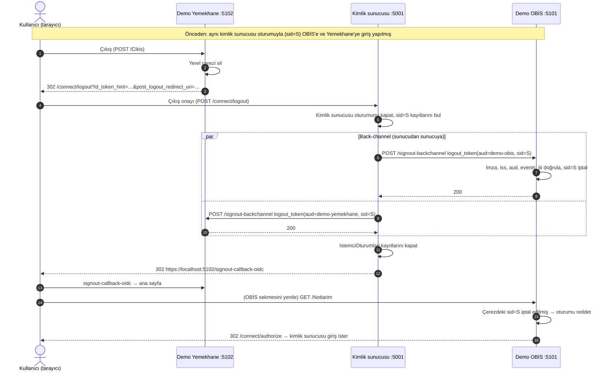

# Tek Şifre Giriş Sistemi (SelcukSSO)

Bitirme projesi: fakülte ve bölüm web uygulamaları için merkezi kimlik sunucusu.

> **Proje tanımı (bölümün verdiği):** "Fakülte ve bölüm genelinde kullanılan tüm web otomasyonları için merkezi
> bir kimlik doğrulama ve yetkilendirme altyapısı sunar. Kullanıcılar (öğrenci, akademisyen, idari personel) tek bir
> kullanıcı adı ve şifre ile güvenli bir şekilde tüm alt uygulamalara giriş yapabilir. Token tabanlı (JWT vb.) oturum
> yönetimini, şifre sıfırlama vb. özelliklere sahiptir."

Depoda şu an **kimlik sunucusu**, ona OpenID Connect ile bağlanan iki alt uygulama (**Demo OBİS**, **Demo Yemekhane**)
ve bu uygulamaların ortak istemci kütüphanesi var. **Tek giriş** (bir kez giriş, diğer uygulamalara şifresiz geçiş)
ve OIDC Back-Channel Logout ile **tek çıkış** (bir uygulamadan çıkınca hepsinden çıkış) çalışıyor. Diğer özellikler
[yol haritasında](#yapılacaklar-yol-haritası).

## Mimari özet

```
                       ┌──────────────────────────────────────────┐
                       │ Selcuk.Identity  :5001                    │
                       │  Giriş · Onay · Çıkış · Uygulamalarım     │
                       │  ASP.NET Core Identity + OpenIddict (OIDC)│
                       │  EF Core ──► LocalDB (SelcukSSO)          │
                       └──────────────────────────────────────────┘
        authorize/token/userinfo ▲   │ logout_token      ▲   │ logout_token
        (code + PKCE S256)       │   ▼ (back-channel)    │   ▼ (back-channel)
            ┌────────────────────────────┐    ┌────────────────────────────┐
            │ Selcuk.Demo.Obis  :5101    │    │ Selcuk.Demo.Yemekhane :5102│
            │  Notlarım, Ders Yönetimi   │    │  Menü, Rezervasyonlarım,   │
            │                            │    │  Yemekhane Yönetimi        │
            └─────────────┬──────────────┘    └─────────────┬──────────────┘
                          └───────── Selcuk.Istemci.Ortak ──┘
                     AddSelcukSSO: Cookie + OIDC, güvenlik başlıkları,
                     /signout-backchannel alıcısı
```

| Uç nokta | Adres | Açıklama |
|---|---|---|
| Discovery | `/.well-known/openid-configuration` | OIDC meta verisi (`backchannel_logout_supported: true`) |
| JWKS | `/.well-known/jwks` | İmza doğrulama anahtarları |
| Authorize | `/connect/authorize` | Giriş ve onay ekranı (Razor Page) |
| Token | `/connect/token` | `authorization_code` ve `refresh_token` grant'leri |
| UserInfo | `/connect/userinfo` | Kapsama göre kullanıcı bilgisi |
| End-session | `/connect/logout` | Çıkış sayfası; Back-Channel Logout bildirimlerini gönderir, `post_logout_redirect_uri` ile istemciye döner |
| Uygulamalarım | `/` | Giriş yapmış kullanıcıya kayıtlı uygulamaların kartları |

**Akışlar:** yalnızca Authorization Code + PKCE ve Refresh Token. PKCE sunucu genelinde zorunlu ve **yalnızca
`S256`** kabul edilir (`plain` kapalı). Implicit, hybrid, password ve client credentials akışları kapalı.

**Kapsamlar ve claim'ler:**

| Kapsam | Claim'ler |
|---|---|
| `openid` | `sub`; id_token'da ayrıca `sid` (kimlik sunucusu oturum kimliği) |
| `profile` | `name` (AdSoyad), `preferred_username` (öğrenci no / kullanıcı adı), `fakulte`, `bolum` |
| `email` | `email` (userinfo'da ayrıca `email_verified`) |
| `roles` | `role` (`ogrenci`, `akademisyen`, `personel`) |

Claim'ler yalnızca kullanıcı ilgili kapsama onay verdiyse tokenlara yazılır. Access token'lar **imzalı ama şifresiz
JWT** (`typ: at+jwt`, `DisableAccessTokenEncryption`), içerikleri tezde gösterilebilir. Henüz ayrı bir API (kaynak
sunucusu) tanımlı olmadığı için access token'da `aud` yoktur; tokenın verildiği istemci `client_id` claim'inde
taşınır. Discovery'deki `claims_supported` listesi: `aud exp iat iss sub name email role fakulte bolum sid`.

**Kullanıcı modeli:** `ApplicationUser : IdentityUser` + `AdSoyad`, `Fakulte`, `Bolum`. Öğrencilerin `UserName`'i
öğrenci numarası, akademik/idari personelinki kurumsal kullanıcı adıdır.

**Kayıtlı istemciler** (Development'ta açılışta oluşturulur veya güncellenir; tanımlar
`src/Selcuk.Identity/Data/Istemciler.cs`):

| | `demo-obis` | `demo-yemekhane` |
|---|---|---|
| Görünen ad | Demo OBİS | Demo Yemekhane |
| Redirect URI | `https://localhost:5101/signin-oidc` | `https://localhost:5102/signin-oidc` |
| Post-logout redirect URI | `https://localhost:5101/signout-callback-oidc` | `https://localhost:5102/signout-callback-oidc` |
| `backchannel_logout_uri` | `https://localhost:5101/signout-backchannel` | `https://localhost:5102/signout-backchannel` |
| `client_uri` / `initiate_login_uri` | `https://localhost:5101/` / `…/Giris` | `https://localhost:5102/` / `…/Giris` |

Ortak kurallar: gizli (confidential) web istemcisi, `client_secret` user-secrets'ta; izinler authorization, token,
end-session uç noktaları, `authorization_code`, `code`, `openid profile email roles`; PKCE zorunlu; onay türü
`explicit` (her uygulama için ilk girişte onay ekranı). Özel ayarlar (`backchannel_logout_uri`, `client_uri`,
`initiate_login_uri`, `aciklama`) OpenIddict istemci kaydının `Properties` alanında, OIDC istemci meta verisi
adlarıyla saklanır.

**Güvenlik ayarları:**
- Şifre: en az 10 karakter, büyük harf, küçük harf ve rakam zorunlu.
- 5 hatalı denemede hesap 15 dakika kilitlenir. Yanlış şifre, var olmayan kullanıcı ve kilitli hesap için **aynı**
  genel mesaj gösterilir, bu yüzden mesajdan hesabın var olup olmadığı anlaşılmaz.
- Antiforgery tüm formlarda açık. HTTPS yönlendirmesi ve OpenIddict'in HTTPS zorunluluğu açık.
- HSTS Development dışındaki ortamlarda açık (ASP.NET Core varsayılanı; tarayıcının `localhost` için HSTS'yi
  önbelleğe almaması için Development'ta kapalı).
- Kimlik sunucusunun ve istemcilerin tüm yanıtlarında güvenlik başlıkları: `X-Content-Type-Options: nosniff`,
  `Referrer-Policy: no-referrer`, `X-Frame-Options: DENY`,
  `Content-Security-Policy: default-src 'self'; img-src 'self' data:; object-src 'none'; base-uri 'self'; frame-ancestors 'none'`.
  `form-action` bilerek kısıtlanmadı, çünkü giriş, onay ve çıkış formları başka bir adrese yönlendirmeyle biter.
  İstemciler `response_mode=query` kullanır; `form_post` yanıtının satır içi betiği bu CSP'ye takılırdı.
- Çerezler: `Secure`, `HttpOnly`, `SameSite=Lax` (antiforgery çerezi `Strict`). Uygulamalar aynı makinede yalnızca
  port ile ayrıldığından her birinin oturum çerezi farklı adlıdır (`SelcukSSO.Oturum`, `DemoObis.Oturum`,
  `DemoYemekhane.Oturum`).

## Tek çıkış nasıl çalışıyor

1. Kullanıcı kimlik sunucusunda oturum açınca bu oturuma rastgele bir **oturum kimliği (`sid`)** verilir ve oturum
   çerezine yazılır.
2. Kullanıcı bir uygulamaya girdiğinde id_token'a aynı `sid` konur. Token uç noktası, o `sid` ile hangi istemciye
   token verildiğini `IstemciOturumlari` tablosuna kaydeder. Aynı oturumdan giriş yapılan her uygulama aynı `sid`'i
   alır.
3. Kullanıcı herhangi bir uygulamadan çıkınca uygulama yerel çerezini siler ve kullanıcıyı kimlik sunucusunun
   end-session uç noktasına gönderir (RP-initiated logout).
4. Kimlik sunucusu kendi oturumunu kapatır. Ardından o `sid`'e kayıtlı **her** istemcinin `backchannel_logout_uri`
   adresine tarayıcıyı kullanmadan, sunucudan sunucuya bir **logout_token** POST eder (OIDC Back-Channel Logout 1.0):
   - OpenIddict'in imzalama anahtarıyla imzalı JWT, `typ: logout+jwt`
   - Claim'ler: `iss`, `aud` (client_id), `iat`, `exp` (2 dk), `jti`, `sid`, `sub`,
     `events: {"http://schemas.openid.net/event/backchannel-logout": {}}`; `nonce` yok
   - Zaman aşımı 5 sn. Bildirimler paralel gider; bir istemci yanıt vermezse diğerleri yine bilgilendirilir.
     Hata loglanır, token içeriği loglanmaz.
   - Kayıtlar kapatılır (`KapanmaZamani`).
5. İstemcideki `/signout-backchannel` (Selcuk.Istemci.Ortak) token'ı doğrular ve `sid`'i bellekte "iptal edildi"
   olarak işaretler. Doğrulanan kurallar: JWKS ile imza, iss, aud, exp/iat, typ, events, `nonce` yokluğu, `sid`
   veya `sub` varlığı, `jti`'nin daha önce kullanılmamış olması. Geçersiz token 400, geçerli token 200 alır.
6. O kullanıcının bu uygulamadaki çerezi bir sonraki istekte (`OnValidatePrincipal`) reddedilir. Kullanıcı
   çıkış yapmış sayılır; korumalı sayfaya gidince yeniden girişe yönlendirilir.



İptal kayıtları ve `jti` önbelleği istemcinin belleğinde tutulur. İstemci yeniden başlatılırsa silinir; demo için
yeterlidir (bkz. öneriler).

## Demo uygulamalar

### Demo OBİS (`src/Selcuk.Demo.Obis`, https://localhost:5101)

| Sayfa | Erişim |
|---|---|
| Ana sayfa (`/`) | Herkese açık, "Giriş yap" butonu |
| Notlarım (`/Notlarim`) | Yalnızca `ogrenci` |
| Ders Yönetimi (`/DersYonetimi`) | Yalnızca `akademisyen` |
| Profilim (`/Profilim`) | Giriş yapmış herkes: ad soyad, rol, fakülte, bölüm |
| Token İnceleme (`/TokenInceleme`) | Yalnızca Development: id_token ve access_token'ın header/payload'u (imza hariç), son kullanma zamanı |
| Erişim reddedildi (`/ErisimReddedildi`) | Yetkisiz rol buraya yönlendirilir |
| Çıkış (`/Cikis`) | Yerel çerezi siler, kimlik sunucusunun end-session uç noktasına gider, dönüşte ana sayfa |

### Demo Yemekhane (`src/Selcuk.Demo.Yemekhane`, https://localhost:5102)

| Sayfa | Erişim |
|---|---|
| Haftalık menü (`/`) | Herkese açık, bu haftanın uydurma menüsü |
| Rezervasyonlarım (`/Rezervasyonlarim`) | Giriş yapmış herkes: sonraki 5 iş gününden seçip rezervasyon ekleme ve iptal (bellek içi) |
| Yemekhane Yönetimi (`/YemekhaneYonetimi`) | Yalnızca `personel`: günlük rezervasyon sayıları |
| Profilim, Erişim reddedildi, Çıkış | OBİS'teki gibi |

## Yeni bir uygulamayı sisteme bağlamak

1. **İstemciyi kaydedin.** `src/Selcuk.Identity/Data/Istemciler.cs` dosyasına `DemoObis`/`DemoYemekhane` gibi bir
   tanım ekleyin (client_id, görünen ad, kök adres, açıklama). Redirect, post-logout, `backchannel_logout_uri`,
   `client_uri` ve `initiate_login_uri` adresleri kök adresten türetilir. `BaslangicVerisi.StartAsync` içinde
   `IstemciKaydetAsync(..., "Istemciler:<Ad>:ClientSecret", Istemciler.<Ad>)` satırını ekleyin.
2. **Secret üretin** ve iki projenin user-secrets'ına aynı değeri yazın (bkz. [Sırlar](#sırlar-user-secrets)):
   kimlik sunucusunda `Istemciler:<Ad>:ClientSecret`, yeni uygulamada `Kimlik:ClientSecret`.
3. **Uygulamayı bağlayın.** Projeye `src/Selcuk.Istemci.Ortak` referansı ekleyin ve `Program.cs`'de:
   ```csharp
   builder.Services.AddSelcukSSO(builder.Configuration);   // Cookie + OIDC (code + PKCE), claim eşlemeleri
   // ...
   var app = builder.Build();
   app.UseSelcukGuvenlikBasliklari();                      // nosniff, no-referrer, DENY, CSP
   // UseHttpsRedirection, UseStaticFiles, UseRouting, UseAuthentication, UseAuthorization ...
   app.MapRazorPages();
   app.MapSelcukBackChannelLogout();                       // POST /signout-backchannel
   ```
4. **Ayarları yazın** (`appsettings.json`):
   ```json
   "Kimlik": {
     "Authority": "https://localhost:5001",
     "ClientId": "<client_id>",
     "CerezAdi": "<Uygulama>.Oturum",
     "GirisHatasiYolu": "/GirisHatasi"
   }
   ```
   `GirisHatasiYolu` isteğe bağlıdır (varsayılan `/GirisHatasi`): `/signin-oidc` dönüşü başarısız olduğunda (geri
   tuşu, süresi dolmuş giriş, reddedilen onay) giriş yapmamış kullanıcı bu sayfaya `?neden=oturum-suresi` veya
   `?neden=erisim-reddedildi` ile yönlendirilir.
5. **Sayfaları ekleyin:** `/Giris` (OIDC challenge), `/Cikis` (çerez + OIDC SignOut), `/ErisimReddedildi`.
   Rol korumalı sayfalarda `[Authorize(Roles = "...")]` kullanın; rol claim'i `role`, ad claim'i `name`.
6. Kimlik sunucusunu yeniden başlatın: istemci kaydedilir ve "Uygulamalarım" sayfasında görünür.

## Klasör yapısı

```
SelcukSSO.sln
dotnet-tools.json                 dotnet-ef yerel aracı
.gitattributes                    Satır sonu kuralları
scripts/run-all.ps1               Üç uygulamayı ayrı pencerelerde başlatır
src/Selcuk.Identity/
  Program.cs                      Identity, OpenIddict, çerez/HSTS ayarları, discovery ek alanları
  GuvenlikBasliklari.cs           Güvenlik başlıkları ara katmanı
  Data/                           ApplicationUser, DbContext, IstemciOturumu, Roller, Istemciler, BaslangicVerisi, Migrations
  Oidc/                           Token/UserInfo uç noktaları, claim hedefleri, OturumKimligi (sid),
                                  BackChannelLogoutGonderici
  Pages/                          Uygulamalarım (Index), Account/Login, AccessDenied, Connect/Authorize, Logout
src/Selcuk.Istemci.Ortak/         AddSelcukSSO, güvenlik başlıkları, Back-Channel Logout alıcısı, OturumIptalDeposu
src/Selcuk.Demo.Obis/             Notlarım, Ders Yönetimi, Profilim, Token İnceleme …
src/Selcuk.Demo.Yemekhane/        Haftalık menü, Rezervasyonlarım, Yemekhane Yönetimi …
tests/Selcuk.Identity.Tests/      Kimlik sunucusu entegrasyon, protokol, tek giriş/çıkış testleri
tests/Selcuk.Istemci.Ortak.Tests/ Back-Channel Logout alıcısı testleri (yerel anahtar + sahte JWKS)
tests/Selcuk.Demo.Obis.Tests/     Demo OBİS yönlendirme ve rol testleri
tests/Selcuk.Demo.Yemekhane.Tests/ Demo Yemekhane yönlendirme ve rol testleri
```

## Kurulum

Gereksinimler (Windows):
- .NET 10 SDK: `winget install --id Microsoft.DotNet.SDK.10 --exact`
- SQL Server LocalDB (`(localdb)\MSSQLLocalDB`). winget'te ayrı paket yok; SQL Server 2022 Express indiricisiyle
  yalnızca LocalDB MSI'ı indirilip kurulur:
  ```powershell
  winget install --id Microsoft.SQLServer.2022.Express --exact --override "/ACTION=Download /MEDIATYPE=LocalDB /MEDIAPATH=C:\Temp\sqlmedia /QUIET"
  msiexec /i "C:\Temp\sqlmedia\en-US\SqlLocalDB.msi" /qn IACCEPTSQLLOCALDBLICENSETERMS=YES
  ```

Proje kökünde:

```powershell
dotnet tool restore                                          # dotnet-ef yerel aracı
dotnet ef database update --project src/Selcuk.Identity      # veritabanını oluşturur / son migration'a getirir
dotnet dev-certs https --trust                               # (bir kez) HTTPS geliştirme sertifikasına güven
```

Migration'lar: `Baslangic` (Identity + OpenIddict tabloları), `IstemciOturumlari` (tek çıkış için oturum–istemci
kayıtları). Mevcut bir veritabanında yeni migration'ı uygulamak için yine `dotnet ef database update` yeterlidir.

`dotnet dev-certs https --trust` istemciler için gereklidir: istemciler kimlik sunucusunun discovery ve JWKS
adreslerine HTTPS ile bağlanır. Komut Windows'ta bir onay penceresi açar.

### Sırlar (user-secrets)

Hiçbir şifre veya secret repoda yoktur. Development'ta `dotnet user-secrets` kullanılır:

| Proje | Anahtar | İçerik |
|---|---|---|
| `src/Selcuk.Identity` | `TestKullanicilari:Ogrenci:Sifre`, `…:Akademisyen:Sifre`, `…:Personel:Sifre` | Test kullanıcılarının şifreleri |
| `src/Selcuk.Identity` | `Istemciler:DemoObis:ClientSecret` | demo-obis secret'ı |
| `src/Selcuk.Identity` | `Istemciler:DemoYemekhane:ClientSecret` | demo-yemekhane secret'ı |
| `src/Selcuk.Demo.Obis` | `Kimlik:ClientSecret` | demo-obis secret'ı (kimlik sunucusundakiyle aynı) |
| `src/Selcuk.Demo.Yemekhane` | `Kimlik:ClientSecret` | demo-yemekhane secret'ı (kimlik sunucusundakiyle aynı) |

Görmek için:

```powershell
dotnet user-secrets list --project src/Selcuk.Identity
dotnet user-secrets list --project src/Selcuk.Demo.Obis
dotnet user-secrets list --project src/Selcuk.Demo.Yemekhane
```

Yeni bir makinede tanımlamak için (her istemci için ayrı secret üretin ve iki projeye de aynı değeri yazın):

```powershell
$b = New-Object byte[] 32; [System.Security.Cryptography.RandomNumberGenerator]::Create().GetBytes($b)
$s = [Convert]::ToBase64String($b)
dotnet user-secrets set "Istemciler:DemoYemekhane:ClientSecret" $s --project src/Selcuk.Identity
dotnet user-secrets set "Kimlik:ClientSecret" $s --project src/Selcuk.Demo.Yemekhane
```

Kimlik sunucusu her açılışta istemci tanımlarını, secret dahil, user-secrets'taki değerle eşitler.

## Çalıştırma

Üçünü birlikte başlatmak için:

```powershell
powershell -ExecutionPolicy Bypass -File scripts\run-all.ps1
```

Betik kimlik sunucusunu (5001), Demo OBİS'i (5101) ve Demo Yemekhane'yi (5102) ayrı PowerShell pencerelerinde
başlatır, hepsi hazır olunca tarayıcıda https://localhost:5001 adresini açar. Durdurmak için pencerelerde `Ctrl+C`.

Tek tek:

```powershell
dotnet run --project src/Selcuk.Identity          # https://localhost:5001
dotnet run --project src/Selcuk.Demo.Obis         # https://localhost:5101
dotnet run --project src/Selcuk.Demo.Yemekhane    # https://localhost:5102
```

Kimlik sunucusu açılışta rolleri (yoksa) oluşturur. Development'ta test kullanıcılarını ve iki demo istemciyi de
ekler.

## Elle deneme

### Tek giriş ve tek çıkış

1. `powershell -ExecutionPolicy Bypass -File scripts\run-all.ps1`. Tarayıcıda https://localhost:5001 açılır ve giriş
   sayfasına yönlendirilirsiniz.
2. **`203011001`** ile giriş yapın. Şifre, `dotnet user-secrets list --project src/Selcuk.Identity` çıktısındaki
   `TestKullanicilari:Ogrenci:Sifre` değeri. **Uygulamalarım** sayfası açılır; Demo OBİS ve Demo Yemekhane kartları
   görünür.
3. **Demo OBİS** kartına tıklayın. Şifre sorulmaz. İlk seferde onay ekranı çıkar; **İzin ver** deyin. OBİS'e
   girmiş olursunuz. Bu sekmeyi açık bırakın.
4. Yeni bir sekmede https://localhost:5001 adresine dönüp **Demo Yemekhane** kartına tıklayın. Şifre sorulmaz; ilk
   seferde onay verin. **Rezervasyonlarım** açılır; bir gün seçip rezervasyon yapabilirsiniz.
5. Yemekhane'de **Çıkış** → kimlik sunucusunun çıkış sayfasında **Çıkış yap**. Yemekhane ana sayfasına dönersiniz.
6. OBİS sekmesini yenileyin, ya da https://localhost:5101/Notlarim adresine gidin. **OBİS de çıkış yapmış
   olmalıdır**: sayfa açılmaz, kimlik sunucusu yeniden giriş ister. Kimlik sunucusunun penceresindeki logda iki
   istemci için "Back-channel logout gönderildi" satırları görünür.

### Uygulama içi senaryolar

1. Demo OBİS'te **Notlarım**: 5 dersin vize, final ve harf notu görünür.
2. **Token İnceleme** (yalnızca Development): id_token ve access_token'ın header ve payload'u, son kullanma
   zamanlarıyla görünür. `sid`, `role`, `fakulte`, `bolum` ve `name` claim'lerini kontrol edin (tez ekran görüntüsü
   için).
3. Çıkış yapıp **`hoca.test`** (şifresi `TestKullanicilari:Akademisyen:Sifre`) ile girin. OBİS'te **Ders Yönetimi**
   açılır; `/Notlarim` adresine gidince **Erişim reddedildi** sayfası görünür.
4. **`personel.test`** (şifresi `TestKullanicilari:Personel:Sifre`) ile Yemekhane'de **Yemekhane Yönetimi** açılır
   ve günlük rezervasyon sayılarını gösterir. Öğrenci hesabıyla aynı sayfa **Erişim reddedildi** verir.
5. Demo OBİS'e giriş yaptıktan sonra tarayıcıda iki kez **geri** tuşuna basın. Uygulamanın ana sayfasına
   dönülmeli; "Correlation failed" veya başka bir hata sayfası görünmemelidir. Giriş yapmadan
   https://localhost:5101/signin-oidc?code=x&state=y adresine gidilirse **Giriş tamamlanamadı** sayfası ve
   **Tekrar giriş yap** düğmesi görünür.

## Testler

```powershell
dotnet build
dotnet test
```

Testler LocalDB'ye, çalışan bir kimlik sunucusuna ve ağa ihtiyaç duymaz.
- **Selcuk.Identity.Tests:** her test, SQLite in-memory üzerinde kendi veritabanıyla ayrı bir uygulama örneği
  başlatır (`EnsureCreated`, ortam `Testing`, geçici imzalama anahtarları, user-secrets okunmaz). Test kullanıcıları
  ve istemci secret'ları test içinde, çalışma anında üretilir. İstemciler uygulamanın kendi tanımlarıyla
  (`Istemciler.*`) kaydedilir. Back-Channel Logout POST'ları sahte bir HTTP handler ile yakalanır.
- **Selcuk.Istemci.Ortak.Tests:** kimlik sunucusu yerine yerel bir RSA anahtar çifti ile, bu anahtarı yayınlayan
  sahte discovery ve JWKS uç noktaları kullanılır.
- **Selcuk.Demo.Obis.Tests / Selcuk.Demo.Yemekhane.Tests:** discovery bilgisi sabit verilir. Rol testlerinde gerçek
  kimlik sunucusu yerine sahte bir kimlik doğrulama şeması kullanılır.

| Test | Doğruladığı |
|---|---|
| **Selcuk.Identity.Tests** | |
| `Discovery_dokumani_donuyor_ve_issuer_dogru` | Discovery 200 döner, `issuer` = `https://localhost:5001/` |
| `Discovery_grant_turleri_ve_S256_iceriyor` | `authorization_code`, `refresh_token` var, `password`/`implicit` yok, `S256` var |
| `Giris_sayfasi_aciliyor` | Giriş formu ve antiforgery token'ı geliyor |
| `Dogru_sifreyle_giris_basarili` | 302 + oturum çerezi |
| `Yanlis_sifreyle_giris_basarisiz` | Genel hata mesajı, çerez yok |
| `Bes_hatali_denemeden_sonra_hesap_kilitleniyor` | 5 denemede ~15 dk kilit; kilitliyken doğru şifre de reddedilir ve mesaj aynı kalır |
| `Uc_rol_olusturulmus` | `akademisyen`, `ogrenci`, `personel` |
| `Pkce_olmadan_authorize_istegi_reddediliyor` | `code_challenge` olmadan istek 400 `invalid_request`; PKCE ile aynı istek girişe yönlenir |
| `Kod_akisi_PKCE_ile_imzali_JWT_tokenlar_uretiyor` | Giriş → authorize (S256) → onay → kod → token; JWKS ile imza, iss/aud/exp/nonce; sub, name, role, fakulte, bolum; userinfo |
| `Ayni_kod_ikinci_kez_kullanilinca_reddediliyor` | İkinci kullanımda `invalid_grant` |
| `Yanlis_code_verifier_reddediliyor` | `invalid_grant` |
| `Kayitli_olmayan_redirect_uri_reddediliyor` | 400 `invalid_request`, yönlendirme yok |
| `Yanlis_client_secret_reddediliyor` | `invalid_client` |
| `Plain_code_challenge_method_reddediliyor` | Discovery yalnızca `S256` gösterir; `plain` 400 `invalid_request` |
| `Guvenlik_basliklari_giris_sayfasinda_mevcut` | nosniff, no-referrer, DENY, CSP (`frame-ancestors 'none'`) |
| `Cikis_post_logout_redirect_uri_ile_istemciye_donuyor` | End-session demo-obis'e `state` ile döner, sonra authorize yeniden giriş ister |
| `Oturum_aciksa_ikinci_istemci_sifre_sormadan_kod_aliyor` | OBİS'ten sonra Yemekhane: giriş formu yok; onaydan sonra doğrudan kod |
| `Iki_istemcinin_id_tokeninda_ayni_sid_var` | İki id_token'da aynı `sid`; `IstemciOturumlari`'nda iki açık kayıt |
| `Cikista_her_istemciye_dogrulanabilir_logout_token_gidiyor` | İki `backchannel_logout_uri`'ye form POST; JWKS ile imza, `typ logout+jwt`, aud, sid, sub, jti, events, nonce yok; kayıtlar kapanır |
| `Bir_istemciye_ulasilamasa_da_digerine_gonderiliyor` | OBİS'e bağlanılamazken Yemekhane yine bildirilir; çıkış tamamlanır |
| `Discovery_back_channel_logout_ve_claims_supported_iceriyor` | `backchannel_logout(_session)_supported: true`; claims_supported ⊇ sub, name, email, role, fakulte, bolum, sid |
| `Uygulamalarim_sayfasi_istemci_kartlarini_gosteriyor` | Girişsiz `/` → giriş sayfası; girişli: iki kart ve `initiate_login_uri` bağlantıları |
| **Selcuk.Istemci.Ortak.Tests** | |
| `Gecerli_logout_token_oturumu_sonlandiriyor` | 200 (`no-store`); o sid'li oturum sonraki istekte authorize'a yönlenir |
| `Imzasi_gecersiz_token_reddediliyor` | 400, oturum etkilenmez |
| `Yanlis_aud_reddediliyor` | 400, oturum etkilenmez |
| `Events_eksik_token_reddediliyor` | 400, oturum etkilenmez |
| `Nonce_iceren_token_reddediliyor` | 400, oturum etkilenmez |
| `Ayni_jti_ikinci_kez_reddediliyor` | İlki 200, ikincisi 400 |
| `Farkli_sidli_oturum_etkilenmiyor` | sid-1 kapanır, sid-2 açık kalır |
| `Guvenlik_basliklari_istemci_yanitlarinda_mevcut` | İstemci yanıtlarında nosniff, no-referrer, DENY, CSP |
| **Selcuk.Demo.Obis.Tests** | |
| `Girissiz_kullanici_Notlarim_icin_kimlik_sunucusuna_yonlendiriliyor` | 302 → `https://localhost:5001/connect/authorize`, `code_challenge` + `S256` |
| `Ogrenci_Notlarim_acilir_Ders_Yonetimi_reddedilir` | ogrenci: Notlarım 200, Ders Yönetimi → Erişim reddedildi |
| `Akademisyen_Ders_Yonetimi_acilir_Notlarim_reddedilir` | akademisyen: Ders Yönetimi 200, Notlarım → Erişim reddedildi |
| `Token_Inceleme_Development_disinda_kapali` | Development dışında 404 |
| **Selcuk.Demo.Yemekhane.Tests** | |
| `Haftalik_menu_herkese_acik` | Girişsiz 200, başlıkta "Demo Yemekhane — test uygulaması" |
| `Girissiz_kullanici_Rezervasyonlarim_icin_kimlik_sunucusuna_yonlendiriliyor` | 302 → authorize, `client_id=demo-yemekhane`, `code_challenge` + `S256` |
| `Ogrenci_Yemekhane_Yonetimi_erisim_reddedildi` | ogrenci: Yönetim → Erişim reddedildi; Rezervasyonlarım 200 |
| `Personel_Yemekhane_Yonetimi_aciliyor` | personel: Yönetim 200 |

## Sürümler

| Bileşen | Sürüm |
|---|---|
| .NET SDK / hedef çatı | 10.0.402 / `net10.0` (çalışma zamanı 10.0.13) |
| **OpenIddict** (`OpenIddict.AspNetCore`, `OpenIddict.EntityFrameworkCore`) | **7.7.2** (NuGet'teki en güncel kararlı sürüm) |
| Microsoft.AspNetCore.Identity.EntityFrameworkCore | 10.0.13 |
| Microsoft.EntityFrameworkCore.SqlServer / .Design | 10.0.13 |
| Microsoft.AspNetCore.Authentication.OpenIdConnect (Selcuk.Istemci.Ortak) | 10.0.13 |
| System.Security.Cryptography.Pkcs (açık kapatmak için sabitlendi; Identity + Identity.Tests) | 10.0.13 |
| System.Security.Cryptography.Xml (açık kapatmak için sabitlendi; Identity.Tests) | 10.0.13 |
| dotnet-ef (yerel araç) | 10.0.13 |
| Test: xunit / xunit.runner.visualstudio / Microsoft.NET.Test.Sdk | 2.9.3 / 3.1.4 / 17.14.1 |
| Test: Microsoft.AspNetCore.Mvc.Testing / Microsoft.EntityFrameworkCore.Sqlite | 10.0.13 / 10.0.13 |
| Veritabanı | SQL Server 2022 Express LocalDB |

## Yapılacaklar (yol haritası)

- [x] **Demo OBİS** istemcisi (Authorization Code + PKCE ile giriş, rol bazlı sayfalar)
- [x] **Demo Yemekhane** istemcisi (ikinci istemci; tek girişle iki uygulamaya şifresiz geçiş)
- [x] **Tek çıkış** (single logout): OIDC Back-Channel Logout 1.0 ile bir uygulamadan çıkınca diğerlerinden de
      çıkış. Front-channel logout eklenmedi.
- [ ] **Şifre sıfırlama** (e-posta ile tek kullanımlık bağlantı)
- [ ] **2FA** (TOTP doğrulayıcı uygulama)
- [ ] **Denetim kaydı** (giriş, başarısız deneme, kilitleme, onay, çıkış olayları)
- [ ] **Yönetim paneli** (kullanıcı, rol ve istemci uygulama yönetimi)
- [ ] **Token iptali** (revocation uç noktası, oturum/yetkilendirme iptali)
- [ ] **Production sertifika yönetimi**: şu an yalnızca Development sertifikaları (`AddDevelopmentSigningCertificate`,
      `AddDevelopmentEncryptionCertificate`) kullanılıyor. Production'da kalıcı X.509 imzalama/şifreleme
      sertifikaları (sertifika deposu veya Key Vault), anahtar rotasyonu ve `OpenIddict:Issuer`'ın gerçek alan adına
      ayarlanması gerekiyor. Development ve Testing dışındaki ortamlarda uygulama bilerek açılmaz.
