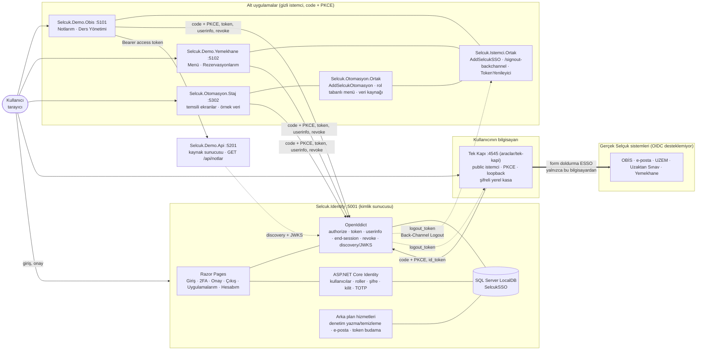
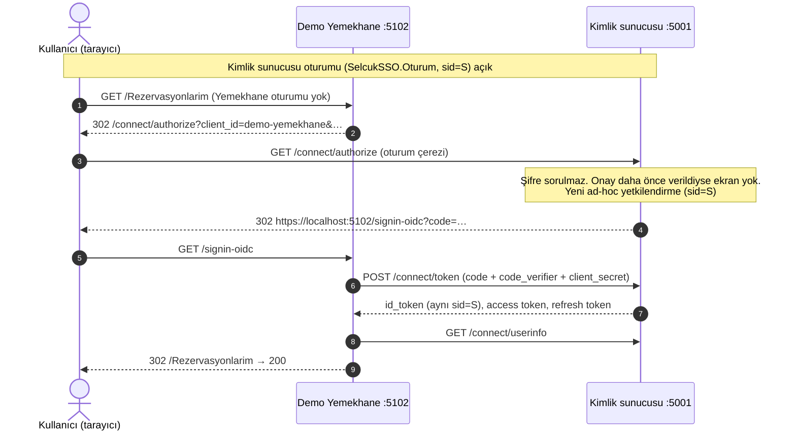

# Mimari

Tek Şifre Giriş Sistemi'nin bileşenleri ve dört temel akışı. Adresler geliştirme ortamınındır (README > Mimari özet);
diyagramlar README'deki ASCII mimari çizimi ve tek çıkış / token yaşam döngüsü sıra diyagramlarıyla aynı akışları
gösterir.

## Bileşenler



- **Kimlik sunucusu** tek doğruluk kaynağıdır: kullanıcı, rol, şifre, 2FA, istemci kayıtları, oturum (`sid`) ve
  token'lar burada. Alt uygulamalar kullanıcının şifresini hiç görmez.
- **Alt uygulamalar** kimlik sunucusuna yalnızca OIDC ile bağlanır; ortak kütüphane (`Selcuk.Istemci.Ortak`) çerez +
  OIDC yapılandırmasını, Back-Channel Logout alıcısını ve token yenilemeyi tek yerde toplar.
- **Demo API** access token'ı kendi başına (JWKS ile imza, `aud`, `typ`, süre, kapsam, rol) doğrular; kimlik
  sunucusuna istek başına sormaz.
- **Tek Kapı** geçiş dönemi aracıdır: kullanıcı ona SSO ile girer, Tek Kapı gerçek sistemlere kendi bilgisayarındaki
  şifreli kasadan form doldurarak girer. Kimlik sunucusu gerçek sistemlerin şifrelerini görmez; kimlik sunucusu ve
  demo uygulamalar gerçek sistemlere bağlanmaz (kalın ok yalnızca Tek Kapı'dan çıkar).
- **Bölüm otomasyonları** ortak şablonla (`Selcuk.Otomasyon.Ortak`, docs/otomasyon-sablonu.md) kurulur: SSO, rol
  tabanlı menü ve yetki, temsili işlemler, veri kaynağı seçimi (`VeriKaynagi:Mod` Mock veya Api). Şimdilik ekranlar
  temsilidir ve örnek veri gösterir; Api modunda veri, access token'la (aud `<otomasyon>-api`) ayrı bir kaynak
  sunucusundan gelir (henüz yazılmadı; sözleşmeler docs/api-sozlesmeleri/).

## Port ve istemci düzeni

| Port | Uygulama | İstemci (`client_id`) | Durum |
|---|---|---|---|
| 5001 | Kimlik sunucusu (`Selcuk.Identity`) | — | var |
| 5101 | Demo OBİS | `demo-obis` | var |
| 5102 | Demo Yemekhane | `demo-yemekhane` | var |
| 5201 | Demo API (kaynak sunucusu) | — (`aud` `demo-api`) | var |
| 4545 | Tek Kapı (yerel, `http://127.0.0.1`) | `tek-kapi` | var (kaldırılması planlanıyor) |
| 5301 | İntibak | `intibak-otomasyonu` | plan |
| 5302 | Staj (`Selcuk.Otomasyon.Staj`) | `staj-otomasyonu` | var (temsili, örnek veri) |
| 5303 | Etik Kurul | `etik-kurul-otomasyonu` | plan |
| 5304 | Mezuniyet | `mezuniyet-otomasyonu` | plan |
| 5305 | Bölüm Kurul Karar | `bolum-kurul-otomasyonu` | plan |
| 5306 | Öğrenci Danışmanlık | `danismanlik-otomasyonu` | plan |
| 5307 | İŞKUR | `iskur-otomasyonu` | plan |
| 5308 | MÜDEK | `mudek-otomasyonu` | plan |
| 5309 | Lisans Projeleri | `lisans-projeleri-otomasyonu` | plan |
| 5310 | Sınav Başarısı Analizi | `sinav-analizi-otomasyonu` | plan |
| 5311 | ÇAP-Yandal | `cap-yandal-otomasyonu` | plan |

Otomasyon numaraları bölümün otomasyon listesindeki sıradır. Her otomasyon gizli web istemcisidir (Authorization Code +
PKCE, explicit onay); redirect `https://localhost:<port>/signin-oidc`, post-logout `/signout-callback-oidc`,
Back-Channel Logout `/signout-backchannel`, giriş başlatma `/Giris`. Plandaki `client_id`'ler önerilir; eklenirken
kesinleşir. Gelecekteki API'ler için kaynak (`aud`) `<ad>-api`, kapsamlar `<ad>.oku` / `<ad>.yaz` (Staj: `staj-api`,
`staj.oku`, `staj.yaz`).

## 1. Giriş (Demo OBİS, soğuk)

```mermaid
sequenceDiagram
    autonumber
    actor K as Kullanıcı (tarayıcı)
    participant O as Demo OBİS :5101
    participant I as Kimlik sunucusu :5001
    participant A as Demo API :5201

    K->>O: GET /Notlarim (oturum yok)
    O-->>K: 302 /connect/authorize?client_id=demo-obis&code_challenge=…&S256&state&nonce
    K->>I: GET /connect/authorize
    I-->>K: 302 /Account/Login (kimlik sunucusu oturumu yok)
    K->>I: POST /Account/Login (kullanıcı adı + şifre, antiforgery)
    I->>I: PBKDF2 doğrulama, kilit sayacı, 2FA gerekiyorsa /Account/IkiAdim
    I-->>K: 302 /connect/authorize (oturum çerezi, sid)
    K->>I: GET /connect/authorize
    Note over I: İlk kez: onay ekranı → İzin ver (kalıcı onay)<br/>Erişim izni, 2FA şartı denetimi; ad-hoc yetkilendirme (sid)
    I-->>K: 302 https://localhost:5101/signin-oidc?code=…&state=…
    K->>O: GET /signin-oidc
    O->>I: POST /connect/token (code + code_verifier + client_secret)
    I->>I: PKCE, istemci, izin, amr, mutlak süre; IstemciOturumlari(sid, demo-obis)
    I-->>O: id_token (sid, amr), access token (15 dk, aud demo-api), refresh token
    O->>I: GET /connect/userinfo (Bearer)
    I-->>O: name, preferred_username, fakulte, bolum, role
    O-->>K: 302 /Notlarim (DemoObis.Oturum çerezi)
    K->>O: GET /Notlarim
    O->>A: GET /api/notlar (Bearer access token)
    A-->>O: 200 notlar (yalnızca sub'ın)
    O-->>K: 200 Notlarım
```

## 2. Tek giriş (OBİS'ten sonra Yemekhane)



## 3. API çağrısı ve token yenileme

```mermaid
sequenceDiagram
    autonumber
    actor K as Kullanıcı (tarayıcı)
    participant O as Demo OBİS :5101
    participant I as Kimlik sunucusu :5001
    participant A as Demo API :5201

    K->>O: GET /Notlarim (DemoObis.Oturum)
    O->>O: Çerez doğrulama: sid iptal mi? access token'a 1 dk'dan az mı kaldı?
    alt Süre yeterli
        O->>A: GET /api/notlar (Bearer access token)
    else Süre dolmak üzere (tek uçuş)
        O->>I: POST /connect/token grant_type=refresh_token (+ client_secret)
        I->>I: Refresh token geçerli ve kullanılmamış mı? Zincir 12 saati aştı mı?<br/>Kullanıcı, izin, 2FA şartı
        I-->>O: yeni access token + yeni refresh token (eskisi redeemed;<br/>ömürler mutlak sınırla kısaltılır)
        O->>O: Çerezi yeni token'larla güncelle
        O->>A: GET /api/notlar (Bearer yeni access token)
    end
    A->>A: JWKS ile imza, iss, aud=demo-api, typ=at+jwt, exp,<br/>scope ⊇ notlar.oku, rol ogrenci
    A-->>O: 200 (yalnızca token'daki sub'ın notları) / 401 / 403
    O-->>K: 200 Notlarım (API'ye ulaşılamazsa Türkçe hata)
    Note over I,O: Kullanılmış refresh token tekrar gelirse: invalid_grant,<br/>zincirin tüm token'ları iptal, denetim kaydı
```

## 4. Tek çıkış

```mermaid
sequenceDiagram
    autonumber
    actor K as Kullanıcı (tarayıcı)
    participant O as Demo OBİS :5101
    participant I as Kimlik sunucusu :5001
    participant Y as Demo Yemekhane :5102
    participant T as Tek Kapı :4545

    Note over K,T: Aynı kimlik sunucusu oturumuyla (sid=S) OBİS'e, Yemekhane'ye (ve Tek Kapı'ya) girilmiş
    K->>O: POST /Cikis
    O->>I: POST /connect/revoke (refresh token, RFC 7009)
    Note over O: Yerel çerez silinir
    O-->>K: 302 /connect/logout?id_token_hint=…&post_logout_redirect_uri=…
    K->>I: POST /connect/logout (çıkış onayı)
    I->>I: Oturumu kapat; sid=S yetkilendirmeleri ve token'ları iptal
    par Back-Channel Logout (sunucudan sunucuya, 5 sn zaman aşımı)
        I->>O: POST /signout-backchannel logout_token(aud=demo-obis, sid=S)
        O-->>I: 200
    and
        I->>Y: POST /signout-backchannel logout_token(aud=demo-yemekhane, sid=S)
        Y->>Y: İmza, iss, aud, events, jti doğrula; sid=S iptal listesine
        Y-->>I: 200
    and
        I->>T: POST /auth/backchannel-logout logout_token(aud=tek-kapi)
        T->>T: Kasayı kilitle, gerçek site sekmelerini ve çerezlerini kapat
        T-->>I: 200
    end
    I-->>K: 302 https://localhost:5101/signout-callback-oidc → /
    K->>Y: GET /Rezervasyonlarim
    Y->>Y: Çerezdeki sid=S iptal edilmiş → oturumu reddet
    Y-->>K: 302 /connect/authorize → kimlik sunucusu giriş ister
```

İlk otomatik ölçümde bu dört akışın süreleri: `docs/olcumler/sso-olcumler-*.md` ((a) giriş, (b) tek giriş,
(c) token yenileme, (e) API çağrısı, (d) tek çıkış).
