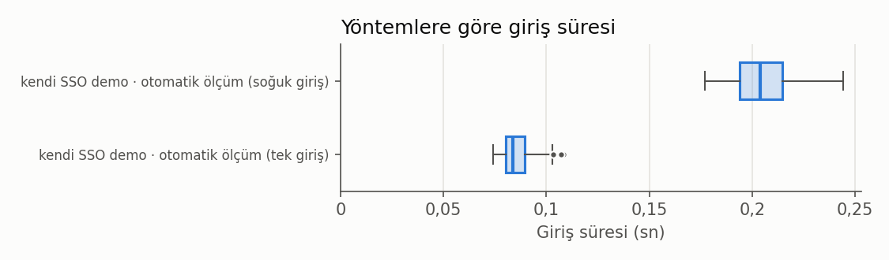
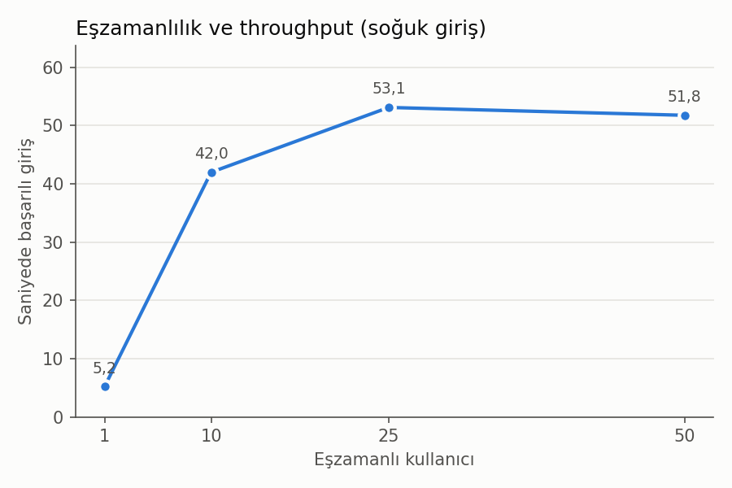

# Karşılaştırma

`scripts/olcum_analiz.py` ile 2026-11-24 20:02 tarihinde üretildi; elle düzenlemeyin. Eksik veri "henüz ölçülmedi" olarak işaretlidir; ölçülmemiş hiçbir değer tahmin edilmez.

## Girdiler

- SSO otomatik ölçüm: sso-olcumler-2026-11-24-1956.csv (toplam 4 çalıştırma; en yenisi kullanıldı)
- Elle giriş ölçümü: henüz ölçülmedi
- Tek Kapı kayıtları: henüz ölçülmedi
- SUS yanıtları: henüz ölçülmedi

## Sistem ve yöntem bazında giriş

Süreler yalnızca hatasız denemelerden. "Şifre girilen deneme": kullanıcının o sistemin şifresini yazdığı deneme sayısı / bilgisi olan deneme sayısı. Otomatik ölçümde tık/tuş sayılmaz (–); tek girişte şifre sorulursa tur hatalı sayılır.

| Sistem | Yöntem | Kaynak | Deneme | Ortalama süre (sn) | Medyan süre (sn) | Ort. tık / adım | Ort. tuş vuruşu | Şifre girilen deneme | CAPTCHA çıkan | Hata |
|---|---|---|---:|---:|---:|---:|---:|---:|---:|---:|
| OBİS | kendi SSO demo | otomatik ölçüm (soğuk giriş) | 100 | 0,20 | 0,20 | – | – | 100 / 100 | 0 / 100 | 0 |
| Yemekhane | kendi SSO demo | otomatik ölçüm (tek giriş) | 100 | 0,09 | 0,08 | – | – | 0 / 100 | 0 / 100 | 0 |

Henüz ölçülmeyen sistem / yöntem çiftleri: OBİS / elle, OBİS / Tek Kapı, e-posta / elle, e-posta / Tek Kapı, e-posta / kendi SSO demo, UZEM / elle, UZEM / Tek Kapı, UZEM / kendi SSO demo, Uzaktan Sınav / elle, Uzaktan Sınav / Tek Kapı, Uzaktan Sınav / kendi SSO demo, Yemekhane / elle, Yemekhane / Tek Kapı.

## Kendi SSO: otomatik ölçüm özeti

| Senaryo | n | Hata | p50 (ms) | p95 (ms) | Ortalama (ms) |
|---|---:|---:|---:|---:|---:|
| (a) Soğuk giriş (OBİS) | 100 | 0 | 203,6 | 228,4 | 204,8 |
| (b) Tek giriş (Yemekhane) | 100 | 0 | 83,8 | 100,5 | 85,6 |
| (c) Token yenileme | 100 | 0 | 43,8 | 50,6 | 44,4 |
| (d) Tek çıkış | 100 | 0 | 59,8 | 73,1 | 60,7 |
| (e) API çağrısı | 100 | 0 | 10,1 | 11,6 | 10,1 |

## Eşzamanlılık (soğuk giriş)

| Eşzamanlı kullanıcı | Giriş | Hata | Hata oranı | Saniyede başarılı giriş | p50 (ms) | p95 (ms) |
|---:|---:|---:|---:|---:|---:|---:|
| 1 | 100 | 0 | 0,0 % | 5,18 | 190,0 | 212,2 |
| 10 | 100 | 0 | 0,0 % | 41,99 | 231,0 | 268,9 |
| 25 | 100 | 0 | 0,0 % | 53,12 | 434,7 | 653,8 |
| 50 | 100 | 0 | 0,0 % | 51,77 | 863,4 | 1330,9 |

## Kullanılabilirlik (SUS)

Henüz ölçülmedi.

## Grafikler

