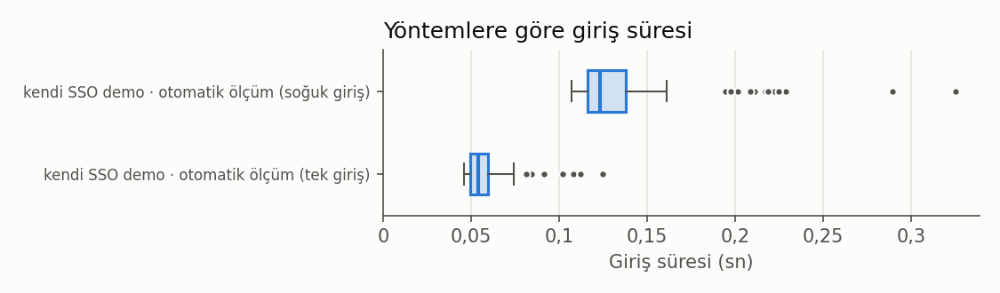
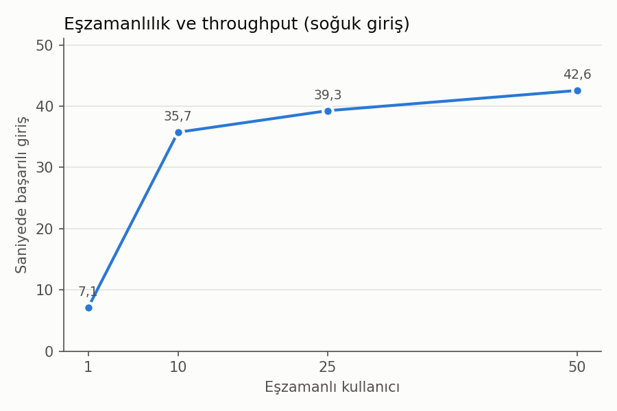

# Karşılaştırma

`scripts/olcum_analiz.py` ile 2026-10-26 00:51 tarihinde üretildi; elle düzenlemeyin. Eksik veri "henüz ölçülmedi" olarak işaretlidir; ölçülmemiş hiçbir değer tahmin edilmez.

## Girdiler

- SSO otomatik ölçüm: sso-olcumler-2026-10-26-0037.csv
- Elle giriş ölçümü: henüz ölçülmedi
- Tek Kapı kayıtları: henüz ölçülmedi
- SUS yanıtları: henüz ölçülmedi

## Sistem ve yöntem bazında giriş

Süreler yalnızca hatasız denemelerden. "Şifre girilen deneme": kullanıcının o sistemin şifresini yazdığı deneme sayısı / bilgisi olan deneme sayısı. Otomatik ölçümde tık/tuş sayılmaz (–); tek girişte şifre sorulursa tur hatalı sayılır.

| Sistem | Yöntem | Kaynak | Deneme | Ortalama süre (sn) | Medyan süre (sn) | Ort. tık / adım | Ort. tuş vuruşu | Şifre girilen deneme | CAPTCHA çıkan | Hata |
|---|---|---|---:|---:|---:|---:|---:|---:|---:|---:|
| OBİS | kendi SSO demo | otomatik ölçüm (soğuk giriş) | 100 | 0,14 | 0,12 | – | – | 100 / 100 | 0 / 100 | 0 |
| Yemekhane | kendi SSO demo | otomatik ölçüm (tek giriş) | 100 | 0,06 | 0,05 | – | – | 0 / 100 | 0 / 100 | 0 |

Henüz ölçülmeyen sistem / yöntem çiftleri: OBİS / elle, OBİS / Tek Kapı, e-posta / elle, e-posta / Tek Kapı, e-posta / kendi SSO demo, UZEM / elle, UZEM / Tek Kapı, UZEM / kendi SSO demo, Uzaktan Sınav / elle, Uzaktan Sınav / Tek Kapı, Uzaktan Sınav / kendi SSO demo, Yemekhane / elle, Yemekhane / Tek Kapı.

## Kendi SSO: otomatik ölçüm özeti

| Senaryo | n | Hata | p50 (ms) | p95 (ms) | Ortalama (ms) |
|---|---:|---:|---:|---:|---:|
| (a) Soğuk giriş (OBİS) | 100 | 0 | 123,2 | 222,1 | 138,1 |
| (b) Tek giriş (Yemekhane) | 100 | 0 | 54,2 | 91,5 | 59,0 |
| (c) Token yenileme | 100 | 0 | 27,8 | 46,7 | 30,3 |
| (d) Tek çıkış | 100 | 0 | 38,9 | 61,2 | 41,5 |
| (e) API çağrısı | 100 | 0 | 7,0 | 11,8 | 7,7 |

## Eşzamanlılık (soğuk giriş)

| Eşzamanlı kullanıcı | Giriş | Hata | Hata oranı | Saniyede başarılı giriş | p50 (ms) | p95 (ms) |
|---:|---:|---:|---:|---:|---:|---:|
| 1 | 100 | 0 | 0,0 % | 7,10 | 118,9 | 227,4 |
| 10 | 100 | 0 | 0,0 % | 35,74 | 272,5 | 338,8 |
| 25 | 100 | 0 | 0,0 % | 39,26 | 588,2 | 880,2 |
| 50 | 100 | 0 | 0,0 % | 42,56 | 1085,4 | 1897,1 |

## Kullanılabilirlik (SUS)

Henüz ölçülmedi.

## Grafikler

